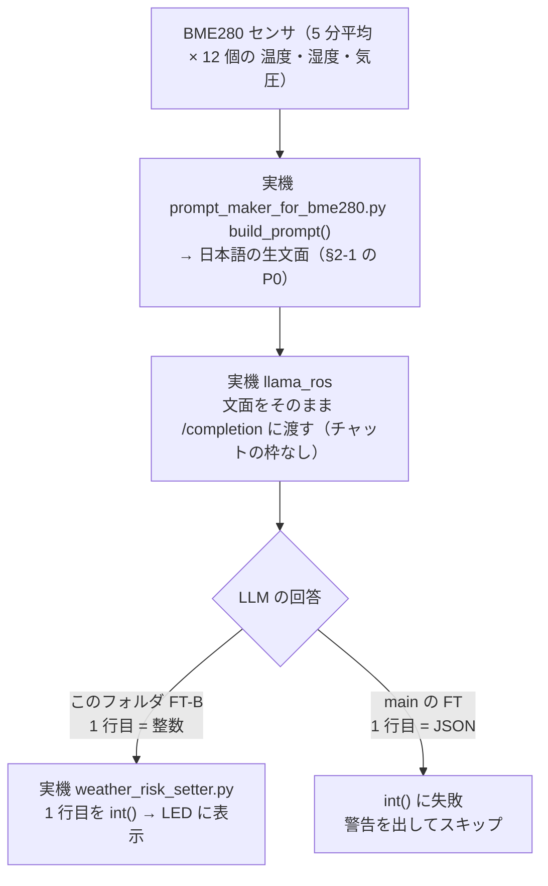
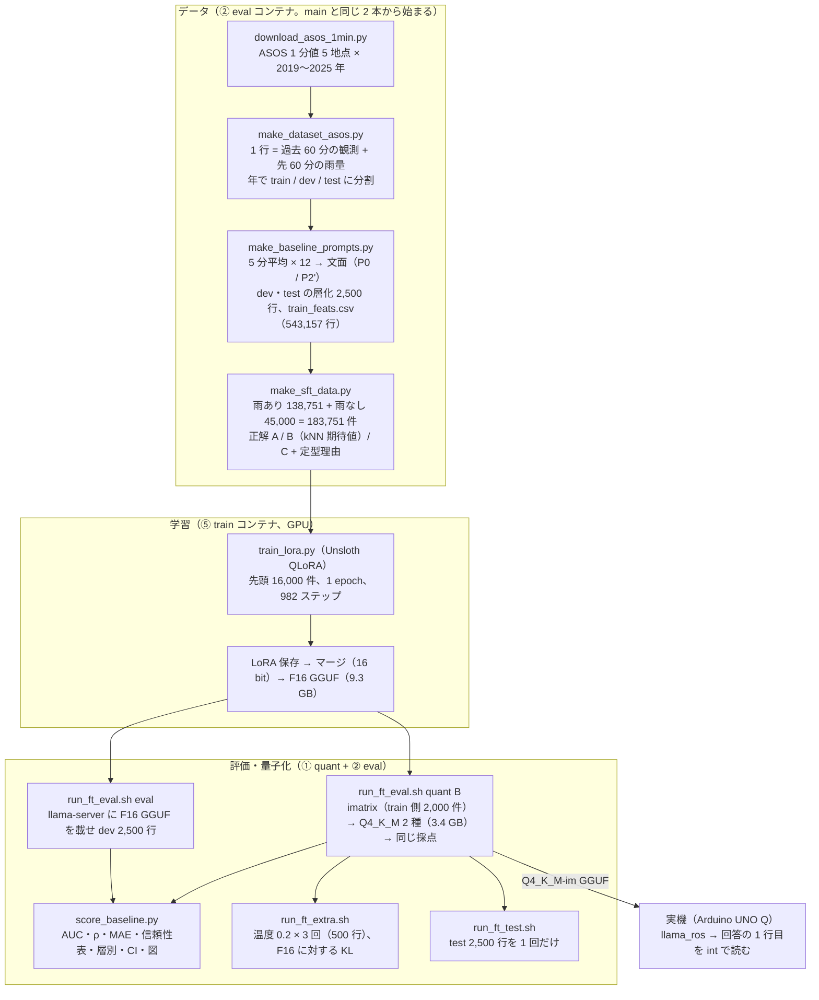
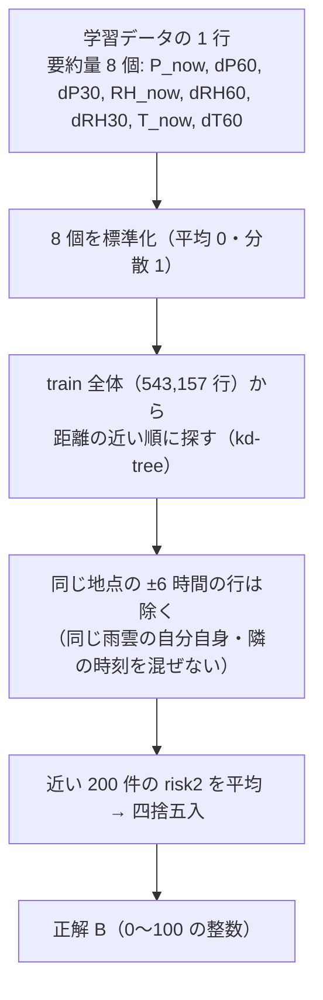

# FT_devicefmt_knn_gguf — 実機形式の文面・期待値ラベル・GGUF 評価で行う Gemma 4 E2B の LoRA FineTune

このフォルダは、main の FineTune（`src/`・`util/`・`docs/train_guide.md`。以下「main の FT」）とは**別系統で開発した FineTune 一式**を、main に手を入れずに丸ごと置いたものです。
フォルダ名は main の FT との 3 つの違いを表します。

| 名前の部分 | 意味 | main の FT との違い | 詳しい説明 |
|---|---|---|---|
| `devicefmt` | 実機（[bme280_ros_with_uno_q](https://github.com/gomi-kuzu/bme280_ros_with_uno_q)）が組み立てる**生の文面**をそのまま入力し、**回答の 1 行目に整数**を返す | main はチャット形式で JSON を入出力する | §2 |
| `knn` | 正解を「似た状況 200 件の risk2 の平均」（**期待値ラベル**）にする | main は risk2 の値そのもの | §4 |
| `gguf` | 実機に載せる **GGUF（Q4_K_M + imatrix）を llama-server で採点**する | main は 4 ビット（nf4）の HF モデル + LoRA で採点 | §5-3 |

- 作成者: hide0625（元の作業場所: `work_261007_Gemma4/`。2026-10-15〜10-17 に実施、2026-11-15 にこのフォルダへ写した）
- 実行環境: Docker（5 コンテナ）。ホストに llama.cpp や Python を入れない。学習は AWS の T4（16 GB）で行った
- 位置づけ: 両実装の比較と、main へ取り込む候補の整理は `docs/004_FineTune比較_マージ検討_revB.md`（以下 004）と `docs/006_実装I_main更新内容.md` にある。004 では main 側を「実装I」、このフォルダ側を「実装H」と呼んでいる

> **要点**: 期待値ラベル（B）で学習した LoRA は、dev 2,500 行で AUC 0.87・順位相関 0.63・出力 23 種類。Q4_K_M（imatrix）に量子化しても AUC 0.87 を保ち、test（2024 年）でも 0.86 だった。risk2 そのものを正解にした A・C は出力が「0 か 3」の 2 値に崩れた（§9）。

## 目次

1. [main の FT との違い（概要）](#1-main-の-ft-との違い概要)
2. [入出力の形式: main のチャット形式 JSON と、このフォルダの生文面](#2-入出力の形式-main-のチャット形式-json-とこのフォルダの生文面)
3. [全体の流れ](#3-全体の流れ)
4. [正解の作り方: なぜ「似た状況 200 件の平均」にしたか](#4-正解の作り方-なぜ似た状況-200-件の平均にしたか)
5. [設定とその決定理由](#5-設定とその決定理由)
6. [フォルダ構成](#6-フォルダ構成)
7. [実行環境（Docker）](#7-実行環境docker)
8. [再現手順](#8-再現手順)
9. [結果](#9-結果)
10. [含めていないもの（大きなファイル）](#10-含めていないもの大きなファイル)
11. [このフォルダへ写すときに手を加えた箇所](#11-このフォルダへ写すときに手を加えた箇所)
12. [実装の出どころ](#12-実装の出どころ)
13. [関連文書（docs/）](#13-関連文書docs)
14. [ライセンス・注意](#14-ライセンス注意)
15. [用語集](#15-用語集)

## 1. main の FT との違い（概要）

**表 1-1: main の FT とこのフォルダの比較**（詳細は 004 の §3〜§4）

| 項目 | main の FT（`src/`・`util/`） | このフォルダ | 詳しくは |
|---|---|---|---|
| 元データの取得・整形 | `util/download_asos_1min.py`・`util/make_dataset_asos.py` | **同じファイル**（バイト単位で同一。`eval/scripts/` に写しを置く） | — |
| 実機との入出力 | チャット形式。user は列指向 JSON、回答は `{"weather_risk", "reason"}` の JSON | 実機の `build_prompt()` と同じ生文面（P2' = 要約 + 手がかり 1 文）。回答は `<整数>\n<定型の理由 1 文>`。実機の `weather_risk_setter`（1 行目を int で読む）がそのまま読める | §2 |
| 入力の 12 個 | 1 分値を 5 分おきに拾った瞬間値 | **5 分平均 × 12**（実機の BucketAccumulator と同じ作り方） | §2-3 |
| 学習データの選び方 | 急変の種類ごとに比率を決めて 3,000 / 750 / 750 件 | train 分割（2019〜2022 年、543,157 行）から雨あり全部 + 雨なし 45,000 行 = 183,751 件を作り、**先頭 16,000 件**で学習 | §5-1 |
| 正解（教師信号） | risk2（先 60 分の雨量 mm × 10、上限 100）そのもの | **B: 似た状況 200 件の risk2 の平均**（kNN、同地点 ±6 時間を除外）。A/C（risk2 そのもの）は対照 | §4 |
| 理由文 | 気圧の上下動を主指標にした文（`explain()` が観測値から組み立てる） | 湿度 × 気圧の 60 分変化から機械的に選ぶ 6 パターンの定型文 | §5-1 |
| 学習 | transformers 5.22 + PEFT + TRL、QLoRA、bf16、3 epoch、conda | **Unsloth 2026.10.5** 経由で PEFT + TRL、QLoRA（r=16、α=16、attention + MLP）、float32（T4 は bf16 不可）、1 epoch、Docker | §5-2 |
| 学習後 | `merge_lora.py` → `convert_hf_to_gguf.py` → q4_0 | `train_lora.py` の中でマージ → F16 GGUF（llama.cpp **v0.6.0** 固定）→ `llama-quantize` で Q4_K_M（imatrix 無し / 有り） | §5-3 |
| 評価 | `util/eval_llm.py`（HF nf4 + LoRA）、MAE・F1 | GGUF を llama-server に載せ、dev 層化 2,500 行で **AUC・順位相関・出力の種類数・信頼性表・ブートストラップ CI**。test は最良 1 本に 1 回だけ | §5-4 |
| 実機所要の見積り | 入力 636 トークン + 出力 111〜160 トークン → 約 3 分（004 §4-6） | 入力 231 トークン + 出力 24 トークン → **約 59 秒** | §2-4 |

**表 1-2: このフォルダの 3 本の学習条件**

| run | 文面 | 正解 | 役割 |
|---|---|---|---|
| A | P2'（要約 + 手がかり） | risk2 そのもの | 主案（提案書 016） |
| **B** | P2' | **期待値ラベル（kNN 200 件の平均）** | A の「出力が最頻値に寄る」懸念への保険 → **採用** |
| C | P0（現行の 36 値列挙） | risk2 そのもの | 文面の差が FineTune 後も残るかの対照 |

## 2. 入出力の形式: main のチャット形式 JSON と、このフォルダの生文面

一番大きな違いは「LLM に何を渡し、何を返させるか」です。実機のアプリ（bme280_ros_with_uno_q）は、**センサ値から日本語の文面を組み立てて LLM に渡し、回答の 1 行目を整数として読む**作りになっています。このフォルダはその作りを変えずに学習しました。main の FT は入出力を JSON に変えて学習しているので、そのままでは今の実機では読めません（004 §4-1）。



fig 1: 実機の処理経路。実機は回答を最初の改行で区切り、前半を `int()` で整数にする。JSON の回答は変換できず捨てられる。

### 2-1. 実機の現行文面（P0）と、このフォルダが学習に使った文面（P2'）

実機の `build_prompt()`（`eval/vendor/bme280_ros_with_uno_q/prompt_maker_for_bme280.py` 190〜214 行目）が作る文面は次の形です（P0。36 個の数値を列挙する）。

```text
以下は、温湿度・気圧センサの直近 60 分間の測定値を、300 秒ごとに取得したものです (古い順、各 12 個)。
温度 [C]: 23.91, 23.88, 23.90, 23.85, 23.80, 23.82, 23.79, 23.75, 23.80, 23.78, 23.77, 23.80
湿度 [%]: 90.12, 91.04, 92.50, 93.10, 94.00, 93.50, 92.80, 92.00, 91.50, 91.20, 91.00, 91.30
気圧 [hPa]: 978.01, 977.95, 977.80, 977.60, 977.20, 976.90, 976.50, 976.10, 975.90, 976.30, 976.90, 977.30
この情報を元にこの先1時間以内に天候が悪化する可能性を0から100の範囲で評価してください。
あくまで推測でかまいません。回答は数値だけを端的に返したのち、改行文字を挟んで、その後短く理由を教えてください
```

このフォルダの FT-B は、同じ 36 個の数値を**要約した文面 P2'**（`baseline_prompt.py` の `build_prompt_p2h()`）で学習しました。末尾の 2 行（指示文）は実機と同じで、回答の形式も同じです。P2' を選んだ理由は §5-1。

```text
以下は、温湿度・気圧センサの直近 60 分間の測定値の要約です。
現在: 温度 9.9 C、湿度 36 %、気圧 988.7 hPa
60 分間の変化: 気圧 -0.7 hPa、湿度 -1 ポイント、温度 +1.3 C
直近 30 分間の変化: 気圧 -0.4 hPa、湿度 -0 ポイント
60 分間の範囲: 気圧 988.7〜989.5 hPa、湿度 35〜39 %
一般に、湿度が高く（90% 以上）、気圧が下がっている時ほど、1 時間以内に雨が降りやすいとされます。
この情報を元にこの先1時間以内に天候が悪化する可能性を0から100の範囲で評価してください。
あくまで推測でかまいません。回答は数値だけを端的に返したのち、改行文字を挟んで、その後短く理由を教えてください
```

学習データ 1 件（`eval/data/sft/sft_B.jsonl` の 1 行目の実物。`prompt` が上の文面、`completion` が教える回答）:

```json
{"prompt": "以下は、温湿度・気圧センサの直近 60 分間の測定値の要約です。\n現在: 温度 9.9 C、湿度 36 %、気圧 988.7 hPa\n ...（上の文面）... ",
 "completion": "0\n湿度が 36% で、気圧が 60 分で 0.7 hPa 下がっているため",
 "sample_id": "ATL_202201261820", "label": 0, "risk2": 0}
```

- 回答は「整数」「改行」「定型の理由 1 文」。学習時はこの後に EOS（終わりの印）を付けるので、学習後のモデルは理由 1 文で止まる（上限到達 0%）。
- 文面はチャットの枠（system / user の区切り）で包まず、実機が `/completion` に渡すのと同じ**生の文字列**として学習する（`train_lora.py` の `to_text()`。損失は `completion` 側だけ）。

### 2-2. main の FT の形式（チャット形式・JSON）

main の `util/make_weather_sft.py` は 1 件を **system / user / assistant の 3 発言**にします（`chat_record()`、155〜161 行目）。

```jsonc
{"messages": [
  {"role": "system",
   "content": "山中オフライン用の気象予測。過去1時間・5分間隔のT(気温℃)、RH(相対湿度%)、P(現地気圧hPa)、dP(5分気圧差)から今後1時間の荒天リスクを出す。各配列は-60..-5分の順。出力はJSONで weather_risk(整数0-100) と reason(短い理由) の2項目のみ。weather_riskは今後1時間の合計降水量mm×10で100上限、降水量の指標で降水確率ではない。判断は気圧の細かな上下動(dPのばらつき)を最重視し、変動が大きいほど高リスク、平坦なら低リスク。湿度と気温は補助で気圧変動より優先しない。気圧が正味で上下した向きだけでは判断しない。雷・突風・雨雪は断定しない。reasonは観測の変化と意味を簡潔に。未来値を既知として述べず、注意書きやレーダー確認案内は不要。"},
  {"role": "user",
   "content": "{\"station\": \"FIELD\", \"t0_utc\": \"2026-11-03T05:00Z\", \"min\": [-60, -55, -50, -45, -40, -35, -30, -25, -20, -15, -10, -5], \"T\": [8.21, 8.19, ...], \"RH\": [72.4, 72.9, ...], \"P\": [912.35, 912.41, ...], \"dP\": [null, 0.06, -0.08, ...]}"},
  {"role": "assistant",
   "content": "{\"weather_risk\": 3, \"reason\": \"現地気圧は5分ごとに小さく上下しており（変化のばらつき0.08hPa）、やや不安定な場を示すが、変動は中程度にとどまる。なお55分の正味変化は-0.13hPaだが、上下の向きだけでは荒天は判断しない。補助的に見ると、相対湿度は79.8%とやや高く、飽和に近づきやすい。\"}"}
]}
```

（system は `make_weather_sft.py` の `SYSTEM` の原文。user は main の README の例。assistant は `explain()` の書式に沿った例で、数値は仮。）

- 学習・推論のときは `tokenizer.apply_chat_template()` が 3 発言を Gemma 4 のチャット用の特別なトークンで包む。推論側も同じ包み方で system と user を渡し、**assistant の JSON を `json.loads()` で読む**前提（main の README §4）。
- 入力は数値の配列（12 点 × 4 種 + 地点・時刻）で、1 分値のうち −60, −55, …, −5 分の**その 1 分の値**を拾う（§2-3）。
- 文の長さ: 入力 約 636 トークン、出力 111〜160 トークン（004 §4-6。system 文と JSON のキー名が入るため）。

### 2-3. 入力の 12 個の作り方の違い

| | main の FT | このフォルダ・実機 |
|---|---|---|
| 12 個の値 | 1 分値のうち −60, −55, …, −5 分の**瞬間値**（`make_weather_sft.py`）。直前 4 分は使わない | 過去 60 分の 1 分値を 5 分ずつ 12 区切りにして**平均**（`make_baseline_prompts.py` の `bucket_means()`。実機の `_close_bucket()` と同じ） |
| 気圧差 `dP` | 隣接する瞬間値の差（先頭は null） | 文面には入れない（P2' では 60 分・30 分の変化量を要約として書く） |
| 影響 | 平均するとこまかい揺れがならされる。main が主指標にしている「5 分ごとの気圧差のばらつき」は瞬間値の方が大きく出る | 学習と実機で**入力の作り方が一致**する（実機の BucketAccumulator がそのまま使える） |

このフォルダが 5 分平均にしたのは、実機が 5 分平均を作って文面にする設計だからです。学習だけ瞬間値にすると、実機では見たことのない分布の入力になります。

### 2-4. 回答の読み取りと、実機での所要時間

実機の `weather_risk_setter.py` は回答を最初の改行で区切り、前半を `int()` にします（004 §4-1。2026-11-05 に確認）。このフォルダの採点クライアント `run_baseline.py` も同じ読み方をします。

```python
def parse_first_line(text: str):
    head, _, _ = (text or "").partition("\n"); head = head.strip()
    try:
        v = int(head); return max(0, min(100, v))
    except ValueError:
        return None          # 実機ではここで「スキップ」になる
```

| | main の FT | このフォルダ FT-B |
|---|---|---|
| 入力トークン | 約 636 | 231 |
| 出力トークン | 111〜160 | 約 24（整数 + 定型理由） |
| 実機（Cortex-A53、4 GB）での 1 判定の見積り | 約 3 分 | **約 59 秒**（`bench/predict.py` の式。実測ではない） |
| 今の実機で回答を読めるか | 読めない（1 行目が JSON） | 読める |

main の形式を実機で使うには、実機側の 3 か所（`build_prompt()`・llama_ros の渡し方・`weather_risk_setter.py` の読み取り）を変える必要があります。どちらの形式に揃えるかはチームで決める事項です（004 §5-4）。

## 3. 全体の流れ



fig 2: このフォルダの処理の流れ（上から下へ）。元データの取得・整形までは main と同じファイルで、文面と正解の作り方から分かれる。評価は実機に載せる GGUF そのものを採点する。

## 4. 正解の作り方: なぜ「似た状況 200 件の平均」にしたか

### 4-1. 背景: risk2 をそのまま正解にすると、答えが「0 か 3」に固まる

risk2 は「先 60 分の合計雨量 mm × 10（上限 100）」の整数です。雨量計の最小の刻みが 0.254 mm なので、雨が降った行の正解は 3 の倍数に近い飛び飛びの値になり、しかも大半が 0 です。

**表 4-1: train 分割（2019〜2022 年、5 地点、543,157 行）の risk2 の内訳**（`eval/data/baseline/train_feats.csv` から集計）

| risk2 | 行数 | 割合 |
|---|---:|---:|
| 0（降らない） | 404,406 | 74.5% |
| 3 | 42,279 | 7.8% |
| 5 | 20,806 | 3.8% |
| 8 | 13,861 | 2.6% |
| 10 | 9,925 | 1.8% |
| 13〜100 | 51,880 | 9.6% |
| 雨あり（> 0）の合計 | 138,751 | 25.5% |

0 と 3 だけで全体の 82% を占め、雨ありの中でも 3 が 30% です（このデータは雨なしを間引いた後の値。間引く前の母集団では 0 が約 95%）。

ここで問題になるのは、**同じような入力でも正解がばらつく**ことです。雨は偶然に左右されるので、湿度 90%・気圧低下という同じ状況でも、実際の risk2 は 0 だったり 3 だったり 46 だったりします。LLM の学習は「正解トークンの確率を上げる」ことなので、答えがばらつく入力では**一番よく出る答え（最頻値）**の確率が最も高くなります。温度 0（greedy）の生成はその最頻値をそのまま出すため、出力が 0 か 3 に固まります。これは main の `train_guide.md` が次の課題に挙げている「mode collapse（greedy で 0/10/100 に偏る）」と同じ現象です。

実際にこのフォルダでも、risk2 をそのまま正解にした FT-A・FT-C で起きました（表 4-2）。

**表 4-2: 正解の違いによる学習後の出力（dev 2,500 行、温度 0）**（`docs/023_FineTune_報告_revC.md` §5-B）

| 条件 | 正解 | 出力の値（上位） | 出力の種類 | 真値の段 0 / 1〜10 / 11〜30 / 31〜60 / 61〜100 ごとの出力の平均 | AUC |
|---|---|---|---:|---|---:|
| FineTune 前（P2' 文面、015） | — | 30（81%）、40（19%） | 2 | 30 のまま | 0.60 |
| FT-A | risk2 そのもの | 3（72%）、0（28%） | 2 | 1.0 / 2.6 / 2.8 / 2.9 / 2.8 | 0.79 |
| FT-C | risk2 そのもの（P0 文面） | 3（82%）、0（18%） | 2 | 1.5 / 2.9 / 3.0 / 3.0 / 3.0 | 0.73 |
| **FT-B** | **期待値ラベル** | 1、0、4、3、10、2、6、5、7、8、14、11 … | **23** | **1.6 / 4.9 / 6.2 / 7.5 / 9.0**（段とともに単調に増える） | **0.87** |
| 参照: 勾配ブースティング | risk2（回帰） | 連続値 | — | 0.8 / 4.4 / 6.3 / 8.7 / 14.4 | 0.90 |

FT-A の AUC 0.79 は「0 と 3 が湿度で分かれている」だけで出た値で、真値の段が上がっても出力は 3 のままです。LED に段階を出す用途では使えません。

### 4-2. 対策: 正解を「その状況での平均」に置き換える（期待値ラベル）

FT-B では、各行の正解を**入力が似ている 200 件の risk2 の平均**に置き換えました（`make_sft_data.py` 49〜58 行目）。



fig 3: 期待値ラベルの計算。目的関数は無く、近い 200 件の平均を取るだけ。LLM は介在せず、実測だけから作る。

同じ行の正解 A（実測）と B（期待値）を並べると次のようになります（`sft_A.jsonl`・`sft_B.jsonl` の先頭 6 行の実物）。

| sample_id | 正解 A（実測 risk2） | 正解 B（似た 200 件の平均） | 定型理由 |
|---|---:|---:|---|
| ATL_202201261820 | 0 | 0 | 湿度が 36% で、気圧が 60 分で 0.7 hPa 下がっているため |
| BOS_202002070820 | 8 | 12 | 湿度が 85% で、気圧が 60 分で 0.9 hPa 下がっているため |
| BOS_202205022025 | 3 | 0 | 湿度が 73% で、気圧が安定しているため |
| SEA_202103221535 | 8 | 3 | 湿度が 88% で、気圧が安定しているため |
| DSM_202205250420 | 25 | 9 | 湿度が 96% と高く、気圧が安定しているため |
| DSM_202110291105 | 3 | 6 | 湿度が 93% と高く、気圧が 60 分で 0.5 hPa 上がっているため |

**表 4-3: 学習データ 183,751 件での正解 A と B の統計**（`eval/data/sft/sft_summary.json`）

| 項目 | 正解 A（実測） | 正解 B（期待値） |
|---|---:|---:|
| 平均 | 12.1 | 6.9 |
| 値の種類 | 41 | 59 |
| 中央値 / 90% 点 / 99% 点 | — | 5 / 15 / 31 |
| A と B の順位相関（Spearman） | 0.55 | |

**表 4-4: 正解 B の値ごとに、実測 risk2 がどう分布しているか**（183,751 件。`docs/022_finetune/out/label_ab_table.csv`、行ごとの %）

| 正解 B の範囲 | 実測 0 | 実測 1〜10 | 実測 11〜30 | 実測 31〜100 |
|---|---:|---:|---:|---:|
| 0 | 83.2 | 14.4 | 1.6 | 0.8 |
| 1〜5 | 28.6 | 52.7 | 13.5 | 5.1 |
| 6〜10 | 7.3 | 56.8 | 25.2 | 10.7 |
| 11〜15 | 3.7 | 50.7 | 28.3 | 17.2 |
| 16〜20 | 2.5 | 45.3 | 28.0 | 24.2 |
| 21〜30 | 1.8 | 38.5 | 26.5 | 33.3 |
| 31〜 | 1.6 | 24.1 | 21.3 | 53.1 |

B が大きいほど実測も大きい側に寄り（単調）、かつ同じ B の中でも実測はばらついています。つまり B は「この状況なら平均どれくらい降るか」を表し、入力が決まれば値が 1 つに決まります。モデルは**入力と答えの滑らかな対応**を学べるようになり、学習後の出力は 0〜30 の 23 種類に広がりました（表 4-2）。

### 4-3. 期待値ラベルの設計で決めたことと理由

| 決めたこと | 値 | 理由 |
|---|---|---|
| 似ている度合いを測る変数 | 要約量 8 個（現在の気圧・湿度・温度と、60 分・30 分の変化量） | P2' の文面に書いてある情報そのもの。文面から読み取れない情報で正解を作ると、モデルには当てようがない |
| 標準化 | 平均 0・分散 1 に揃える | 気圧（hPa）と湿度（%）の目盛りが違うので、そのままでは距離が気圧に支配される |
| K（何件の平均か） | 200 | 少ないと実測のばらつきが残り（K=1 なら A と同じ）、多いと状況の違いがならされて全体平均（約 7）に近づく。200 は提案書 016 で固定し、学習後に信頼性表（出力 20 台の行の 88% が実際に降る、023 §5-C）で妥当性を確かめた。K の比較実験はしていない |
| 同地点 ±6 時間の除外 | 除外する | 同じ雨雲による前後の時刻は要約量も risk2 もほぼ同じなので、除外しないと「自分の実測」をそのまま写すことになり期待値にならない |
| 探す母集団 | train 全体（dry を 1:3 に間引いた後の 543,157 行）。母集団重みで戻さない | 重みで元の分布（0 が 95%）に戻すと B の値が 0〜5 に潰れ、尺度として使えなくなる（`make_sft_data.py` 冒頭の注記）。そのため B の絶対値は本番の事象率より高めに出る。LED などに出すときは信頼性表で読み替える（§9） |
| 丸め | 四捨五入して整数 | 回答は整数 1 行目という実機の仕様に合わせる |

限界: B は学習母集団での期待値なので上限が 30 程度（99% 点 31）で、尺度の低い側しか使いません。「20 と出たら 9 割降る状況」という意味になるため、0〜100 を使い切らせたい場合は後処理の校正表（出力 10 → 25%、20 → 88% など）を通します。

## 5. 設定とその決定理由

### 5-1. 学習データと文面

| 設定 | 値 | 理由 |
|---|---|---|
| 学習に使う分割 | train（2019〜2022 年）のみ | dev（2023 年）は選択用、test（2024 年）は最終確認用に残す。年で分けるのは、同じ年の前後の時刻が学習と評価にまたがる（情報漏れ）を防ぐため |
| 雨あり / 雨なしの比率 | 雨あり 138,751 行を全部 + 雨なし 45,000 行（約 1:3、無作為、seed 20261015） | 母集団のまま（0 が 95%）だと「常に 0」を学ぶのが最も損失が低くなる。雨ありを全部残して雨なしを間引き、雨ありの比率を 1/4 にした |
| 学習に使う件数 | 先頭 16,000 件（学習 15,700 + 検証 300） | 計画は 18 万件だったが、T4 は bf16 非対応で float32 になり 1 秒 3.3 件（18 万件で 1 本 15 時間）。損失は 500 ステップで平坦になっていた（`docs/022_finetune/figs/figR3_loss.png`）ので 1.6 万件で止めた。全件での伸びは未検証 |
| 文面 | P2'（要約 + 手がかり 1 文、231 トークン） | FineTune 前の文面比較（015）で、P0 → P1（丸め）→ P2（要約）→ P2'（+ 手がかり）と AUC が 0.40 → 0.46 → 0.52 → 0.60 と上がり、P2' が最良。実機所要も 86 秒 → 52 秒に短くなる。P0 は対照（FT-C）として残した |
| 回答の形 | `<整数>\n<定型理由>` + EOS | 実機の読み取り（1 行目を int）に合わせる。EOS を教えることで理由 1 文で止まり、出力が約 24 トークンに収まる（実機の所要時間に直結） |
| 理由文 | 湿度（90% 以上か）× 気圧の 60 分変化（−0.5 以下 / +0.5 以上 / その間）の 6 パターンを機械的に選ぶ | LLM に書かせると入力と矛盾する文が混ざる。定型なら「述べている湿度・気圧が入力と一致する」ことを保証でき（学習後 100% 一致）、形式の崩れ（理由が出ない・繰り返す）も防げる。代わりに理由の情報量は少ない |
| 損失の対象 | 回答（completion）のトークンだけ（`completion_only_loss=True`） | 文面まで当てさせると「気象の要約文を書く練習」に学習が割かれる。答え方だけに集中させる |

### 5-2. 学習（LoRA）

| 設定 | 値 | 理由 |
|---|---|---|
| ベースモデル | `unsloth/gemma-4-E2B-it`（BF16、重み 51.2 億個） | 実機（4 GB）で動く大きさで、日本語の文面を読める指示追従モデル。実機候補の GGUF と同じ系列 |
| 方式 | QLoRA（元の重みを 4 ビットで読み込み凍結、LoRA だけ学習） | 全重みの学習は T4（16 GB）に載らない。LoRA は 2,416 万個（全体の 0.47%）だけ動かす |
| LoRA を付ける場所 | 35 層の注意機構（q/k/v/o）と MLP（gate/up/down）の 7 種類 | Unsloth / PEFT の標準対象。埋め込み表・出力層は「語彙」なので変えず、「読んだ内容の処理」だけ変える。どこが効いたかの切り分けは未実施 |
| ランク r / α | 16 / 16 | LoRA の一般的な既定値（入出力の形を覚えさせる用途には十分）。r=8 / 32 との比較は未実施 |
| 学習率・スケジュール | 2e-4、cosine、warmup 3% | LoRA の一般的な既定値。大きすぎると形式が壊れ、小さすぎると 1 周で足りない |
| バッチ | 8 × 勾配累積 2 = 16 件 / ステップ | T4 のメモリに入る大きさで、更新 1 回の雑音を抑える |
| epoch | 1 | 同じ件を 2 度見せるより件数を増やす方が先。過学習の兆候なし（検証損失 ≈ 学習損失） |
| 系列長 | 512 トークン | 1 件 260〜400 トークンなので切り捨てが起きない最小の 2 のべき |
| 計算精度 | float32（T4） | T4 は bf16 非対応。Unsloth が Gemma 4 の fp16 を拒否したため。bf16 対応 GPU では自動で bf16 になる（`train_lora.py`） |
| 最適化 | AdamW 8 ビット | メモリ節約（Unsloth の既定） |
| seed | 0 | LoRA の初期値とデータの順番を固定（再現用） |
| 学習ライブラリ | Unsloth 2026.10.5（中で PEFT 0.21.2 + TRL 1.15.0） | 4 ビット読み込み・勾配チェックポイント・マージ・GGUF 変換まで 1 本で書ける。代償として transformers が 5.17.0 までに制限され、main の環境（5.22.1）と同居できない |

学習の目的関数（平易に）: 回答の各トークンについて「正解トークンに付けた確率」の対数を取り符号を反転した値（交差エントロピー）を平均し、それが小さくなる方向に LoRA の行列だけを動かす。FT-B の実測では 50 ステップで損失 1.20（正解に平均 30% の確率）、100 ステップで 0.14（87%）まで下がり、これが「整数 + 定型理由 + 改行 + EOS」の形式を覚えた段階。その後の 0.14 → 0.086 の緩やかな低下が「整数の値を入力に合わせる」学習に相当する（023 §2-A-7）。

### 5-3. 学習後: マージ・GGUF・量子化

| 設定 | 値 | 理由 |
|---|---|---|
| マージ | LoRA を元の重みに足し込み、16 bit の HF 重みにする（`save_pretrained_merged`） | 足し込むと元と同じ形の 1 つのモデルになり、以後の変換・量子化・実機への載せ方が FineTune 前と同じ経路で済む。実機（llama_ros）で LoRA を別に読む運用より単純 |
| GGUF 変換 | llama.cpp の `convert_hf_to_gguf.py`、F16 | 実機の llama.cpp が読む形式。F16 GGUF（9.3 GB）は PC 側の採点にも使う |
| llama.cpp の版 | **v0.6.0** に固定（①③⑤ のコンテナで同じタグ） | 版が違うと変換結果や既定の挙動が変わりうる。評価・変換・実機配布で同じバイナリを使うため。main は `--depth 1` で最新を取るため版が記録されない（004 §4-7-2） |
| 量子化形式 | Q4_K_M（重み 1 個 約 4.5 ビット、3.4 GB） | 実機の空き RAM が約 2.9 GB で、F16（9.3 GB）は載らない。Q4_K_M は llama.cpp の 4 ビット形式の中で精度と大きさの釣り合いが良い標準的な選択。実機で q4_0 の方が速い可能性は未測定（main は q4_0） |
| imatrix | 有り / 無しの両方を作り比較 | imatrix は「どの重みがよく使われるか」を校正用の文面で測り、よく使う重みの誤差を小さくする。KL（F16 との分布のずれ）は有り 0.114 / 無し 0.185、AUC は 0.866 / 0.863 で差は CI の内側 |
| imatrix の校正文面 | 学習に使っていない train 側 2,000 件（`sft_B.jsonl` の末尾） | 評価データ（dev）を校正に使うと評価が甘くなる。学習に使った件を使うと学習分布に過剰に寄る |

### 5-4. 評価

| 設定 | 値 | 理由 |
|---|---|---|
| 評価データ | dev（2023 年）126,787 行から risk2 の値で 5 段（0 / 1〜10 / 11〜30 / 31〜60 / 61〜100）に分け、段ごとに 800 / 600 / 500 / 350 / 250 行を無作為に抜いた 2,500 行（seed 20261015） | risk2 > 30 の行は dev の 2.8% しかなく、無作為に 2,500 行抜くと 70 行程度で「強い雨を当てられるか」が見えない。層化で高い側を厚くし、母集団に戻す重み（段の行数 ÷ 抜いた行数 × dry 間引きの重み）を付けて集計する |
| 同じ 2,500 行を使い回す | FineTune 前の文面比較（013・015）と同じ `sample_id` | 条件間の差を同じ行で比べるため。採点スクリプトも同じ（`score_baseline.py`） |
| 主指標 | AUC（先 60 分に 0.5 mm 以上降るかの判別）と risk2 との順位相関 ρ | 正解はゼロ過多の整数で、MAE だけ見ると「常に 0」が最良になり何も分からない（FT-A の MAE 1.76 は FT-B の 2.28 より良いが、出力は 2 値）。危険度は「順位が付くか」が本質で、値の校正は後処理でできる |
| 副指標 | 出力の値の種類数、信頼性表、整数率、出力トークン数 | 種類数は mode collapse の検出用。信頼性表は出力を事象率に読み替える校正表。整数率と出力長は実機要件 |
| 温度 | 0（greedy） | 実機の既定と同じで、再現性がある。揺れは別途 温度 0.2 × 3 回（500 行）で測り、run 間の AUC の SD 0.004 を「差と呼べる最小幅」の物差しにする |
| 信頼区間 | 2,500 行のブートストラップ 1,000 回 | 条件間の差が CI の幅を超えない限り「差がある」と書かないため |
| 参照モデル | 同じ要約量から作ったロジスティック回帰・勾配ブースティング（train で学習、同じ 2,500 行で採点） | FineTune で到達しうる上限の目安（0.87〜0.90）。「常に 0」「地点平均」は下限 |
| 合格の目安 | BF16 で AUC 0.80・ρ 0.50・出力の種類 20 以上、Q4 で AUC 0.75 | 提案書 016 で**学習前に**決めた。結果を見てから基準を動かさないため |
| test の使い方 | 最良 1 本（FT-B Q4_K_M-im）だけ、1 回 | 複数の条件で test を引くと test で選ぶことになり、数字が甘くなる。dev での選択回数（文面 1 回 + モデル 1 回）も記録している |
| 採点対象 | 実機に載せる GGUF（llama-server、v0.6.0） | HF の 4 ビット（nf4）+ LoRA で採点すると、実機の q4 GGUF とは丸め方・LoRA の扱い・変換の有無が違い、数字がどちらにもずれうる（004 §4-7-2） |

### 5-5. 環境

| 設定 | 値 | 理由 |
|---|---|---|
| すべて Docker | ホストで動かすのは `docker compose` だけ | 学習（Unsloth、transformers 5.17）と変換・評価（llama.cpp）の依存が衝突するので役割ごとにコンテナを分ける。main の README も学習環境と GGUF 変換環境の分離を勧めている |
| 版の固定 | `requirements-*.txt` と `LLAMA_CPP_TAG` で固定 | 再現性。2026-10-15 時点で Gemma 4 E2B が動く組合せ |
| arm64 コンテナ | armv8-a、Cortex-A53 向け、dotprod / i8mm / fp16 演算を含めない静的リンク | 実機の CPU（A53）はこれらの命令を持たず、含めると SIGILL で落ちる。PC では QEMU で起動・疎通・RSS だけ確認し、同じイメージを実機に配る |
| 成果物の所有者 | `.env` の `DOCKER_UID` / `DOCKER_GID` でホストのユーザーとして実行 | root 所有のファイルが残らないようにする |

## 6. フォルダ構成

| パス | 中身 | 実行する場所 |
|---|---|---|
| `env/docker/` | Docker 5 コンテナの定義（`compose.yaml`・`Dockerfile.*`・`requirements-*.txt`・`run.sh`・`smoke.sh`）。`README.md` に役割と固定した版 | ホスト（`docker compose` のみ） |
| `models/` | モデルの取得スクリプト（`download.sh`・`SHA256SUMS.txt`）と、学習済み B の `train_log.json`・`adapter_config.json`。本体は git に入れない（`models/README.md`） | — |
| `eval/scripts/download_asos_1min.py`・`make_dataset_asos.py` | 元データの取得・整形（main の `util/` と同一） | ② eval |
| `eval/scripts/baseline_prompt.py` | 実機の `build_prompt()` の写し（P0）と、文面の候補 P1〜P3・q1〜q3。P2' が `build_prompt_p2h()` | （import される） |
| `eval/scripts/make_baseline_prompts.py` | 5 分平均 × 12 の作成、dev / test の層化 2,500 行、`train_feats.csv`（参照モデルと SFT の元） | ② eval |
| `eval/scripts/make_sft_data.py` | 学習データ `sft_A/B/C.jsonl`（正解 B は kNN の期待値、理由は定型 6 パターン） | ② eval |
| `eval/scripts/train_lora.py` | Unsloth で QLoRA → LoRA 保存 → マージ → F16 GGUF | ⑤ train |
| `eval/scripts/run_ft_queue.sh` | A / B / C を順に学習（ホストから `docker compose exec`） | ホスト |
| `eval/scripts/serve_gguf.sh` | ① で任意の GGUF の llama-server を起動 / 停止 | ホスト |
| `eval/scripts/run_ft_eval.sh` | `eval`: F16 GGUF を採点 / `quant`: imatrix → Q4_K_M 2 種 → 採点 | ホスト |
| `eval/scripts/run_ft_extra.sh` | 温度 0.2 × 3 回（500 行）と F16 に対する KL | ホスト |
| `eval/scripts/run_ft_test.sh` | test（2024 年）で 1 回だけ採点 | ホスト |
| `eval/scripts/run_baseline.py` | 文面を llama-server に流し、1 行目の整数・トークン数・所要を記録（FineTune 前から使う採点クライアント） | ② eval |
| `eval/scripts/score_baseline.py` | AUC・順位相関・MAE・信頼性表・層別・ブートストラップ CI・参照モデル（ロジスティック回帰・勾配ブースティング）・図 | ② eval |
| `eval/scripts/run_baseline_sweep.sh` | FineTune 前の元モデル（BF16 / UD-Q4_K_XL）の採点（表 9-1 の上 2 行） | ホスト |
| `eval/vendor/bme280_ros_with_uno_q/` | 実機 repository の `prompt_maker_for_bme280.py` の無改変の写し（commit `89b247a`、Apache-2.0）。文面の一致検査に使う | — |
| `eval/data/` | 小さな要約だけ（層化の内訳 `strata*.json`・`sft_summary.json`・`dataset_summary.csv`）。本体は §10 | — |
| `eval/results/baseline/out_017/`・`out_017_test/` | dev / test の採点結果（`summary.csv`・`predictions_all.csv`・`reliability.csv`・`slices.csv`・`error_samples.csv`） | — |
| `bench/predict.py` | GGUF のテンソル表から実機の decode 速度と 1 判定の所要秒を見積もる | ① or ② |
| `docs/` | 提案書・報告・コード解説・main との比較（§13） | — |
| `logs/` | 各シェルがログを書く場所（中身は git に入れない） | — |

## 7. 実行環境（Docker）

ホストで動かすのは `docker compose`（`env/docker/run.sh` 経由）だけです。詳細は `env/docker/README.md`。

**表 7-1: 5 つのコンテナ**

| 番号 | サービス | イメージ | 役割 | 入口 |
|---|---|---|---|---|
| ① | `quant` | nvidia/cuda 12.8.1 + llama.cpp v0.6.0（CUDA、sm_75） | 参照推論・imatrix・量子化・KL・llama-server | `127.0.0.1:8081` |
| ② | `eval` | python 3.12 + pandas 2.3.3 / scikit-learn 1.7.2 / matplotlib | データ作成・文面生成・採点 | — |
| ②' | `eval-lmeval` | ② + torch（CPU）+ lm-eval | 補助ベンチ（任意、`--profile lmeval`） | — |
| ③ | `arm64` | debian bookworm aarch64 + llama.cpp v0.6.0（armv8-a、Cortex-A53 向け） | 実機と同一バイナリの疎通・RSS 計測（QEMU）。実機にもこのイメージを配布 | `127.0.0.1:8083` |
| ⑤ | `train` | nvidia/cuda 12.8.1 + torch 2.14.1 / transformers 5.17.0 / unsloth 2026.10.5 / trl 1.15.0 / peft 0.21.2 / bitsandbytes 0.50.2 + llama.cpp v0.6.0 の `convert_hf_to_gguf.py` | LoRA 学習・マージ・GGUF 変換 | — |

注意点:

- **GPU の世代**: `compose.yaml` の `CUDA_DOCKER_ARCH: "75"` は T4 向け。RTX 4060 Ti なら `"89"` に変える（①のビルド時間を短くするため 1 世代に絞っている）。
- **bf16 の有無**: `train_lora.py` は `torch.cuda.is_bf16_supported()` で bf16 / fp16 を自動で選ぶ。T4 では Unsloth が Gemma 4 の fp16 を拒否したため float32 で学習した（1 秒 2〜3 件）。bf16 が使える GPU では速くなる見込みだが、未確認。
- **Unsloth と transformers の版**: unsloth 2026.10.5 の上限が transformers 5.17.0。main の学習環境（transformers 5.22.1）とは同居できないので、このフォルダは別コンテナで動かす（004 §4-6）。
- **プロキシ・CA**: `compose.yaml` はホストの `HTTP_PROXY` 等をビルド時と ② に渡し、`/etc/ssl/certs/ca-certificates.crt` をマウントする（TLS を中継するプロキシ下で取得できるようにするため）。プロキシが無い環境ではそのままで動く。
- **ファイルの所有者**: 成果物が root 所有にならないよう `env/docker/.env` の `DOCKER_UID` / `DOCKER_GID` でホストのユーザーとして実行する（§8 の手順 0）。

## 8. 再現手順

すべてこのフォルダ（`FT_devicefmt_knn_gguf/`）をカレントにして実行します。所要の目安は T4 での実績です。

```bash
# 0. 準備: 自分の UID/GID を .env に書く
cp env/docker/.env.example env/docker/.env
sed -i "s/^DOCKER_UID=.*/DOCKER_UID=$(id -u)/; s/^DOCKER_GID=.*/DOCKER_GID=$(id -g)/" env/docker/.env

# 1. モデルの取得（GGUF 約 13 GB、HF 重み 10.2 GB。models/README.md 参照）
bash models/download.sh
pip install -U huggingface_hub && hf download unsloth/gemma-4-E2B-it --local-dir models/hf/gemma-4-E2B-it

# 2. イメージの構築と起動（① は CUDA ビルドで 20〜40 分）
bash env/docker/run.sh build            # quant / eval / arm64
bash env/docker/run.sh build train      # 学習用
bash env/docker/run.sh up               # binfmt 確認 → ①②③ をアイドル起動
docker compose -f env/docker/compose.yaml up -d train
bash env/docker/run.sh smoke            # GPU・arm64・Python・GGUF 読み込みの疎通
```

```bash
# 3. データ作成（② eval コンテナ内。E は以後の省略形）
E="docker compose -f env/docker/compose.yaml exec -T eval"
$E python3 -I eval/scripts/download_asos_1min.py          # 5 地点 × 2019〜2025 → eval/data/raw/asos_1min/（数十分）
$E python3 -I eval/scripts/make_dataset_asos.py           # → eval/data/dataset_asos/dataset_<地点>.csv（計 1.4 GB）
$E python3 -I eval/scripts/make_baseline_prompts.py                        # dev 層化 2,500 行（P0 文面）+ train_feats.csv + strata.json
$E python3 -I eval/scripts/make_baseline_prompts.py --style p2h            # 同じ 2,500 行の P2' 文面
$E python3 -I eval/scripts/make_baseline_prompts.py --split test           # test 層化 2,500 行（最終確認用）
$E python3 -I eval/scripts/make_baseline_prompts.py --split test --style p2h
$E python3 -I eval/scripts/make_sft_data.py               # → eval/data/sft/sft_{A,B,C}.jsonl（183,751 件、計 500 MB）、sft_summary.json

# 4.（任意）FineTune 前の元モデルの採点（表 9-1 の上 2 行）
bash eval/scripts/run_baseline_sweep.sh "BF16 UD-Q4_K_XL" "raw:0:0:p2h"
```

```bash
# 5. 学習（⑤ train。T4 float32 で 1 本 80〜130 分。ログは logs/train_<run>_<日付>.log）
nohup bash eval/scripts/run_ft_queue.sh "A B C" 16000 300 > logs/ft_queue.log 2>&1 &
#    → models/ft/<run>/{lora, merged, gemma-4-E2B-wr-<run>-F16.gguf, train_log.json}

# 6. 評価（① llama-server に GGUF を載せ、② から dev 2,500 行を流す。1 本 約 6 分）
bash eval/scripts/run_ft_eval.sh eval "A B C"             # F16 GGUF の採点（C は P0 文面、A/B は P2'）
bash eval/scripts/run_ft_eval.sh quant B                  # imatrix（train 側 2,000 件）→ Q4_K_M 2 種 → 同じ採点
$E python3 -I eval/scripts/score_baseline.py --cond-filter 'FT-|p2h' \
     --summary-dir eval/results/baseline/out_017 --figdir eval/results/figs
#    → summary.csv / predictions_all.csv / reliability.csv / slices.csv / error_samples.csv と図 fig1〜fig7

# 7. 追加確認と test（test は最良 1 本に 1 回だけ。実験台帳に記録すること）
bash eval/scripts/run_ft_extra.sh B                       # 温度 0.2 × 3 回（500 行）、F16 に対する KL
bash eval/scripts/run_ft_test.sh B Q4_K_M-im              # test 2,500 行 → eval/results/baseline/out_017_test/
```

- `score_baseline.py` は日本語フォント `eval/data/raw/fonts/NotoSansJP-Regular.ttf` があれば図の日本語を正しく出す（無ければ豆腐になるだけで動く）。[Google Fonts の Noto Sans JP](https://fonts.google.com/noto/specimen/Noto+Sans+JP) から置く。
- 乱数は固定（層化・SFT の seed 20261015、学習 seed 0、ブートストラップ 1,000 回）。同じ入力なら同じ結果になる。
- 実機へ配る GGUF は `models/ft/B/gemma-4-E2B-wr-B-Q4_K_M-im.gguf`（3.4 GB）。③ のイメージと一緒に `docker save` で渡す手順は `env/docker/README.md`。

## 9. 結果

**表 9-1: dev 層化 2,500 行（2023 年、母集団の重み付き）での採点**。AUC は「先 60 分に雨が降るか」の 2 値に対する値（95% 信頼区間はブートストラップ 1,000 回）。ρ は risk2 との順位相関、MAE は risk2 との平均絶対誤差。「出力の種類」は 2,500 行で出た整数の種類数（少ないほど尺度が使えていない）。出典: `docs/023_FineTune_報告_revC.md` §1、`eval/results/baseline/out_017/summary.csv`

| 条件（生文面、温度 0） | AUC [95% CI] | ρ | MAE | 出力の種類 | 理由文の形式一致 |
|---|---:|---:|---:|---:|---:|
| P2' 元モデル BF16 | 0.601 [0.587, 0.616] | 0.313 | 29.9 | 4 | — |
| P2' 元モデル UD-Q4_K_XL | 0.507 | 0.075 | 29.5 | 3 | — |
| FT-A（risk2 そのもの、P2'） | 0.790 [0.771, 0.807] | 0.539 | 1.76 | **2（0 / 3）** | 99.96% |
| **FT-B（期待値ラベル、P2'）F16** | **0.871 [0.853, 0.887]** | **0.629** | 2.28 | 23 | 99.4% |
| **FT-B Q4_K_M + imatrix（実機候補）** | **0.866 [0.848, 0.883]** | **0.629** | 2.48 | 21 | 99.4% |
| FT-B Q4_K_M（imatrix 無し） | 0.863 [0.845, 0.880] | 0.618 | 2.46 | 21 | — |
| FT-C（risk2 そのもの、P0） | 0.731 [0.711, 0.748] | 0.509 | 2.23 | 2（0 / 3） | 98.5% |
| 参照: 勾配ブースティング回帰 | 0.899 [0.883, 0.913] | 0.658 | 1.58 | 連続値 | — |

- 元モデルの MAE が 30 前後なのは、出力が 30/40 の 2 値に張り付き、真値の大半が 0 のため。
- **test（2024 年、1 回だけ）**: FT-B Q4_K_M + imatrix は AUC 0.863 [0.846, 0.879]・ρ 0.60。dev とほぼ同じで、dev で選んだ値が甘かった兆候は無い。同じ test で勾配ブースティングは 0.888・0.61（`eval/results/baseline/out_017_test/summary.csv`）。
- 温度 0.2 × 3 回（500 行）の AUC の run 間 SD は 0.004。出力は約 24 トークンで上限到達 0%。理由文は述べている湿度の値と気圧の向き・量が入力と 100% 一致。
- 出力の上限は 30 程度で尺度の低い側しか使わない（期待値ラベルの性質、§4-3）。信頼性表では出力 20 台の行の 88% が実際に降る。LED などに出すときは校正表で読み替える（023 §6）。
- 量子化で落ちなかった理由（解釈）: FineTune 前は「湿度 90% 以上なら 40、それ以外は 30」という文面に書いた規則の読み取りで判断しており、4 ビットの丸めでその読み取りが崩れた。FineTune 後は入力と答えの対応が重み全体に分散して刻まれており、個々の丸め誤差では壊れない。
- 既知の課題: 学習件数を 18 万 → 1.6 万に縮小しているため、全件で学習したときの伸びは未検証。理由文は定型なので「気圧の上下動」（main が主指標にしているもの。004 §4-5 でこちらのデータでも荒天 AUC 0.80 と有効だった）を手がかりに入れていない。

## 10. 含めていないもの（大きなファイル）

git に入れたのはコード・設定・小さな要約（合計 約 3 MB）だけです。次のものは §8 の手順で再生成するか、別経路で受け渡します。

| 置き場 | 中身 | 大きさ | 再生成 |
|---|---|---:|---|
| `models/*.gguf` | 元モデルの GGUF 4 本 | 約 13 GB | `bash models/download.sh` |
| `models/hf/gemma-4-E2B-it/` | 学習用の HF 重み | 10.2 GB | `hf download`（§8 手順 1） |
| `models/ft/{A,B,C}/` | LoRA（97 MB）・マージ（10.2 GB）・F16 GGUF（9.3 GB）・Q4_K_M 2 種（各 3.4 GB）・imatrix | 約 30 GB / run | §8 手順 5〜6 |
| `eval/data/raw/asos_1min/` | ASOS 1 分値の生 CSV | 1.8 GB | §8 手順 3 |
| `eval/data/dataset_asos/dataset_*.csv` | 整形済み CSV（5 地点） | 1.4 GB | 同上 |
| `eval/data/baseline/*.csv`・`*.jsonl` | `train_feats.csv`（212 MB）・dev / test の層化サンプルと文面 | 236 MB | 同上 |
| `eval/data/sft/sft_*.jsonl` | 学習データ 3 本 | 494 MB | 同上 |
| `eval/results/baseline/*.jsonl` | 採点の生出力（1 行 1 サンプル。`predictions_all.csv` に要約済み） | 1.9 MB / 条件 | §8 手順 4・6 |
| `eval/results/kl/` | 量子化形式ごとの KL 計測（FineTune 前の調査） | 15 GB | 対象外 |
| 元の作業場所にあった評価の周辺スクリプト（文面探索 q1〜q3 の集計、量子化形式の横断比較、2 段推論のパイロット） | FineTune の再現に不要 | — | 対象外（必要なら別途） |

## 11. このフォルダへ写すときに手を加えた箇所

元の作業場所（2026-11-15 時点）からの変更は次の 3 点だけで、それ以外は**バイト単位で同一**です（`cmp` で確認済み）。

| ファイル | 変更 | 理由 |
|---|---|---|
| `eval/scripts/score_baseline.py` | `--figdir` の既定値を `report/.../013_baseline/figs` → `eval/results/figs` に（docstring の 1 行も同様） | 元の作業場所のレポート用フォルダがここには無いため |
| `eval/scripts/run_ft_test.sh` | `--figdir report/.../017_finetune/figs_test` → `eval/results/figs_test` | 同上 |
| `env/docker/.env` → `.env.example` | 作業者固有の UID/GID を既定値 1000 に置き換え、`.env` は git に入れない | 各自の ID で上書きして使う |

加えて、このフォルダ専用の `.gitignore`・`README.md`（本書）・`models/README.md`・`logs/.gitkeep` を新しく置きました。

## 12. 実装の出どころ

**表 12-1: 元にしたもの（書き換えていない）**

| 種類 | 名前・版 | 使い方 |
|---|---|---|
| ベースモデル（学習） | Hugging Face `unsloth/gemma-4-E2B-it`（safetensors、BF16、10.2 GB、重み 51.2 億個） | ⑤ で 4 ビットに圧縮して読み込み、重みは凍結 |
| ベースモデル（GGUF） | `unsloth/gemma-4-E2B-it-GGUF`（BF16・UD-Q4_K_XL・imatrix・MTP） | FineTune 前の採点と量子化の元 |
| 学習ライブラリ | Unsloth 2026.10.5（中で PEFT 0.21.2 と TRL 1.15.0 を呼ぶ）、transformers 5.17.0、torch 2.14.1、bitsandbytes 0.50.2 | `train_lora.py` から標準機能を呼ぶだけ |
| 推論・量子化 | llama.cpp v0.6.0（`convert_hf_to_gguf.py`・`llama-quantize`・`llama-imatrix`・`llama-perplexity`・`llama-server`） | ①③⑤ で同じタグに固定 |
| 実機アプリ | `gomi-kuzu/bme280_ros_with_uno_q` commit `89b247a` の `prompt_maker_for_bme280.py` | `eval/vendor/` に無改変で写し、文面の一致検査に使う |
| 元データ | Iowa State University IEM が再配布する ASOS 1 分値（5 地点 × 2019〜2025） | main と同じ取得・整形スクリプト |

**表 12-2: 自作したファイルと行数**（FineTune のために新しく書いた 9 本。全文と解説は `docs/029_FineTune追加コード解説.md`）

| 区分 | ファイル | 行数 | 中で使っている主な機能 |
|---|---|---:|---|
| 学習用コンテナ | `env/docker/Dockerfile.train` | 22 | nvidia/cuda devel + venv + llama.cpp の gguf-py |
| 学習用コンテナ | `env/docker/requirements-train.txt` | 16 | 版の固定 |
| 学習用コンテナ | `env/docker/compose.yaml` の `train` | 20 | GPU 割り当て・`shm_size`・ボリューム |
| 学習データ | `eval/scripts/make_sft_data.py` | 79 | `sklearn.neighbors.NearestNeighbors`（kNN）、`StandardScaler`、定型理由 `reason()` |
| 学習 | `eval/scripts/train_lora.py` | 84 | `FastLanguageModel.from_pretrained(load_in_4bit)`・`get_peft_model(r=16, α=16, 7 箇所)`、`SFTTrainer`（`completion_only_loss=True`）、`save_pretrained_merged`、`convert_hf_to_gguf.py` |
| 実行 | `eval/scripts/run_ft_queue.sh` | 16 | `docker compose exec train` |
| 評価 | `eval/scripts/run_ft_eval.sh` | 44 | `llama-imatrix`・`llama-quantize`・`run_baseline.py` |
| 評価 | `eval/scripts/serve_gguf.sh` | 24 | `llama-server`（`/health`・`/props` でモデル一致を確認） |
| 評価 | `eval/scripts/run_ft_extra.sh` | 20 | `llama-perplexity --kl-divergence` |
| 評価 | `eval/scripts/run_ft_test.sh` | 14 | `score_baseline.py --sample test` |

FineTune 前から使っている自作ファイル（文面作成・採点）は `baseline_prompt.py`・`make_baseline_prompts.py`・`run_baseline.py`・`score_baseline.py`・`run_baseline_sweep.sh`、環境は `env/docker/` の残り（提案書 `docs/016_FineTune_提案.md` の §7 と 004 の表 0-1 に経緯）。

## 13. 関連文書（docs/）

| ファイル | 内容 |
|---|---|
| `docs/016_FineTune_提案.md` | 計画（仮説・学習データ・手法・合格条件・リスク）。この計画を既定値で実施した |
| `docs/023_FineTune_報告_revC.md` | 結果の報告。LoRA をどこに入れたか（35 層 × 7 箇所の地図）、学習データ 1 件の形、学習曲線、量子化、信頼性表、層別、理由文の検査、test の結果。図は `docs/017_finetune/`・`022_finetune/`・`023_finetune/` |
| `docs/029_FineTune追加コード解説.md` | 自作 9 ファイルの全文と構造の解説（Python は読めるが FineTune に詳しくない人向け） |
| `docs/004_FineTune比較_マージ検討_revB.md` | main の FT（実装I）とこのフォルダ（実装H）の機能比較。入出力・学習データ・正解・量子化と評価の違い、main へ入れる候補 3 本（実機形式の文面 / 期待値ラベル / GGUF 評価）。`docs/check/` は比較で使った小スクリプト（気圧の上下動の AUC、トークン数） |
| `docs/006_実装I_main更新内容.md` | main の `9c6dcf3` → `a24220e` の差分の整理（train_guide の更新のみ）と、mode collapse への対応案 |

文書中の `report/...` というパスは元の作業場所のもので、このフォルダでは `docs/` に対応します。`eval/results/baseline/out_017/` などはこのフォルダにそのまま入っています。

## 14. ライセンス・注意

- このフォルダのコードは repository と同じ Apache License 2.0。
- `eval/vendor/bme280_ros_with_uno_q/` は同じ作者の Apache-2.0 のコードの写し（LICENSE 同梱）。
- 元の観測データ（ASOS 1 分値）と Gemma 4 の重みは含めない。各自の取得・利用条件に従うこと（Gemma は Hugging Face で利用条件への同意が要る）。
- test（2024 年）は最良 1 本に 1 回だけ使った。条件を変えて test を繰り返さないこと。

## 15. 用語集

| 用語 | 平易な説明 |
|---|---|
| risk2 | 正解の整数。判定時刻から先 60 分の合計雨量 mm × 10（上限 100）。main と同じ定義 |
| 期待値ラベル（kNN） | 正解を「要約量 8 個が似ている 200 件の risk2 の平均」に置き換えたもの。同じ入力に対して正解がばらつく問題で、最頻値（0）に寄らない学習をさせる（§4） |
| mode collapse | 出力が少数の値（0 / 3、0 / 10 / 100 など）に偏ること。正解がばらつく入力で最頻値を学ぶと起きる。main の train_guide が次の課題に挙げている現象で、このフォルダの A・C でも起きた |
| P2' / P0 | 文面の種類。P0 は実機の現行文面（36 値の列挙）、P2' は 60 分の要約 + 手がかり 1 文（入力 231 トークン）（§2-1） |
| チャットテンプレート | system / user / assistant の発言を、モデル固有の特別なトークンで区切って 1 本の文字列にする決まり。main の FT はこれを使い、このフォルダは使わない（§2-2） |
| 層化 2,500 行 | risk2 を 5 段に分け、段ごとに決めた行数を無作為に抜いた評価用のサンプル。重みを付けて元の分布（母集団）に戻して集計する |
| LoRA / QLoRA | 元の重みは凍結し、横に付けた小さな行列だけを学習する方法。QLoRA は凍結した重みを 4 ビットに圧縮してメモリを節約する |
| Unsloth | LoRA 学習を速く・省メモリにするライブラリ。中で PEFT と TRL を呼ぶ |
| マージ | 学習した小さな行列を元の重みに足し込み、元と同じ形の 1 つのモデルに戻すこと |
| GGUF | llama.cpp が読むモデルの形式。実機（llama_ros）はこれを読む |
| Q4_K_M / imatrix | 重みを約 4.5 ビットに丸める量子化の形式。imatrix は「どの重みが大事か」を校正文で測って丸め方を調整する表 |
| KL | 量子化の前後で「次のトークンの確率分布」がどれだけずれたか。0 なら同じ |
| AUC | 「雨が降る行」に「降らない行」より高い値を付けられた割合。0.5 が当てずっぽう、1.0 が完全 |
| ρ（順位相関） | 出力の順位と risk2 の順位がどれだけ揃うか（スピアマン） |
| 信頼性表 | 出力の値ごとに「実際に降った割合」を並べた表。出力を確率として読み替える（校正）のに使う |
| ブートストラップ CI | 2,500 行から復元抽出を 1,000 回繰り返して指標のばらつきを測った 95% 区間 |
| llama-server | llama.cpp の推論サーバー。① で起動し、② から HTTP で文面を送って答えを受け取る |
| greedy（温度 0） | 毎回いちばん確率の高いトークンを選ぶ生成。同じ入力なら同じ答えになる |
