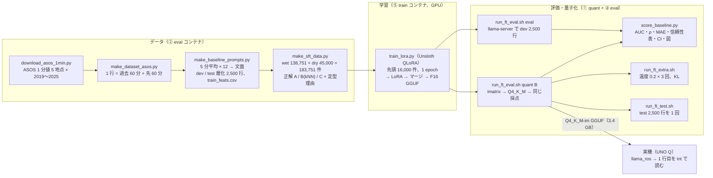

# FT_devicefmt_knn_gguf — 実機形式の文面・期待値ラベル・GGUF 評価で行う Gemma 4 E2B の LoRA FineTune

このフォルダは、main の FineTune（`src/`・`util/`・`docs/train_guide.md`。以下「main の FT」）とは**別系統で開発した FineTune 一式**を、main に手を入れずに丸ごと置いたものです。
フォルダ名は main の FT との 3 つの違いを表します。

| 名前の部分 | 意味 | main の FT との違い |
|---|---|---|
| `devicefmt` | 実機（[bme280_ros_with_uno_q](https://github.com/gomi-kuzu/bme280_ros_with_uno_q)）が組み立てる**生の文面**をそのまま入力し、**回答の 1 行目に整数**を返す | main はチャット形式で JSON を入出力する |
| `knn` | 正解を「似た状況 200 件の risk2 の平均」（**期待値ラベル**）にする | main は risk2 の値そのもの |
| `gguf` | 実機に載せる **GGUF（Q4_K_M + imatrix）を llama-server で採点**する | main は 4 ビット（nf4）の HF モデル + LoRA で採点 |

- 作成者: hide0625（元の作業場所: `work_261007_Gemma4/`。2026-10-15〜10-17 に実施、2026-11-15 にこのフォルダへ写した）
- 実行環境: Docker（5 コンテナ）。ホストに llama.cpp や Python を入れない。学習は AWS の T4（16 GB）で行った
- 位置づけ: 両実装の比較と、main へ取り込む候補の整理は `docs/004_FineTune比較_マージ検討_revB.md`（以下 004）と `docs/006_実装I_main更新内容.md` にある。004 では main 側を「実装I」、このフォルダ側を「実装H」と呼んでいる

> **要点**: 期待値ラベル（B）で学習した LoRA は、dev 2,500 行で AUC 0.87・順位相関 0.63・出力 23 種類。Q4_K_M（imatrix）に量子化しても AUC 0.87 を保ち、test（2024 年）でも 0.86 だった。risk2 そのものを正解にした A・C は出力が「0 か 3」の 2 値に崩れた（§6）。

## 目次

1. [main の FT との違い](#1-main-の-ft-との違い)
2. [全体の流れ](#2-全体の流れ)
3. [フォルダ構成](#3-フォルダ構成)
4. [実行環境（Docker）](#4-実行環境docker)
5. [再現手順](#5-再現手順)
6. [結果](#6-結果)
7. [含めていないもの（大きなファイル）](#7-含めていないもの大きなファイル)
8. [このフォルダへ写すときに手を加えた箇所](#8-このフォルダへ写すときに手を加えた箇所)
9. [実装の出どころ](#9-実装の出どころ)
10. [関連文書（docs/）](#10-関連文書docs)
11. [ライセンス・注意](#11-ライセンス注意)
12. [用語集](#12-用語集)

## 1. main の FT との違い

**表 1-1: main の FT とこのフォルダの比較**（詳細は 004 の §3〜§4）

| 項目 | main の FT（`src/`・`util/`） | このフォルダ |
|---|---|---|
| 元データの取得・整形 | `util/download_asos_1min.py`・`util/make_dataset_asos.py` | **同じファイル**（バイト単位で同一。`eval/scripts/` に写しを置く） |
| 実機との入出力 | チャット形式。user は列指向 JSON、回答は `{"weather_risk", "reason"}` の JSON | 実機の `build_prompt()` と同じ生文面（P2' = 要約 + 手がかり 1 文）。回答は `<整数>\n<定型の理由 1 文>`。実機の `weather_risk_setter`（1 行目を int で読む）がそのまま読める |
| 入力の 12 個 | 1 分値を 5 分おきに拾った瞬間値 | **5 分平均 × 12**（実機の BucketAccumulator と同じ作り方） |
| 学習データの選び方 | 急変の種類ごとに比率を決めて 3,000 / 750 / 750 件 | train 分割（2019〜2022 年、543,157 行）から雨あり全部 + 雨なし 45,000 行 = 183,751 件を作り、**先頭 16,000 件**で学習（float32 の速度のため） |
| 正解（教師信号） | risk2（先 60 分の雨量 mm × 10、上限 100）そのもの | **B: 似た状況 200 件の risk2 の平均**（kNN、同地点 ±6 時間を除外）。A/C（risk2 そのもの）は対照 |
| 理由文 | 気圧の上下動を主指標にした短い文 | 湿度 × 気圧の 60 分変化から機械的に選ぶ 6 パターンの定型文（LLM は書かない） |
| 学習 | transformers 5.22 + PEFT + TRL、QLoRA、bf16、3 epoch、conda | **Unsloth 2026.10.5** 経由で PEFT + TRL、QLoRA（r=16、α=16、attention + MLP）、float32（T4 は bf16 不可）、1 epoch、Docker |
| 学習後 | `merge_lora.py` → `convert_hf_to_gguf.py` → q4_0 | `train_lora.py` の中でマージ → F16 GGUF（llama.cpp **v0.6.0** 固定）→ `llama-quantize` で Q4_K_M（imatrix 無し / 有り） |
| 評価 | `util/eval_llm.py`（HF nf4 + LoRA）、MAE・F1 | GGUF を llama-server に載せ、dev 層化 2,500 行で **AUC・順位相関・出力の種類数・信頼性表・ブートストラップ CI**。test は最良 1 本に 1 回だけ |
| 実機所要の見積り | 入力 636 トークン + 出力 111〜160 トークン → 約 3 分（004 §4-6） | 入力 231 トークン + 出力 24 トークン → **約 59 秒** |

**表 1-2: このフォルダの 3 本の学習条件**

| run | 文面 | 正解 | 役割 |
|---|---|---|---|
| A | P2'（要約 + 手がかり） | risk2 そのもの | 主案（提案書 016） |
| **B** | P2' | **期待値ラベル（kNN 200 件の平均）** | A の「出力が最頻値に寄る」懸念への保険 → **採用** |
| C | P0（現行の 36 値列挙） | risk2 そのもの | 文面の差が FineTune 後も残るかの対照 |

## 2. 全体の流れ



fig 1: このフォルダの処理の流れ。左のデータ作成は main と同じ 2 本から始まり、文面と正解の作り方で分かれる。評価は実機に載せる GGUF そのものを採点する。

## 3. フォルダ構成

| パス | 中身 | 実行する場所 |
|---|---|---|
| `env/docker/` | Docker 5 コンテナの定義（`compose.yaml`・`Dockerfile.*`・`requirements-*.txt`・`run.sh`・`smoke.sh`）。`README.md` に役割と固定した版 | ホスト（`docker compose` のみ） |
| `models/` | モデルの取得スクリプト（`download.sh`・`SHA256SUMS.txt`）と、学習済み B の `train_log.json`・`adapter_config.json`。本体は git に入れない（`models/README.md`） | — |
| `eval/scripts/download_asos_1min.py`・`make_dataset_asos.py` | 元データの取得・整形（main の `util/` と同一） | ② eval |
| `eval/scripts/baseline_prompt.py` | 実機の `build_prompt()` の写し（P0）と、文面の候補 P1〜P3・q1〜q3。P2' が `build_prompt_p2h()` | （import される） |
| `eval/scripts/make_baseline_prompts.py` | 5 分平均 × 12 の作成、dev / test の層化 2,500 行、`train_feats.csv`（参照モデルと SFT の元） | ② eval |
| `eval/scripts/make_sft_data.py` | 学習データ `sft_A/B/C.jsonl`（正解 B は kNN の期待値、理由は定型 6 パターン） | ② eval |
| `eval/scripts/train_lora.py` | Unsloth で QLoRA → LoRA 保存 → マージ → F16 GGUF | ⑤ train |
| `eval/scripts/run_ft_queue.sh` | A / B / C を順に学習（ホストから `docker compose exec`） | ホスト |
| `eval/scripts/serve_gguf.sh` | ① で任意の GGUF の llama-server を起動 / 停止 | ホスト |
| `eval/scripts/run_ft_eval.sh` | `eval`: F16 GGUF を採点 / `quant`: imatrix → Q4_K_M 2 種 → 採点 | ホスト |
| `eval/scripts/run_ft_extra.sh` | 温度 0.2 × 3 回（500 行）と F16 に対する KL | ホスト |
| `eval/scripts/run_ft_test.sh` | test（2024 年）で 1 回だけ採点 | ホスト |
| `eval/scripts/run_baseline.py` | 文面を llama-server に流し、1 行目の整数・トークン数・所要を記録（FineTune 前から使う採点クライアント） | ② eval |
| `eval/scripts/score_baseline.py` | AUC・順位相関・MAE・信頼性表・層別・ブートストラップ CI・参照モデル（ロジスティック回帰・勾配ブースティング）・図 | ② eval |
| `eval/scripts/run_baseline_sweep.sh` | FineTune 前の元モデル（BF16 / UD-Q4_K_XL）の採点（表 6-1 の上 2 行） | ホスト |
| `eval/vendor/bme280_ros_with_uno_q/` | 実機 repository の `prompt_maker_for_bme280.py` の無改変の写し（commit `89b247a`、Apache-2.0）。文面の一致検査に使う | — |
| `eval/data/` | 小さな要約だけ（層化の内訳 `strata*.json`・`sft_summary.json`・`dataset_summary.csv`）。本体は §7 | — |
| `eval/results/baseline/out_017/`・`out_017_test/` | dev / test の採点結果（`summary.csv`・`predictions_all.csv`・`reliability.csv`・`slices.csv`・`error_samples.csv`） | — |
| `bench/predict.py` | GGUF のテンソル表から実機の decode 速度と 1 判定の所要秒を見積もる | ① or ② |
| `docs/` | 提案書・報告・コード解説・main との比較（§10） | — |
| `logs/` | 各シェルがログを書く場所（中身は git に入れない） | — |

## 4. 実行環境（Docker）

ホストで動かすのは `docker compose`（`env/docker/run.sh` 経由）だけです。詳細は `env/docker/README.md`。

**表 4-1: 5 つのコンテナ**

| 番号 | サービス | イメージ | 役割 | 入口 |
|---|---|---|---|---|
| ① | `quant` | nvidia/cuda 12.8.1 + llama.cpp v0.6.0（CUDA、sm_75） | 参照推論・imatrix・量子化・KL・llama-server | `127.0.0.1:8081` |
| ② | `eval` | python 3.12 + pandas 2.3.3 / scikit-learn 1.7.2 / matplotlib | データ作成・文面生成・採点 | — |
| ②' | `eval-lmeval` | ② + torch（CPU）+ lm-eval | 補助ベンチ（任意、`--profile lmeval`） | — |
| ③ | `arm64` | debian bookworm aarch64 + llama.cpp v0.6.0（armv8-a、Cortex-A53 向け） | 実機と同一バイナリの疎通・RSS 計測（QEMU）。実機にもこのイメージを配布 | `127.0.0.1:8083` |
| ⑤ | `train` | nvidia/cuda 12.8.1 + torch 2.14.1 / transformers 5.17.0 / unsloth 2026.10.5 / trl 1.15.0 / peft 0.21.2 / bitsandbytes 0.50.2 + llama.cpp v0.6.0 の `convert_hf_to_gguf.py` | LoRA 学習・マージ・GGUF 変換 | — |

注意点:

- **GPU の世代**: `compose.yaml` の `CUDA_DOCKER_ARCH: "75"` は T4 向け。RTX 4060 Ti なら `"89"` に変える（①のビルド時間を短くするため 1 世代に絞っている）。
- **bf16 の有無**: `train_lora.py` は `torch.cuda.is_bf16_supported()` で bf16 / fp16 を自動で選ぶ。T4 では Unsloth が Gemma 4 の fp16 を拒否したため float32 で学習した（1 秒 2〜3 件）。bf16 が使える GPU では速くなる見込みだが、未確認。
- **Unsloth と transformers の版**: unsloth 2026.10.5 の上限が transformers 5.17.0。main の学習環境（transformers 5.22.1）とは同居できないので、このフォルダは別コンテナで動かす（004 §4-6）。
- **プロキシ・CA**: `compose.yaml` はホストの `HTTP_PROXY` 等をビルド時と ② に渡し、`/etc/ssl/certs/ca-certificates.crt` をマウントする（TLS を中継するプロキシ下で取得できるようにするため）。プロキシが無い環境ではそのままで動く。
- **ファイルの所有者**: 成果物が root 所有にならないよう `env/docker/.env` の `DOCKER_UID` / `DOCKER_GID` でホストのユーザーとして実行する（§5 の手順 0）。

## 5. 再現手順

すべてこのフォルダ（`FT_devicefmt_knn_gguf/`）をカレントにして実行します。所要の目安は T4 での実績です。

```bash
# 0. 準備: 自分の UID/GID を .env に書く
cp env/docker/.env.example env/docker/.env
sed -i "s/^DOCKER_UID=.*/DOCKER_UID=$(id -u)/; s/^DOCKER_GID=.*/DOCKER_GID=$(id -g)/" env/docker/.env

# 1. モデルの取得（GGUF 約 13 GB、HF 重み 10.2 GB。models/README.md 参照）
bash models/download.sh
pip install -U huggingface_hub && hf download unsloth/gemma-4-E2B-it --local-dir models/hf/gemma-4-E2B-it

# 2. イメージの構築と起動（① は CUDA ビルドで 20〜40 分）
bash env/docker/run.sh build            # quant / eval / arm64
bash env/docker/run.sh build train      # 学習用
bash env/docker/run.sh up               # binfmt 確認 → ①②③ をアイドル起動
docker compose -f env/docker/compose.yaml up -d train
bash env/docker/run.sh smoke            # GPU・arm64・Python・GGUF 読み込みの疎通
```

```bash
# 3. データ作成（② eval コンテナ内。E は以後の省略形）
E="docker compose -f env/docker/compose.yaml exec -T eval"
$E python3 -I eval/scripts/download_asos_1min.py          # 5 地点 × 2019〜2025 → eval/data/raw/asos_1min/（数十分）
$E python3 -I eval/scripts/make_dataset_asos.py           # → eval/data/dataset_asos/dataset_<地点>.csv（計 1.4 GB）
$E python3 -I eval/scripts/make_baseline_prompts.py                        # dev 層化 2,500 行（P0 文面）+ train_feats.csv + strata.json
$E python3 -I eval/scripts/make_baseline_prompts.py --style p2h            # 同じ 2,500 行の P2' 文面
$E python3 -I eval/scripts/make_baseline_prompts.py --split test           # test 層化 2,500 行（最終確認用）
$E python3 -I eval/scripts/make_baseline_prompts.py --split test --style p2h
$E python3 -I eval/scripts/make_sft_data.py               # → eval/data/sft/sft_{A,B,C}.jsonl（183,751 件、計 500 MB）、sft_summary.json

# 4.（任意）FineTune 前の元モデルの採点（表 6-1 の上 2 行）
bash eval/scripts/run_baseline_sweep.sh "BF16 UD-Q4_K_XL" "raw:0:0:p2h"
```

```bash
# 5. 学習（⑤ train。T4 float32 で 1 本 80〜130 分。ログは logs/train_<run>_<日付>.log）
nohup bash eval/scripts/run_ft_queue.sh "A B C" 16000 300 > logs/ft_queue.log 2>&1 &
#    → models/ft/<run>/{lora, merged, gemma-4-E2B-wr-<run>-F16.gguf, train_log.json}

# 6. 評価（① llama-server に GGUF を載せ、② から dev 2,500 行を流す。1 本 約 6 分）
bash eval/scripts/run_ft_eval.sh eval "A B C"             # F16 GGUF の採点（C は P0 文面、A/B は P2'）
bash eval/scripts/run_ft_eval.sh quant B                  # imatrix（train 側 2,000 件）→ Q4_K_M 2 種 → 同じ採点
$E python3 -I eval/scripts/score_baseline.py --cond-filter 'FT-|p2h' \
     --summary-dir eval/results/baseline/out_017 --figdir eval/results/figs
#    → summary.csv / predictions_all.csv / reliability.csv / slices.csv / error_samples.csv と図 fig1〜fig7

# 7. 追加確認と test（test は最良 1 本に 1 回だけ。実験台帳に記録すること）
bash eval/scripts/run_ft_extra.sh B                       # 温度 0.2 × 3 回（500 行）、F16 に対する KL
bash eval/scripts/run_ft_test.sh B Q4_K_M-im              # test 2,500 行 → eval/results/baseline/out_017_test/
```

- `score_baseline.py` は日本語フォント `eval/data/raw/fonts/NotoSansJP-Regular.ttf` があれば図の日本語を正しく出す（無ければ豆腐になるだけで動く）。[Google Fonts の Noto Sans JP](https://fonts.google.com/noto/specimen/Noto+Sans+JP) から置く。
- 乱数は固定（層化・SFT の seed 20261015、学習 seed 0、ブートストラップ 1,000 回）。同じ入力なら同じ結果になる。
- 実機へ配る GGUF は `models/ft/B/gemma-4-E2B-wr-B-Q4_K_M-im.gguf`（3.4 GB）。③ のイメージと一緒に `docker save` で渡す手順は `env/docker/README.md`。

## 6. 結果

**表 6-1: dev 層化 2,500 行（2023 年、母集団の重み付き）での採点**。AUC は「先 60 分に雨が降るか」の 2 値に対する値（95% 信頼区間はブートストラップ 1,000 回）。ρ は risk2 との順位相関、MAE は risk2 との平均絶対誤差。「出力の種類」は 2,500 行で出た整数の種類数（少ないほど尺度が使えていない）。出典: `docs/023_FineTune_報告_revC.md` §1、`eval/results/baseline/out_017/summary.csv`

| 条件（生文面、温度 0） | AUC [95% CI] | ρ | MAE | 出力の種類 | 理由文の形式一致 |
|---|---:|---:|---:|---:|---:|
| P2' 元モデル BF16 | 0.601 [0.587, 0.616] | 0.313 | 29.9 | 4 | — |
| P2' 元モデル UD-Q4_K_XL | 0.507 | 0.075 | 29.5 | 3 | — |
| FT-A（risk2 そのもの、P2'） | 0.790 [0.771, 0.807] | 0.539 | 1.76 | **2（0 / 3）** | 99.96% |
| **FT-B（期待値ラベル、P2'）F16** | **0.871 [0.853, 0.887]** | **0.629** | 2.28 | 23 | 99.4% |
| **FT-B Q4_K_M + imatrix（実機候補）** | **0.866 [0.848, 0.883]** | **0.629** | 2.48 | 21 | 99.4% |
| FT-B Q4_K_M（imatrix 無し） | 0.863 [0.845, 0.880] | 0.618 | 2.46 | 21 | — |
| FT-C（risk2 そのもの、P0） | 0.731 [0.711, 0.748] | 0.509 | 2.23 | 2（0 / 3） | 98.5% |
| 参照: 勾配ブースティング回帰 | 0.899 [0.883, 0.913] | 0.658 | 1.58 | 連続値 | — |

- 元モデルの MAE が 30 前後なのは、出力が 30/40 の 2 値に張り付き、真値の大半が 0 のため。
- **test（2024 年、1 回だけ）**: FT-B Q4_K_M + imatrix は AUC 0.863 [0.846, 0.879]・ρ 0.60。dev とほぼ同じで、dev で選んだ値が甘かった兆候は無い。同じ test で勾配ブースティングは 0.888・0.61（`eval/results/baseline/out_017_test/summary.csv`）。
- 温度 0.2 × 3 回（500 行）の AUC の run 間 SD は 0.004。出力は約 24 トークンで上限到達 0%。理由文は述べている湿度の値と気圧の向き・量が入力と 100% 一致。
- 出力の上限は 30 程度で尺度の低い側しか使わない（期待値ラベルの性質）。信頼性表では出力 20 台の行の 88% が実際に降る。LED などに出すときは校正表で読み替える（023 §6）。
- 既知の課題: 学習件数を 18 万 → 1.6 万に縮小しているため、全件で学習したときの伸びは未検証。理由文は定型なので「気圧の上下動」（main が主指標にしているもの。004 §4-5 でこちらのデータでも荒天 AUC 0.80 と有効だった）を手がかりに入れていない。

## 7. 含めていないもの（大きなファイル）

git に入れたのはコード・設定・小さな要約（合計 約 3 MB）だけです。次のものは §5 の手順で再生成するか、別経路で受け渡します。

| 置き場 | 中身 | 大きさ | 再生成 |
|---|---|---:|---|
| `models/*.gguf` | 元モデルの GGUF 4 本 | 約 13 GB | `bash models/download.sh` |
| `models/hf/gemma-4-E2B-it/` | 学習用の HF 重み | 10.2 GB | `hf download`（§5 手順 1） |
| `models/ft/{A,B,C}/` | LoRA（97 MB）・マージ（10.2 GB）・F16 GGUF（9.3 GB）・Q4_K_M 2 種（各 3.4 GB）・imatrix | 約 30 GB / run | §5 手順 5〜6 |
| `eval/data/raw/asos_1min/` | ASOS 1 分値の生 CSV | 1.8 GB | §5 手順 3 |
| `eval/data/dataset_asos/dataset_*.csv` | 整形済み CSV（5 地点） | 1.4 GB | 同上 |
| `eval/data/baseline/*.csv`・`*.jsonl` | `train_feats.csv`（212 MB）・dev / test の層化サンプルと文面 | 236 MB | 同上 |
| `eval/data/sft/sft_*.jsonl` | 学習データ 3 本 | 494 MB | 同上 |
| `eval/results/baseline/*.jsonl` | 採点の生出力（1 行 1 サンプル。`predictions_all.csv` に要約済み） | 1.9 MB / 条件 | §5 手順 4・6 |
| `eval/results/kl/` | 量子化形式ごとの KL 計測（FineTune 前の調査） | 15 GB | 対象外 |
| 元の作業場所にあった評価の周辺スクリプト（文面探索 q1〜q3 の集計、量子化形式の横断比較、2 段推論のパイロット） | FineTune の再現に不要 | — | 対象外（必要なら別途） |

## 8. このフォルダへ写すときに手を加えた箇所

元の作業場所（2026-11-15 時点）からの変更は次の 3 点だけで、それ以外は**バイト単位で同一**です（`cmp` で確認済み）。

| ファイル | 変更 | 理由 |
|---|---|---|
| `eval/scripts/score_baseline.py` | `--figdir` の既定値を `report/.../013_baseline/figs` → `eval/results/figs` に（docstring の 1 行も同様） | 元の作業場所のレポート用フォルダがここには無いため |
| `eval/scripts/run_ft_test.sh` | `--figdir report/.../017_finetune/figs_test` → `eval/results/figs_test` | 同上 |
| `env/docker/.env` → `.env.example` | 作業者固有の UID/GID を既定値 1000 に置き換え、`.env` は git に入れない | 各自の ID で上書きして使う |

加えて、このフォルダ専用の `.gitignore`・`README.md`（本書）・`models/README.md`・`logs/.gitkeep` を新しく置きました。

## 9. 実装の出どころ

**表 9-1: 元にしたもの（書き換えていない）**

| 種類 | 名前・版 | 使い方 |
|---|---|---|
| ベースモデル（学習） | Hugging Face `unsloth/gemma-4-E2B-it`（safetensors、BF16、10.2 GB、重み 51.2 億個） | ⑤ で 4 ビットに圧縮して読み込み、重みは凍結 |
| ベースモデル（GGUF） | `unsloth/gemma-4-E2B-it-GGUF`（BF16・UD-Q4_K_XL・imatrix・MTP） | FineTune 前の採点と量子化の元 |
| 学習ライブラリ | Unsloth 2026.10.5（中で PEFT 0.21.2 と TRL 1.15.0 を呼ぶ）、transformers 5.17.0、torch 2.14.1、bitsandbytes 0.50.2 | `train_lora.py` から標準機能を呼ぶだけ |
| 推論・量子化 | llama.cpp v0.6.0（`convert_hf_to_gguf.py`・`llama-quantize`・`llama-imatrix`・`llama-perplexity`・`llama-server`） | ①③⑤ で同じタグに固定 |
| 実機アプリ | `gomi-kuzu/bme280_ros_with_uno_q` commit `89b247a` の `prompt_maker_for_bme280.py` | `eval/vendor/` に無改変で写し、文面の一致検査に使う |
| 元データ | Iowa State University IEM が再配布する ASOS 1 分値（5 地点 × 2019〜2025） | main と同じ取得・整形スクリプト |

**表 9-2: 自作したファイルと行数**（FineTune のために新しく書いた 9 本。全文と解説は `docs/029_FineTune追加コード解説.md`）

| 区分 | ファイル | 行数 | 中で使っている主な機能 |
|---|---|---:|---|
| 学習用コンテナ | `env/docker/Dockerfile.train` | 22 | nvidia/cuda devel + venv + llama.cpp の gguf-py |
| 学習用コンテナ | `env/docker/requirements-train.txt` | 16 | 版の固定 |
| 学習用コンテナ | `env/docker/compose.yaml` の `train` | 20 | GPU 割り当て・`shm_size`・ボリューム |
| 学習データ | `eval/scripts/make_sft_data.py` | 79 | `sklearn.neighbors.NearestNeighbors`（kNN）、`StandardScaler`、定型理由 `reason()` |
| 学習 | `eval/scripts/train_lora.py` | 84 | `FastLanguageModel.from_pretrained(load_in_4bit)`・`get_peft_model(r=16, α=16, 7 箇所)`、`SFTTrainer`（`completion_only_loss=True`）、`save_pretrained_merged`、`convert_hf_to_gguf.py` |
| 実行 | `eval/scripts/run_ft_queue.sh` | 16 | `docker compose exec train` |
| 評価 | `eval/scripts/run_ft_eval.sh` | 44 | `llama-imatrix`・`llama-quantize`・`run_baseline.py` |
| 評価 | `eval/scripts/serve_gguf.sh` | 24 | `llama-server`（`/health`・`/props` でモデル一致を確認） |
| 評価 | `eval/scripts/run_ft_extra.sh` | 20 | `llama-perplexity --kl-divergence` |
| 評価 | `eval/scripts/run_ft_test.sh` | 14 | `score_baseline.py --sample test` |

FineTune 前から使っている自作ファイル（文面作成・採点）は `baseline_prompt.py`・`make_baseline_prompts.py`・`run_baseline.py`・`score_baseline.py`・`run_baseline_sweep.sh`、環境は `env/docker/` の残り（提案書 `docs/016_FineTune_提案.md` の §7 と 004 の表 0-1 に経緯）。

## 10. 関連文書（docs/）

| ファイル | 内容 |
|---|---|
| `docs/016_FineTune_提案.md` | 計画（仮説・学習データ・手法・合格条件・リスク）。この計画を既定値で実施した |
| `docs/023_FineTune_報告_revC.md` | 結果の報告。LoRA をどこに入れたか（35 層 × 7 箇所の地図）、学習データ 1 件の形、学習曲線、量子化、信頼性表、層別、理由文の検査、test の結果。図は `docs/017_finetune/`・`022_finetune/`・`023_finetune/` |
| `docs/029_FineTune追加コード解説.md` | 自作 9 ファイルの全文と構造の解説（Python は読めるが FineTune に詳しくない人向け） |
| `docs/004_FineTune比較_マージ検討_revB.md` | main の FT（実装I）とこのフォルダ（実装H）の機能比較。入出力・学習データ・正解・量子化と評価の違い、main へ入れる候補 3 本（実機形式の文面 / 期待値ラベル / GGUF 評価）。`docs/check/` は比較で使った小スクリプト（気圧の上下動の AUC、トークン数） |
| `docs/006_実装I_main更新内容.md` | main の `9c6dcf3` → `a24220e` の差分の整理（train_guide の更新のみ）と、mode collapse への対応案 |

文書中の `report/...` というパスは元の作業場所のもので、このフォルダでは `docs/` に対応します。`eval/results/baseline/out_017/` などはこのフォルダにそのまま入っています。

## 11. ライセンス・注意

- このフォルダのコードは repository と同じ Apache License 2.0。
- `eval/vendor/bme280_ros_with_uno_q/` は同じ作者の Apache-2.0 のコードの写し（LICENSE 同梱）。
- 元の観測データ（ASOS 1 分値）と Gemma 4 の重みは含めない。各自の取得・利用条件に従うこと（Gemma は Hugging Face で利用条件への同意が要る）。
- test（2024 年）は最良 1 本に 1 回だけ使った。条件を変えて test を繰り返さないこと。

## 12. 用語集

| 用語 | 平易な説明 |
|---|---|
| risk2 | 正解の整数。判定時刻から先 60 分の合計雨量 mm × 10（上限 100）。main と同じ定義 |
| 期待値ラベル（kNN） | 正解を「要約量 8 個が似ている 200 件の risk2 の平均」に置き換えたもの。同じ入力に対して正解がばらつく問題で、最頻値（0）に寄らない学習をさせる |
| P2' / P0 | 文面の種類。P0 は実機の現行文面（36 値の列挙）、P2' は 60 分の要約 + 手がかり 1 文（入力 231 トークン） |
| 層化 2,500 行 | risk2 を 5 段に分け、段ごとに決めた行数を無作為に抜いた評価用のサンプル。重みを付けて元の分布（母集団）に戻して集計する |
| LoRA / QLoRA | 元の重みは凍結し、横に付けた小さな行列だけを学習する方法。QLoRA は凍結した重みを 4 ビットに圧縮してメモリを節約する |
| Unsloth | LoRA 学習を速く・省メモリにするライブラリ。中で PEFT と TRL を呼ぶ |
| マージ | 学習した小さな行列を元の重みに足し込み、元と同じ形の 1 つのモデルに戻すこと |
| GGUF | llama.cpp が読むモデルの形式。実機（llama_ros）はこれを読む |
| Q4_K_M / imatrix | 重みを約 4.5 ビットに丸める量子化の形式。imatrix は「どの重みが大事か」を校正文で測って丸め方を調整する表 |
| AUC | 「雨が降る行」に「降らない行」より高い値を付けられた割合。0.5 が当てずっぽう、1.0 が完全 |
| ρ（順位相関） | 出力の順位と risk2 の順位がどれだけ揃うか（スピアマン） |
| 信頼性表 | 出力の値ごとに「実際に降った割合」を並べた表。出力を確率として読み替える（校正）のに使う |
| llama-server | llama.cpp の推論サーバー。① で起動し、② から HTTP で文面を送って答えを受け取る |
| mode collapse | 出力が少数の値（0 / 10 / 100 など）に偏ること。main の train_guide が次の課題に挙げている現象で、このフォルダの A・C でも起きた |
