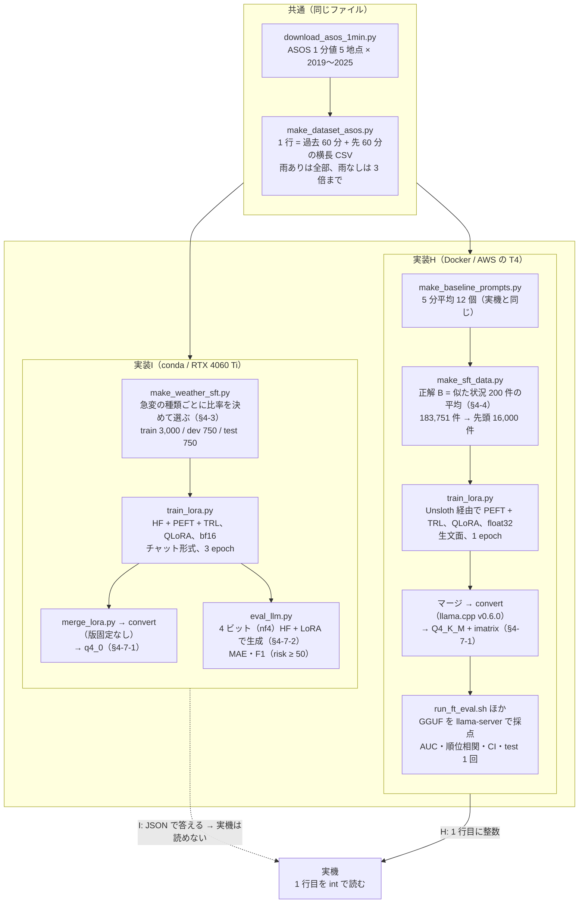
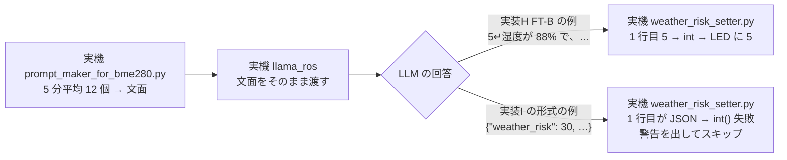
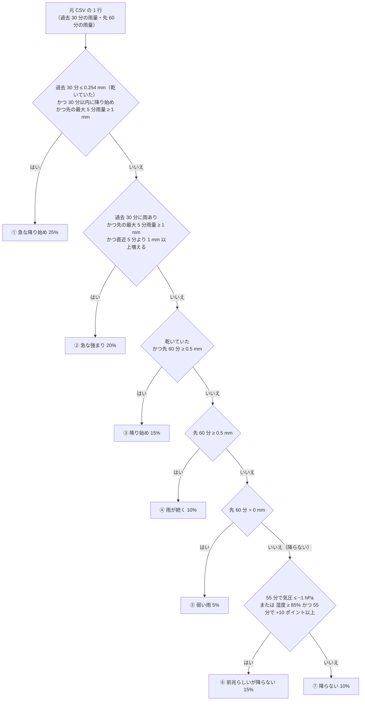
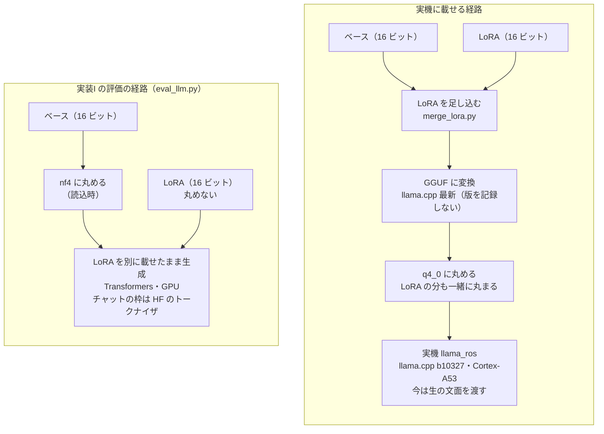
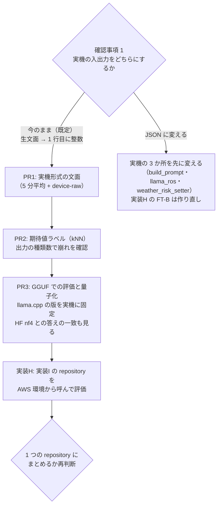

# 実装I（WeatherAI_FineTune）と実装H の FineTune の比較 — 機能の違いと、マージするか別 repository にするかの検討（revB）

## 0. この文書について

- 作成日: 2026-11-05（指示: `001_instruction.md`、レビュー: `003_review.md`）
- 読者: 開発チーム（実装I・実装H の担当者）。LoRA の FineTune を一度は動かしたことがある人を想定。
- 呼び方: この文書では、2 つの実装を次のように呼ぶ。

**表 0-1: この文書での呼び方と、比較の対象**

| 項目 | 実装I | 実装H |
|---|---|---|
| 中身 | [gomi-kuzu/WeatherAI_FineTune](https://github.com/gomi-kuzu/WeatherAI_FineTune) commit `9c6dcf3`（2026-11-03 22:11） | `work_261007_Gemma4/`（2026-10-26 時点。git 管理していない） |
| 状態 | 学習まで動いた（commit「学習まわせた」）。評価結果は repository に無い | FT-B を学習・量子化・dev と test で評価済み（`023_FineTune_報告_revC.md`） |
| 実機 | 同じ Arduino UNO Q 上の [bme280_ros_with_uno_q](https://github.com/gomi-kuzu/bme280_ros_with_uno_q)（2026-09-20 の `89b247a` から変化なし。11-05 に確認） | 同じ |

- やったこと: 実装I の repository を全部読み（13 ファイル・2,368 行）、実装H の FineTune のコード（`029_FineTune追加コード解説.md` で解説した 9 ファイル）と機能ごとに比べた。主張の 1 つ（気圧の上下動が効く）は、実装H のデータで数字を出して確かめた（§4-5）。**実装I のスクリプトは実行していない**（読んだだけ）。

**表 0-2: revB での変更点（`003_review.md` への対応）**

| # | 指摘 | 対応 |
|---|---|---|
| 1 | 全体像の図だけ左右が逆 | fig1 を「左 = 実装I、右 = 実装H」に直し、表と同じ並びにした（§2） |
| 2 | 実装H も PEFT を使っているのでは | その通り。Unsloth が中で PEFT を呼んでいる（`FastLanguageModel.get_peft_model`、PEFT 0.21.2）。fig1・§1・§4-6 を「Unsloth 経由で PEFT + TRL」に直した |
| 3 | 「急変を重視して選ぶ」の意味 | §4-3 を新設して、7 つの種類の定義・目標の比率・選ぶ手順・実際の件数を書き、fig1 に章番号を入れた |
| 4 | 呼び方 | 「実装I」「実装H」に統一した |
| 5 | q4_0 / Q4_K_M / imatrix の解説 | §4-7-1 を新設（表と、数値で 1 ブロックを丸める例） |
| 6 | 「それでも」の使い方 | 不適切だったので書き直した（§4-6）。前の文との間に逆接の関係が無かった |
| 7 | 4 ビット HF モデルで評価していることの影響 | §4-7-2 を新設（評価の経路と実機の経路の図、6 つの影響と確かめ方） |

**この文書で置いた前提（既定値。違っていたら §5 の結論が変わる）**

- 実機の入出力は**今の形式のまま**とする: 実機が組み立てた文面を LLM に渡し、LLM の回答の **1 行目を整数として読む**（`weather_risk_setter.py` 50〜60 行目）。これを変えるかどうかは、実機の repository の持ち主（実装I の担当者）とチームで決めること（§5-4 の確認事項 1）。
- 「マージ」は、実装H の FineTune の機能を実装I の repository に入れることを指す。その逆（実装I のコードを実装H に入れる）は §5-3 に分けて書いた。

## 1. 結論

**結論: 丸ごとのマージは勧めない。repository は別のまま残し、実装H の FineTune のうち実機で使う部分（実機形式の文面・期待値ラベル・GGUF での評価と量子化）を、小さな PR 3 本で実装I の repository に入れるのがよい。1 つの repository にまとめるかどうかは、実機の入出力形式をチームで決めたあとに判断し直す。**

- **共通している部分**: 元データの取得・整形スクリプト 2 本（`download_asos_1min.py`・`make_dataset_asos.py`）は、実装I と実装H で**バイト単位で同じ**。地点（5 地点）・年での分け方・危険度の定義（先 60 分の雨量 mm × 10、上限 100）も同じ。
- **一番大きな違いは実機との入出力**。実装I のモデルは **JSON で答える**ように学習するので、今の実機では 1 行目を整数に変換できず、**回答が捨てられる**（§4-1）。入力も、実機の「5 分平均 12 個」ではなく、「1 分値を 5 分おきに拾った値」で学習している（§4-2）。
- そのほかの違い: 学習データの選び方（急変の種類で比率を決める / 雨ありを全部と雨なしを無作為、§4-3）、正解の作り方（risk2 そのもの / 似た状況 200 件の平均、§4-4）、文面の長さ（入力 636 トークン / 230 トークン → 実機の見積りで約 3 分 / 約 1 分）、学習ライブラリ（PEFT + TRL を直接 / Unsloth 経由で PEFT + TRL）、評価の対象（4 ビット HF モデル / 実機に載せる GGUF、§4-7）。
- **実装I の方が優れている点**もある。「この時間幅では、気圧が下がっていることより**気圧が細かく上下していること**の方が雨と結び付く」という主張は、実装H のデータでも成り立った（荒天の AUC 0.80 と 0.48）。実装H の文面・理由文は「気圧が下がっている」を手がかりにしているので、**実装H が見直すべき点**として取り込む（§4-5・§5-3）。
- **マージできないもの**: Unsloth を使う学習スクリプト。実装I の環境の transformers 5.22.1 と、Unsloth 2026.10.5 が対応する 5.17.0 までの範囲が重ならない。ただし実装I の（Unsloth を使わない）学習スクリプトで同じことができるので、移す必要はない（§5-2）。
- **実装I の評価の数字は、実機での当たり具合をそのまま表さない**。評価は 4 ビット（nf4）の HF モデルに LoRA を別に載せた形で、実機に載せる `q4_0` の GGUF とは丸め方・LoRA の扱い・変換の有無が違う。数字はどちら向きにもずれうるので、GGUF での評価を足す必要がある（§4-7-2）。

## 2. 全体像

fig1: 2 つのパイプラインの比較（左 = 実装I、右 = 実装H）。元データまでは同じファイルで、そこから先（学習データの作り方・学習・評価）が分かれている。実機に載せられる形式で出力するのは、今は実装H だけ（下の矢印は、それぞれの GGUF を実機に載せた場合）。

## 3. 機能の比較表

**表 3-1: 機能ごとの比較（太字は実機での動作や結果に効く違い）**

| 区分 | 実装I | 実装H | 同じ / 違う |
|---|---|---|---|
| 元データ | ASOS 1 分値、5 地点（DSM・IAH・SEA・ATL・BOS）、2019〜2025 年 | 同じ | **同じファイル** |
| 年での分け方 | train 2019〜2022 / dev 2023 / test 2024 / extra 2025 | 同じ | 同じ |
| 危険度（正解の元） | `min(round(先 60 分の雨量 mm × 10), 100)` | 同じ（`risk2_lin`） | 同じ |
| **入力の 12 個** | **1 分値を −60, −55, …, −5 分で拾った値**（瞬間値） | **5 分ごとの平均**（実機と同じ作り方） | 違う（§4-2） |
| 欠測の扱い | 12 点・過去 30 分の雨量・先 60 分の雨量のどれかが欠けたら除く | 過去 60 分のうち 48 分以上そろえば使う。先 60 分の欠測は 0 mm 扱い | 違う |
| 学習データの選び方 | 急変の種類（急な降り始め 25%・急な強まり 20% など 7 種）の比率で選ぶ。同じ地点・同じ年で 60 分以上離す | 雨ありを全部 + 雨なし 45,000 件を無作為 | 違う（§4-3） |
| 件数 | train 3,000（各地点 600）× 3 周 | 15,700 × 1 周 | 違う |
| **正解の整数** | **risk2 そのもの** | **似た状況 200 件の risk2 の平均**（期待値ラベル） | 違う（§4-4） |
| **入力の形式** | **チャット形式**: system の指示文 + user に JSON（T・RH・P・dP の配列） | **生の文面**（チャットの枠なし）: 要約 + 手がかり 1 文（P2'） | 違う（§4-1） |
| **出力の形式** | **JSON** `{"weather_risk": 整数, "reason": 文}` | **1 行目に整数、改行、理由** | 違う（§4-1） |
| 理由文 | 規則で作る 3〜4 文。**気圧の上下動を主**、湿度・気温は補助 | 規則で作る 1 文、6 通り。**湿度と気圧の向き** | 違う（§4-5） |
| ベースモデル | `google/gemma-4-E2B-it` | `unsloth/gemma-4-E2B-it`（Unsloth が再配布しているもの。重みが同じかは未確認） | ほぼ同じ |
| 学習ライブラリ | transformers 5.22.1・PEFT 0.21.2・TRL 1.17.1・bitsandbytes 0.50.2・torch 2.6.0（PEFT・TRL を直接呼ぶ） | **Unsloth 2026.10.5**・transformers 5.17.0・PEFT 0.21.2・TRL 1.15.0・bitsandbytes 0.50.2・torch 2.14.1（Unsloth が中で PEFT・TRL を呼ぶ） | 違う（§4-6） |
| LoRA | r 16・α 32・dropout 0.05、言語部分の 7 種の行列（正規表現で画像・音声側を除外） | r 16・α 16・dropout 0、7 種の行列 | 設定値が違う |
| 学習の設定 | lr 2e-4・cosine・warmup 50 ステップ、実質 16 件ごとに更新、最大 896 トークン、`paged_adamw_8bit`、**bf16** | lr 2e-4・cosine・warmup 3%、実質 16 件ごとに更新、最大 512 トークン、`adamw_8bit`、**float32**（T4 と Unsloth の制約） | ほぼ同じ |
| 回答部分だけで損失 | `completion_only_loss=True` | 同じ | 同じ |
| 学習中の検証 | dev（2023 年）750 件 | train 側から 300 件 | 違う |
| マージ・変換 | 別スクリプトで CPU 上にマージ → 別の venv で `convert_hf_to_gguf.py`（llama.cpp は**版を固定していない**） | 学習の最後にマージと変換まで実行。llama.cpp は **v0.6.0 に固定** | 違う |
| 4 ビット化 | `q4_0`（imatrix なし） | `Q4_K_M` + imatrix（学習に使っていない 2,000 件で校正） | 違う（§4-7-1） |
| **評価の対象** | **4 ビット（nf4）で読んだ HF モデル + LoRA**（実機に載せる GGUF ではない） | **実機に載せる GGUF**（F16 と Q4_K_M）を llama-server で | 違う（§4-7-2） |
| 評価の指標 | JSON の読み取り成功率・MAE・RMSE・荒天（risk ≥ 50）の適合率・再現率・F1 | AUC（先 60 分 ≥ 0.5 mm）・順位相関・MAE・出力の種類数・理由文の一致率、ブートストラップの信頼区間、温度 0.2 のばらつき、量子化前後の KL | 違う |
| 評価データ | test.jsonl 750 件（急変重点。自然な頻度ではない） | dev 層化 2,500 行（母集団の重みあり）。test 2024 年は 1 回だけ | 違う |
| 比較の基準 | 規則（気圧の上下動）の AUC 約 0.75 | ロジスティック回帰・勾配ブースティング（AUC 0.90） | 違う |
| 実行環境 | conda（学習）と venv（変換）を分ける。RTX 4060 Ti（8 GB / 12 GB 向けの設定あり） | Docker の 5 コンテナ（学習・量子化・評価・ARM 版・実機用）。AWS の T4 16 GB | 違う |
| テスト | `test_make_weather_sft.py`（未来の値が入力に混ざらないか等） | なし | 実装I のみ |
| 管理 | git（GitHub、Apache-2.0） | git 管理していない | 違う |

## 4. 違いの詳細

### 4-1. 実機との入出力（一番大きな違い）

fig2: 実機は回答の 1 行目を整数として読む（`weather_risk_setter.py` 50〜60 行目）。実装I の形式の回答は 1 行の JSON なので、変換に失敗して「スキップします」と警告が出るだけになる。

- 実機の `weather_risk_setter.py` は、回答を最初の改行で区切り、前半を `int(head)` で整数にする。変換できなければ警告を出して何もしない（50〜60 行目。2026-11-05 に最新を取得して確認）。
- 実装I の学習データの回答は `{"weather_risk": 整数, "reason": "…"}` の 1 行（`make_weather_sft.py` 152・161 行目）。
- 入力側も違う。実機の文面は「温度 [C]: 数値, 数値, …」を 3 行並べた生の文章（`prompt_maker_for_bme280.py` 190〜214 行目）。実装I の学習は、system の指示文と JSON をチャットの枠（`<|turn>…<turn|>`）で包んだもの。
- 実装H の FT-B も文面は P2'（要約 + 手がかり）に変えているので、実機の `build_prompt()` の差し替えは要る（前処理として変えてよいと 005 計画書 revC で合意済み）。ただし**出力の形式**（1 行目に整数）は実機のままにしてある。

実装I の形式を実機で使うには、実機側の 3 か所（`build_prompt()` を JSON に、llama_ros をチャット形式に、`weather_risk_setter.py` を JSON 読み取りに）を変える必要がある。どちらの形式にそろえるかは、§5-4 の確認事項 1。

### 4-2. 入力の 12 個の作り方

- 実装I: 1 分値のうち、−60, −55, …, −5 分の**その 1 分の値**を拾う（`make_weather_sft.py` 19・80〜81 行目）。直前の 4 分（−4〜−1 分）は使っていない。
- 実装H・実機: 5 分ごとの**平均**。実機は 5 分のバケツに入ったサンプルを平均して 1 個にする（`prompt_maker_for_bme280.py` `_close_bucket()`）。

平均すると細かい揺れがならされるので、同じ時間帯でも「5 分ごとの気圧差のばらつき」は瞬間値の方が大きく出る。実装I の判定帯（0.06 / 0.14 hPa）や理由文の言い回しは瞬間値の大きさで決めてあるので、**実機の 5 分平均にそのまま当てると、静穏側に寄る**と考えられる（大きさの差は未測定）。

### 4-3. 学習データの選び方（実装I の「急変を重視した選び方」）

「急変を重視して選ぶ」とは、**雨が急に降り始める・急に強まる場面を、自然に起きる割合よりずっと多く学習データに入れる**ことを指す。そのまま無作為に選ぶと、学習データのほとんどが「降らない」「弱い雨が続く」場面になり、モデルが急変を学ぶ機会がほとんど無いためである（`eval/data/WEATHER_SFT.md`「急変の操作的定義と採用目標」）。

手順は 2 段ある。① 元 CSV の各行を、先 60 分と過去 30 分の雨量から 7 つの種類のどれかに分ける。② 種類ごとに目標の比率まで選び、足りない分は他の種類で埋める。

fig3: 実装I が 1 行を 7 つの種類に分ける順序（`make_weather_sft.py` 103〜114 行目。上から順に、最初に当てはまった種類になる）。右の % は 1 地点・1 年区分あたりの目標の比率。

**表 4-1: 7 つの種類と、実際に選ばれた件数（train 3,000 件 = 5 地点 × 600 件）**

| 種類（コード上の名前） | 目標の比率 | 1 地点あたりの目標 | 実際の件数（train、5 地点の合計） | ねらい |
|---|---:|---:|---:|---|
| ① 急な降り始め（`sudden_onset`） | 25% | 150 | 666（目標 750） | 急変を学ばせる |
| ② 急な強まり（`rapid_intensification`） | 20% | 120 | 447（目標 600） | 同上 |
| ③ 降り始め（`rain_onset`） | 15% | 90 | 未記載 | 急でない降り始め |
| ④ 雨が続く（`ongoing_rain`） | 10% | 60 | 未記載 | |
| ⑤ 弱い雨（`light_rain`） | 5% | 30 | 未記載 | |
| ⑥ 前兆らしいが降らない（`sensor_alert_no_rain`） | 15% | 90 | 450 | 「気圧が下がった・湿度が上がった = 雨」と覚えさせないための空振り例 |
| ⑦ 降らない（`dry`） | 10% | 60 | 未記載 | |

実際の件数は `WEATHER_SFT.md`「今回の生成結果と実測傾向」に書かれた値（実装I のスクリプトは実行していないので、未記載の種類は数えていない）。① と ② は目標に届かず、足りない分は他の種類で埋められた（① + ② で 1,113 件 = 37.1%）。

**選ぶ手順の細部（`make_weather_sft.py` `select()` 192〜218 行目・`generate()` 251〜277 行目）**

- 地点ごと・年区分（train / dev / test / extra）ごとに選ぶ。各種類の候補は「サンプル ID と乱数の種から計算したハッシュ値」の大きい順に並べる。種が同じなら、何度作っても同じ行が選ばれる。
- 種類を ① → ⑦ の順に回り、各種類で「上限 × 比率」件まで取る（train なら 600 × 25% = 150 件）。
- **同じ地点・同じ年区分で、すでに選んだ行と 60 分未満しか離れていない行は取らない**。同じ雨雲の場面がほぼ重複して入るのを避けるためで、完全に独立にする処理ではない（`WEATHER_SFT.md`）。
- 目標に届かなかった種類の分は、最後に全種類の候補をハッシュ順に並べ直して、上限（600 件）まで埋める。そのため比率は厳密には固定されない。
- dev・test も同じ手順で選ぶので、**評価データも急変が多い「難しい問題集」**になっている。自然な頻度での当たり具合や、確率としての正しさ（較正）は、このデータでは測れない（`WEATHER_SFT.md` 自身もそう書いている）。

実装H は、雨ありの行を全部と、雨なしの行を 45,000 件無作為に選んだ（`make_sft_data.py`）。急変を分けて数えていないので、急変の当たり具合は今の評価では見えない（§5-3 で取り込みを提案）。

### 4-4. 正解の整数

**表 4-2: 正解の作り方の違いと、実装H で分かっていること**

| | 実装I | 実装H FT-A（参考） | 実装H FT-B（採用） |
|---|---|---|---|
| 正解の整数 | risk2 そのもの | risk2 そのもの | 似た状況 200 件の risk2 の平均 |
| 学習データ | 急変重点の 3,000 件（§4-3） | 雨あり全部 + 雨なし、15,700 件 | 同左 |
| 結果（実装H の dev 2,500 行） | 未評価 | **出力が 0 と 3 の 2 値に崩れた**（AUC 0.79） | 出力 23 種類、AUC 0.87 |

risk2 は雨量計の 1 刻み（0.254 mm）が risk 3 にあたり、正解の大半が 0 と 3 になる。FT-A はその最頻値の 0 か 3 だけを答えるようになり、AUC 0.79 は 0 と 3 が湿度で分かれているだけで出た値だった（`017` §5）。実装I のデータは急変を多く入れてあり正解の分布が違うので、同じことが起きるとは限らない。ただし**同じ定義の正解でこの崩れ方が一度起きている**ので、実装I の評価では「出力が何種類の値を取ったか」を見ておくとよい。

### 4-5. 判断の手がかり（気圧の向きか、上下動か）

実装I の repository は「気圧が下がったかどうかより、5 分ごとの気圧差のばらつき（上下動）の方が荒天と結び付く」と主張している（`WEATHER_SFT.md`、test で AUC 約 0.75）。実装H の P2' の手がかり文（「湿度が高く、気圧が下がっている時ほど雨が降りやすい」）と理由文（「気圧が 60 分で N hPa 下がっているため」）とは**逆の立場**なので、実装H の dev 層化 2,500 行で確かめた。

**表 4-3: 1 つの量だけで雨を当てたときの AUC（実装H の dev 層化 2,500 行。入力は 5 分平均 12 個）**

| 量 | event（先 60 分 ≥ 0.5 mm）| 同・母集団の重み | 荒天（risk2 ≥ 50 = 5 mm 以上） | 同・母集団の重み |
|---|---:|---:|---:|---:|
| 気圧の上下動（5 分差の標準偏差） | 0.736 | 0.723 | **0.795** | **0.890** |
| 気圧の 60 分の低下 | 0.558 | 0.568 | 0.478 | 0.513 |
| 今の湿度 | **0.802** | **0.850** | 0.673 | 0.843 |

AUC は「雨が降った行と降らなかった行を 1 組ずつ取ったとき、その量で正しく並ぶ割合」（0.5 は当てずっぽうと同じ）。2,500 行のうち event は 1,412 行、荒天は 322 行。母集団の重み（`w_pop`）は、層化で選んだ比率を元の比率に戻すためのもの。計算: `check/check_signals.py`（評価コンテナで実行）、結果: `check/signal_auc.csv`。

- 気圧の上下動は荒天に対して AUC 0.80（重み付きで 0.89）。気圧の 60 分の低下は 0.48〜0.51 で、**ほとんど当たらない**。実装I の主張は、5 分平均の入力でも成り立った。
- 一方、0.5 mm 以上の event については湿度の方が強い（0.80 と 0.74）。実装I の「湿度は補助」という扱いは、荒天（5 mm 以上）では当てはまるが、弱い雨まで含めると当てはまらない。

実装H の FT-B が AUC 0.87 を出せているのは、正解 B を作った kNN（似た状況を探す方法）の 8 つの要約量に湿度が入っているためで、理由文の「気圧が下がっているため」は当たりやすさとはほぼ関係していないと考えられる。上下動を文面の要約と kNN の要約量に足すと、FT-B がさらに良くなる余地がある（モード A の実験として別に行う）。

### 4-6. 学習の実装

学習の中身はほぼ同じ構成である。4 ビットで読んで LoRA を付け（QLoRA）、TRL の `SFTTrainer` で回答部分だけに損失をかける。**LoRA を付ける部分はどちらも PEFT** で、実装I は PEFT を直接呼び、実装H は Unsloth の `FastLanguageModel.get_peft_model()` が中で PEFT を呼ぶ（`029` §4、PEFT 0.21.2）。違いはライブラリと GPU から来ている。

- **Unsloth を使うか**: 実装H は T4 で速く回すために Unsloth を使った。T4 は bf16 に対応していないので fp16 で回す設定にしたが、Unsloth が Gemma 4 の fp16 を受け付けず、float32 に切り替わった（`029` §9。速度は 2〜3 倍遅くなった）。実装I は bf16 に対応した RTX 4060 Ti で、Unsloth を使わずに PEFT を直接呼び、bf16 で回している。
- **版が衝突する**: Unsloth 2026.10.5 は transformers 5.17.0 まで、実装I の環境は 5.22.1 に固定（GGUF 変換時のトークナイザ不具合を避けるため）。1 つの環境には同居できない。
- **LoRA を付ける場所**: 実装I は正規表現で `model.language_model.layers.*` だけに限っており、画像・音声側に付かないことがコードで保証されている。実装H は Unsloth が行列名で選び、結果として言語部分の 35 層 × 7 か所に付いたことを重みファイルで確かめた（`023` §2-A-5）。
- **実装I にあって実装H に無いもの**: 8 GB GPU を見つけたら自動で省メモリ設定にする（`--low-vram`）、学習中の GPU 使用量の表示、途中保存（200 ステップごと、3 個まで）。

### 4-7. 量子化と評価

#### 4-7-1. 4 ビットの形式（q4_0 / Q4_K_M / nf4）と imatrix

量子化（4 ビット化）は、16 ビットで持っている重みを、**「ブロック共通の目盛り」と「0〜15 の整数」の組**に置き換えて小さくすることである。実機（RAM 約 2.9 GB の空き）に Gemma 4 E2B を載せるには、F16 の 9.3 GB を 4 ビットにして 3〜4 GB 程度にする必要がある（`023` §2-A-8）。形式によって、目盛りの決め方と細かさが違う。

**表 4-4: この文書に出てくる 4 ビットの形式**

| 形式 | 使う場所 | 1 ブロック | 値の戻し方 | 特徴 |
|---|---|---|---|---|
| `q4_0` | 実装I の GGUF（実機に載せる） | 32 個の重みに目盛り d を 1 つ（16 ビット） | 値 ≈ d × (q − 8)（q は 0〜15） | llama.cpp の古くからある最も単純な形式。0 を中心に等間隔の 16 段で、ブロック内で一番大きい値に合わせて d を決める。ずれ（0 からの片寄り）は表せない |
| `Q4_K_M` | 実装H の GGUF（実機候補） | 32 個ごとに目盛り d と最小値 m（各 6 ビット）、それを 8 個まとめた 256 個に全体の目盛り（16 ビット） | 値 ≈ d × q + m | 「K 量子化」と呼ばれる新しい形式。m で片寄りも表せるので、同じ 4 ビットでも q4_0 より誤差が小さい。M（medium）は、効きやすい一部の行列（注意機構の v と MLP の down の半分）を 6 ビットで残す組合せ |
| nf4 | 実装I の評価（`eval_llm.py`）と、両方の学習（QLoRA） | 64 個に目盛りを 1 つ | 値 ≈ 目盛り × 表[q]（16 段の値の表） | bitsandbytes の形式（GPU 上の学習・推論用。llama.cpp では使えない）。16 段を等間隔でなく、重みがよく取る 0 付近に密に置く |
| imatrix（重要度行列） | 実装H の Q4_K_M（実装I は使っていない） | ― | ― | 形式ではなく、丸め方の工夫。代表的な文面をモデルに流して「どの入力の列がよく使われるか」を測り、よく使われる重みの誤差が小さくなるように目盛りを選ぶ。q4_0 にも使える |

**例: q4_0 で重みを丸める（ブロック 32 個のうち 6 個だけで示す。ブロック内の最大値が +0.0128 だったとする）**

| | 重み 1 | 重み 2 | 重み 3 | 重み 4 | 重み 5 | 重み 6 |
|---|---:|---:|---:|---:|---:|---:|
| 元の値（16 ビット） | +0.0025 | −0.0026 | +0.0128 | +0.0021 | −0.0107 | +0.0072 |
| 整数 q（0〜15） | 6 | 10 | 0 | 7 | 15 | 4 |
| 戻した値 d × (q − 8) | +0.0032 | −0.0032 | +0.0128 | +0.0016 | −0.0112 | +0.0064 |
| 誤差 | +0.0007 | −0.0006 | 0 | −0.0005 | −0.0005 | −0.0008 |

目盛り d は「絶対値が最大の値 ÷ −8」= +0.0128 ÷ −8 = −0.0016 とし、各値を d で割って 8 を足し、0〜15 の整数にする（llama.cpp `quantize_row_q4_0_ref` と同じ計算）。1 段の幅が 0.0016 なので、それより細かい違いは消える。Q4_K_M は片寄り m も使い、256 個単位で目盛りを細かく持つので、この誤差がもっと小さくなる。

- 実装H の測定では、F16 → Q4_K_M の劣化の指標 KL（次のトークンの確率分布のずれ）は imatrix 無しで 0.185、有りで 0.114。採点（AUC）は F16 0.871 → Q4_K_M + imatrix 0.866 で、差は信頼区間の内側だった（`023` §2-A-8・§5-I）。
- `q4_0` は実装H では測っていない。上の仕組みから、同じモデルなら Q4_K_M より誤差は大きいと考えられるが、AUC がどれだけ下がるかは未測定。
- 速さは逆の可能性がある。q4_0 は計算が単純なので、実機の Cortex-A53 では Q4_K_M より速いかもしれない（未測定。§5-4 の確認事項 3）。

#### 4-7-2. 4 ビット HF モデルでの評価が、実機の結果と違いうる点

- 実装I の `eval_llm.py` は、ベースモデルを bitsandbytes の 4 ビット（nf4）で読み、学習した LoRA を**別に載せたまま**（16 ビットのまま、足し込まずに）Transformers で生成する（97〜111 行目）。既定は greedy（温度 0）、最大 256 トークン。
- 実機に載せるものは別の経路で作る: LoRA を **16 ビットのベースに足し込み**（`merge_lora.py`、bf16・CPU）→ F16 の GGUF に変換（版を固定しない llama.cpp）→ `q4_0` に丸める → 実機の llama_ros（llama.cpp b10327）で動かす。この GGUF は評価していない。
- 実装H は実機に載せる GGUF そのものを llama-server で採点している（§4-7-1 の数字）。

fig4: 評価の経路（左）と、実機に載せる経路（右）の違い。丸め方（nf4 と q4_0）、LoRA の扱い（別に載せる / 足し込んでから丸める）、変換の有無、動かすソフトの 4 点が違う。

**表 4-5: 考えられる影響と、確かめ方**

| # | 違い | 考えられる影響 | 向き | 確かめ方 |
|---|---|---|---|---|
| 1 | 丸め方が違う（nf4 と q4_0。§4-7-1） | 重みの誤差が別物になり、答えの整数が変わる行が出る。nf4 は 64 個単位で 16 段を 0 付近に密に置き、q4_0 は 32 個単位で等間隔に置くので、どの重みがどれだけずれるかが違う | どちらにもずれうる（悪くなる方が多いと考えられる） | 同じ test.jsonl を両方で解かせ、答えが一致した割合・MAE・F1 の差を見る |
| 2 | **LoRA の分も丸まる** | 評価では LoRA は 16 ビットのまま効く。実機では足し込んだ後に丸めるので、LoRA が加えた小さな変化のうち、q4_0 の 1 段（例では 0.0016）より細かい部分は消える。FineTune の効果が弱まり、ベースモデルの答え方に戻る方向にずれる。**JSON の形が崩れる・理由文が変わる**といった形で出やすい | 実機の方が悪い | 1 と同じ比較で、JSON の読み取り成功率と出力の種類数も比べる |
| 3 | 学習時の丸めとの組み合わせ | QLoRA では、LoRA は「nf4 で丸めたベース」に合わせて学習される。評価はそれと全く同じ条件なので最も有利。実機は nf4 の誤差の無いベースに足し込んでから別の形式で丸めるので、LoRA が打ち消していた nf4 の誤差の分だけ前提がずれる | 評価が甘く出る | 1・2 と同じ比較に含まれる。F16 の GGUF も採点すると、丸めの影響だけを分けられる |
| 4 | 変換でトークナイザ・チャットの枠が変わりうる | 評価は HF のトークナイザで枠（`<|turn>…`）を付ける。GGUF には変換時の版のトークナイザと枠が入る。実装I の README にも「transformers の版によってはトークナイザが壊れて変換に失敗する」とある。また今の実機は枠を付けずに生の文面を渡す（§4-1）。枠がずれると、学習した答え方が出ない | 実機の方が悪い（ずれていれば大きく） | llama-server でチャット形式の API を使って採点し、HF と同じトークン列になっているかを数件で確かめる |
| 5 | llama.cpp の版 | 変換は最新版、実機は b10327。Gemma 4 の読み込みや計算の実装が版で違うと、読み込めない・答えが変わることがある | 不明（動かない場合もある） | 実機と同じ b10327 の llama-server で GGUF を読み、採点する |
| 6 | 動かす計算機 | 同じ重みでも GPU と ARM の CPU で計算の細かい丸めが違い、greedy で 2 つの候補がほぼ同点の所で答えが変わる。速さ・メモリは評価では分からない | 小さい（速さは別問題） | 実機で数十件を流し、llama-server の答えとの一致を見る。速さは表 4-6 の見積りを実測で置き換える |

- 実装I の今の評価で分かるのは「**LoRA の学習が効いたか**」であり、「**実機で同じ答えが出るか**」ではない。特に 2・3 は評価を甘く見せる方向に効くので、今の数字は実機の当たり具合の**上限に近い値**と読むのが安全と考えられる。
- 大きさの目安として、実装H では F16 → Q4_K_M + imatrix で AUC が 0.005 しか下がらなかった。ただし実装H は imatrix を使った Q4_K_M で、`q4_0`・imatrix 無し・別の版での変換という実装I の組合せより丸めの誤差が小さい。実装I の組合せで同じくらいに収まるかは、測らないと分からない。
- 4・5 は数字が少し下がるのではなく「形が崩れて読めない」「読み込めない」という壊れ方をしうるので、実機に載せる前に一度は GGUF で確かめる価値が高い。§5-4 の PR3 がこれにあたる。

#### 4-7-3. 1 回の推論の長さ

- 実装I の llama.cpp は `--depth 1` で取った最新版で、版が記録されない。実機の llama_ros は llama.cpp b10327 に固定（`261008_auduino検証/003` 計画書）。変換したときの版と実機の版の組合せで動くかは、実機で確かめる必要がある（表 4-5 の 5）。

**表 4-6: 1 回の推論の長さと、実機での所要の見積り**

| | 入力トークン | 出力トークン | 実機の所要（見積り） |
|---|---:|---:|---:|
| 実装I の形式 | 636 | 111〜160 | 約 175〜190 秒 |
| 実装H FT-B（P2'） | 230 | 21 | 約 57 秒 |

トークン数は Gemma 4 のトークナイザで数えた（`check/count_tokens.py`、学習コンテナで実行。結果: `check/token_counts.json`）。実装I の形式は README の入力例と、`make_weather_sft.py` の system 文・理由文の最短と最長の型を写して組み立てた。実装I の train_guide にある実測（入力と出力の合計 727〜826）と合う。所要は 005 の式（入力 ÷ 4.5 + 出力 ÷ 3.3 秒）による見積りで、実機では測っていない。実機は 5 分ごとに文面を出すので、どちらもその間には収まる。

## 5. マージするか、別 repository にするか

### 5-1. 3 つの案

**表 5-1: まとめ方の 3 案**

| 案 | 中身 | 作業量 | 良い点 | 問題点 | 判定 |
|---|---|---|---|---|---|
| 1. 丸ごとマージ | 実装H の環境（Docker 5 コンテナ・評価一式・FineTune）を実装I の repository に入れる | 大 | 1 か所で済む | ① Unsloth と transformers の版が衝突する ② 実機向けの入出力が 2 種類並ぶ ③ 実装H のコードはコンテナ構成・評価データ（dev 層化 2,500 行）・レポートの番号に強く結び付いていて、そのままでは動かない | × |
| **2. 別 repository + 機能ごとに PR** | repository は分けたまま、実機で使う機能だけを小さな PR で実装I の repository に入れる。共通スクリプトは実装I の repository を正本にする | 小〜中 | 版の衝突を避けられる。実装I のコードの形（標準ライブラリ中心・テスト付き）を崩さない。実装H の AWS 環境は評価の場として残せる | 2 か所の管理になる | **○ 推奨** |
| 3. 完全に別のまま | 何も共有しない | 0 | 手間が無い | 同じスクリプトを 2 か所で持ち続ける。期待値ラベルや気圧の上下動の知見がお互いに伝わらない | △ |

### 5-2. 実装H の機能ごとのマージの可否

**表 5-2: 実装H の FineTune の機能を実装I の repository に入れられるか**

| 実装H の機能 | コード | 可否 | 必要な作業 |
|---|---|---|---|
| ① 実機形式の文面（5 分平均 12 個 → 生文面、回答は 1 行目に整数） | `baseline_prompt.py`、`make_baseline_prompts.py` の `bucket_means()` | **○** | `make_weather_sft.py` に「5 分平均を作る関数」と `--format chat-json / device-raw` を足す。`train_lora.py` の `to_prompt_completion()` に「文字列の prompt / completion」を受ける分岐を数行足す（TRL は文字列のままでも回答部分だけに損失をかけられる。実装H で確認済み） |
| ② 期待値ラベル（似た状況 200 件の平均） | `make_sft_data.py` 49〜58 行目 | **○（要調整）** | `--label risk2 / knn` を足す。numpy・scikit-learn が要るので、標準ライブラリだけで動く今の生成器とは別のスクリプトにするのがよい。近い行は選別後の 3,000 件ではなく、元の CSV 全体から探す |
| ③ GGUF での評価と量子化（Q4_K_M + imatrix、llama-server で採点、AUC・出力の種類数） | `run_ft_eval.sh`、`serve_gguf.sh`、`run_baseline.py`、`score_baseline.py` | **△（書き直し）** | 採点の考え方は移せるが、今のコードはコンテナと dev 層化データが前提。llama.cpp の版を実機と同じに固定したうえで、`llama-server` を直接起動して test.jsonl を採点する 1 本に書き直す。表 4-5 の比較（HF nf4 と GGUF の答えの一致）もここに入れる |
| ④ Unsloth を使う学習 | `train_lora.py`、`Dockerfile.train` | **×** | 版が衝突する（§4-6）。実装I の（Unsloth を使わない）学習スクリプトに①を足せば同じ学習ができるので、移す必要はない |
| ⑤ Docker 環境 | `env/docker/` | △（任意） | 入れるなら `docker/` に任意の手段として足す。既定は実装I の conda のまま |
| ⑥ 理由文の 2 段推論（`025` の提案） | `run_stage2.py` ほか | ―（保留） | 実機の入出力形式が決まってから |

### 5-3. 逆向き: 実装I の repository から実装H に取り込むもの

**表 5-3: 実装I の repository から実装H に取り込むもの**

| 実装I の機能・知見 | 実装H での使い方 |
|---|---|
| 気圧の上下動（§4-5） | P2' の要約に「60 分間の気圧の揺れ」を 1 行足し、手がかり文と理由文から「気圧が下がっている」を外す案と、kNN の要約量に上下動を足す案を、モード A の実験として比べる |
| 急変の種類での選別（§4-3） | 実装H の評価に「急変の種類ごとの当たり方」を足す。今の dev は急変を分けて見ていない |
| 単体テスト・上書き防止・年をまたぐ窓の除外 | 学習データ作成スクリプトに同じ考え方の検査を足す |
| git 管理 | 実装H のコードも、PR を出す機会に git に入れる |

### 5-4. 進め方と、決めること

fig5: 推奨する進め方。最初に実機の入出力形式を決め、その後に小さな PR を 3 本出す。repository を 1 つにするかは最後に判断し直す。

#### 決めること

**表 5-4: 実装I の担当者・チームと決めること（既定値は、返事がなければこのまま進める値）**

| # | 決めること | 既定値 | 理由 |
|---|---|---|---|
| 1 | 実機の入出力の形式 | 今のまま（生文面 → 1 行目に整数） | 実機で動いている形。JSON にすると実機の 3 か所の変更と再学習が要り、入力も約 3 倍に長くなる（表 4-6） |
| 2 | 学習データの 12 個 | 5 分平均（実機と同じ） | 学習と実機で入力の作り方をそろえるため（§4-2） |
| 3 | 4 ビットの形式 | Q4_K_M + imatrix と q4_0 を両方作り、実機の速度と当たり具合で決める | 実装H は q4_0 を測っていない。Cortex-A53 では q4_0 の方が速い可能性がある（未測定。§4-7-1） |
| 4 | 共通スクリプトの正本 | 実装I の repository | git 管理されていて、中身は実装H と同じ |
| 5 | 評価の指標と対象 | AUC と出力の種類数を両方の評価に入れる。採点は実機に載せる GGUF で行う | MAE は 0 付近の答えでも小さくなり、崩れ（§4-4）を見逃すため。HF nf4 での評価は実機の結果とずれうるため（§4-7-2） |

## 6. 実装I のコードを読んで気付いた点

コードから読み取れる事実だけを書く。良い点も含める。

**良い点**

- 未来の値（先 60 分の雨量・選別のカテゴリ）を入力と理由文に入れず、別ファイル（`.metadata.jsonl`）に分けている。それを単体テストで確かめている（`test_make_weather_sft.py`）。
- 年をまたぐ窓を除いて、split の間で同じ観測が混ざらないようにしている（`make_weather_sft.py` 77〜79 行目）。
- 出力先があれば上書きせずに止まる（`--overwrite` を付けたときだけ上書き）。
- LoRA を付ける場所を正規表現で言語部分に限っている。
- 学習データの選び方（§4-3）がハッシュで決まり、同じ種なら同じ行が選ばれる。選んだ理由と限界（dev・test も急変重点で、自然な頻度の評価には使えない）を `WEATHER_SFT.md` に自分で書いている。

**直すとよい点・確認したい点**

- 回答が JSON なので、今の実機では読めない（§4-1）。
- 入力が 1 分の瞬間値で、実機の 5 分平均と違う（§4-2）。
- 正解が risk2 そのもので、実装H では同じ定義で出力が 2 値に崩れた（§4-4）。
- 評価が 4 ビット（nf4）の HF モデルで、実機に載せる GGUF ではない。llama.cpp の版が固定されていない（§4-7-2）。
- 文書が古いままの箇所: `train_guide.md` の進捗が「学習は未着手」のまま、§5 の見出しが 2 回出てくる、利用規約の例が `gemma-2-2b-it`。README §3 に「実際の Gemma モデルでの学習実行までは検証していない」とある。
- `train_lora.py` は Hugging Face からモデルを取りに行く（`local_files_only` なし）。オフラインの場所で使うなら、ローカルのパスを `--model` に渡す。

## 7. 制約・注意点

- 実装I のスクリプトは実行していない。学習データの分布（出力の種類数、急変の比率の実際の値など）は、文書とコードに書かれた値である。表 4-1 の「未記載」は実装I の文書に件数が無く、実装H 側でも数えていない。実装I の学習結果はまだ見ていない。
- §4-5 の AUC は実装H の 5 分平均のデータで測った。実装I の瞬間値での値（0.75）とは、入力の作り方も正解の閾値も違うので、数字どうしは比べられない。順位の傾向（上下動 > 低下）だけが一致している。
- 表 4-5 の影響は、仕組みから考えたもので測っていない。q4_0 での劣化の大きさも未測定。
- 表 4-6 の所要は式による見積りで、実装I の形式を実機で動かしてはいない。
- `google/gemma-4-E2B-it` と `unsloth/gemma-4-E2B-it` の重みが同じかは確かめていない。
- 実機の repository は 2026-11-05 時点の最新（`89b247a`）で確認した。実装I の担当者が実機側を JSON 形式に変える予定があるなら、§5 の既定値は変わる。

## 用語集

<dl>
<dt>実装I / 実装H</dt><dd>この文書での 2 つの FineTune の実装の呼び名。実装I は GitHub の WeatherAI_FineTune、実装H は work_261007_Gemma4 の FineTune。</dd>
<dt>マージ（repository の）</dt><dd>別の場所にあるコードを 1 つの repository に取り込むこと。この文書では、実装H の FineTune の機能を実装I の repository に入れることを指す。</dd>
<dt>マージ（LoRA の）</dt><dd>学習した LoRA の小さな行列を元の重みに足し込み、1 つの普通のモデルにすること。</dd>
<dt>PR（プルリクエスト）</dt><dd>GitHub で、変更を相手の repository に取り込んでもらうよう依頼する仕組み。</dd>
<dt>FineTune（追加学習）</dt><dd>学習済みのモデルに、目的に合わせたデータを追加で学習させること。</dd>
<dt>LoRA / QLoRA</dt><dd>元の重みを固定し、横に付けた小さな行列だけを学習する方式。QLoRA は元の重みを 4 ビット（nf4）で読んだまま行う。</dd>
<dt>PEFT / TRL / Unsloth</dt><dd>PEFT は Hugging Face の LoRA の実装、TRL は「文面 → 回答」で学習する繰り返し処理（SFTTrainer）。Unsloth はそれらを中で呼びつつ、速く・省メモリにするライブラリ。</dd>
<dt>transformers</dt><dd>Hugging Face のモデルを読み書きするライブラリ。Gemma 4 には 5.5 以上が必要。</dd>
<dt>bf16 / fp16 / float32</dt><dd>数 1 個を 16 ビット（2 種類の配分）または 32 ビットで表す形式。T4 は bf16 に対応していない。</dd>
<dt>チャット形式 / チャットテンプレート</dt><dd>system（指示）・user（質問）・model（回答）の発話を決まった記号で囲んでモデルに渡す形。生の文面はその枠を使わない。</dd>
<dt>生の文面（生プロンプト）</dt><dd>チャットの枠を付けず、文章をそのままモデルに渡す方式。今の実機はこの方式。</dd>
<dt>JSON</dt><dd>`{"名前": 値}` の形でデータを書く書式。</dd>
<dt>risk2</dt><dd>先 60 分の雨量 mm × 10 を整数にした値（上限 100）。両方の repository で同じ定義。</dd>
<dt>急変重点の選び方</dt><dd>急な降り始め・急な強まりの場面を、自然な割合より多く学習データに入れる選び方（§4-3）。</dd>
<dt>期待値ラベル（正解 B）</dt><dd>要約量が似た過去の 200 件の risk2 の平均。「この状況なら平均でどれだけ降るか」。</dd>
<dt>kNN（k 近傍法）</dt><dd>要約量が近い行を k 件集める方法。</dd>
<dt>瞬間値 / 5 分平均</dt><dd>瞬間値はある 1 分の値そのもの。5 分平均はその 5 分間の値の平均。</dd>
<dt>気圧の上下動</dt><dd>5 分ごとの気圧の差を 11 個並べたときの標準偏差。気圧が細かく上がったり下がったりするほど大きい。</dd>
<dt>AUC</dt><dd>降った行と降らなかった行を 1 組ずつ取ったとき、その値で正しく並ぶ割合。0.5 は当てずっぽうと同じ、1 は完全。</dd>
<dt>順位相関（ρ）</dt><dd>2 つの値の大小の並びがどれだけそろっているか。</dd>
<dt>MAE / RMSE</dt><dd>予測と正解の差の絶対値の平均 / 差の 2 乗の平均の平方根。</dd>
<dt>F1 / 適合率 / 再現率</dt><dd>「荒天」と答えたうち本当に荒天だった割合が適合率、本当の荒天のうち当てた割合が再現率、その 2 つをまとめた値が F1。</dd>
<dt>母集団の重み</dt><dd>層化で偏らせた比率を、元のデータの比率に戻すために各行に掛ける重み。</dd>
<dt>層化</dt><dd>データを区分（雨あり・なし、急変の種類など）に分け、区分ごとに件数を決めて選ぶこと。</dd>
<dt>dev / test / extra</dt><dd>dev は条件を比べるための評価データ（2023 年）、test は最後に 1 回だけ使う確認用（2024 年）、extra は欠測が多い 2025 年を別にしたもの。</dd>
<dt>ハッシュ</dt><dd>文字列から決まった計算で作る、ばらばらに見える数。同じ文字列からは必ず同じ値が出るので、「無作為に見えるが毎回同じ」選び方に使える。</dd>
<dt>量子化（4 ビット化）</dt><dd>重みを「ブロック共通の目盛り」と「0〜15 の整数」の組に置き換えて、ファイルとメモリを小さくすること。元の値との差が誤差になる（§4-7-1）。</dd>
<dt>q4_0 / Q4_K_M</dt><dd>llama.cpp の 4 ビット形式。q4_0 は 32 個に目盛り 1 つの単純な形式。Q4_K_M は目盛りと最小値を 2 段で持ち、一部の行列を 6 ビットで残すので誤差が小さい（表 4-4）。</dd>
<dt>nf4</dt><dd>bitsandbytes の 4 ビット形式。16 段を 0 付近に密に置く。GPU 上の学習・推論（QLoRA）で使い、llama.cpp では使えない。</dd>
<dt>imatrix（重要度行列）</dt><dd>代表的な文面をモデルに流して、どの重みがよく使われるかを測った表。量子化のときに、よく使われる重みの誤差が小さくなるように目盛りを選ぶのに使う。</dd>
<dt>KL（カルバック・ライブラー情報量）</dt><dd>量子化前後で「次のトークンの確率分布」がどれだけずれたかを表す値。0 なら同じ。</dd>
<dt>greedy（温度 0）</dt><dd>毎回、一番確率の高いトークンを選ぶ生成の仕方。同じ入力なら同じ答えになる。</dd>
<dt>GGUF</dt><dd>llama.cpp（実機でも使う LLM 実行ソフト）が読むモデルファイルの形式。</dd>
<dt>llama-server / llama_ros</dt><dd>llama-server は llama.cpp の推論サーバー。llama_ros は実機で llama.cpp を ROS 2 から呼ぶ部品。</dd>
<dt>トークン</dt><dd>モデルが文字列を区切って扱う単位。日本語では 1〜数文字。</dd>
<dt>conda / venv / Docker</dt><dd>conda と venv は Python の環境を分ける仕組み。Docker は OS ごと分けたコンテナで動かす仕組み。</dd>
<dt>モード A</dt><dd>この作業環境の決まりでいう「アルゴリズム改善」（実験・評価のサイクル）。</dd>
</dl>
