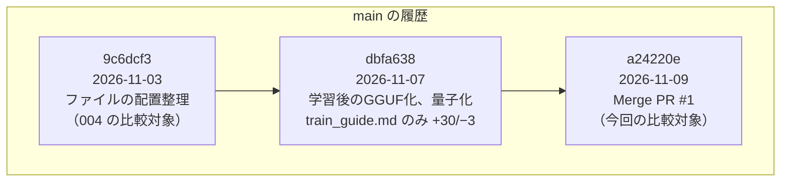
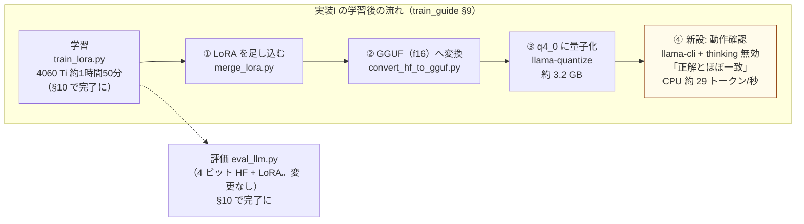

# 実装I（WeatherAI_FineTune）の main 更新の整理 — 9c6dcf3 → a24220e（2026-11-03 → 11-09）

## 0. この文書について

- 作成日: 2026-11-09（指示: `005_instruction.md`）
- 読者: 開発チーム（実装I・実装H の担当者）。前回の比較文書 `004_FineTune比較_マージ検討_revB.md`（以下 004）を読んだ人を想定。
- 呼び方: 004 と同じく、GitHub の [gomi-kuzu/WeatherAI_FineTune](https://github.com/gomi-kuzu/WeatherAI_FineTune) を **実装I**、`work_261007_Gemma4/` の FineTune を **実装H** と呼ぶ。

**表 0-1: 比べた 2 つの版**

| 項目 | 前回（004 の比較対象） | 今回（main の最新） |
|---|---|---|
| commit | `9c6dcf3`「ファイルの配置整理」（2026-11-03 22:11） | `a24220e`「Merge pull request #1」（2026-11-09 00:04） |
| 間の commit | — | `dbfa638`「学習後のGGUF化、量子化」（2026-11-07 23:32）を作業ブランチで作り、PR #1 で main に取り込んだ |
| 実機の repository | [bme280_ros_with_uno_q](https://github.com/gomi-kuzu/bme280_ros_with_uno_q) `89b247a` | `89b247a` のまま（2026-11-09 に確認。変化なし） |

- やったこと: 最新の main を取得し、`git diff 9c6dcf3 a24220e` で全差分を読んだ。新しく推奨されたコマンドのオプションが、実機と同じ llama.cpp の版（b10327）にあるかをソースで確かめた（§3-2）。**実装I のスクリプト・コマンドは実行していない**。train_guide に書かれた実測値（学習時間・速さ・一致の度合い）は、実装I の担当者の申告をそのまま載せている。

<div class="kpi" markdown="1">

**結論: 変わったのは手順書 `docs/train_guide.md` の 1 ファイルだけ（+30 行 / −3 行）。コード・データ・設定は変わっていない。中身は「学習から実機形式（q4_0 GGUF）までを一通り終えた」という進捗報告と、推論時に thinking を切る手順の追加。004 の結論（丸ごとのマージはせず、別 repository + 機能ごとの PR 3 本）は変わらない。ただし実装I 自身が「出力が 0/10/100 に偏る（mode collapse）」を次の課題に挙げたので、004 の PR2（期待値ラベルと出力の種類数の確認）の優先度を上げるのがよい。**

</div>

## 1. 結論

<div class="kpi" markdown="1">

- **何が変わったか（事実）**
    - `docs/train_guide.md` に §9 ④「デプロイ前の動作確認（thinking を無効化する）」が新設された。Gemma 4 は既定で「考える過程」（thinking）を先に出力するので、`llama-cli` に `--reasoning off --reasoning-budget 0` を付けて切る、という手順と推奨コマンド（§3-2）。
    - 同じファイルの §10「次のステップ」で、残っていた 3 項目が完了になった: 本番学習（RTX 4060 Ti で約 1 時間 50 分）、`test.jsonl` での評価（`util/eval_llm.py`）、q4_0 GGUF での動作確認。新しい未完了項目として「**予測値の mode collapse（greedy で 0/10/100 に偏る）の改善**」が加わった（§3-3）。
    - `src/`・`util/`・`README.md`・`eval/data/WEATHER_SFT.md` は 1 行も変わっていない。評価の数字（AUC など）や出力の分布は repository に載っていない。
- **004 の論点への影響**（§4 の表 4-1）
    - 前進: 「実機に載せる q4_0 GGUF で動かしていない」→ 動かして「正解とほぼ一致」と書かれた。ただし件数・数値は無い。
    - 004 の見込みどおり: 「正解が risk2 そのものなので出力が少数の値に崩れうる」→ 実装I 自身が mode collapse を報告。
    - 変化なし: 「JSON で答えるので今の実機では回答が捨てられる」「llama.cpp の版を固定していない」「評価スクリプトは 4 ビット（nf4）の HF モデルで採点」。
- **次にすること**: 実装I の担当者に、test の評価結果（出力の種類数を含む）と GGUF 確認の件数を共有してもらう。mode collapse の対策として、実装H の期待値ラベル（似た状況 200 件の平均）を PR2 として先に出す（§5）。

</div>

## 2. 全体像



fig1: 前回の比較から main に入ったのは commit 1 個（とそのマージ）だけで、変更は手順書 1 ファイルに限られる。



fig2: 実装I の流れのうち、今回の更新で増えたのは ④（色付き）の手順と、各段が「完了」になったという記録である。①〜③と評価スクリプトは変わっていない。

## 3. 変更の詳細

### 3-1. 変わったファイルと、変わっていないファイル

**表 3-1: 9c6dcf3 → a24220e のファイルごとの変化**（`git diff --stat` による）

| ファイル | 行数（今回） | 変化 | 中身 |
|---|---:|---|---|
| `docs/train_guide.md` | 400 | **+30 / −3** | §9 ④ 新設（+26）、§10 の進捗更新（+4 / −3） |
| `src/train_lora.py`・`src/merge_lora.py` | 241・67 | なし | 学習・LoRA の足し込み |
| `util/eval_llm.py` | 222 | なし | 評価（4 ビット nf4 の HF モデル + LoRA で生成して採点） |
| `util/make_weather_sft.py` ほか util 4 本 | 315 ほか | なし | データ作成・ルールの基準線・テスト |
| `README.md`・`eval/data/WEATHER_SFT.md` | 327・98 | なし | 全体説明・データ仕様 |

repository 全体は 13 ファイル・2,395 行（前回 2,368 行から +27 行）。

### 3-2. 新設された §9 ④「デプロイ前の動作確認」

train_guide に追加された説明の要旨:

- Gemma 4 のモデルに入っているチャットの枠（チャットテンプレート。質問と回答を区切る決まった書式）は、**thinking（回答の前に考える過程を文章で出すモード）を既定で有効**にする。
- 実装I の学習データは thinking なしで JSON をすぐ答える形なので、そのまま動かすと `Thinking Process:` などの文が混ざり、学習した形と一致しない。
- そこで推論時に `--reasoning off --reasoning-budget 0` で thinking を切る。

推奨コマンド（train_guide からそのまま引用）:

```bash
./llama.cpp/build/bin/llama-cli \
    -m outputs/gemma4-weather-merged/model-q4_0.gguf \
    --jinja --reasoning off --reasoning-budget 0 \
    -st --temp 0 --no-display-prompt \
    -sys "<システムプロンプト>" \
    -p "<観測 JSON>"
```

**表 3-2: 推奨コマンドのオプションの意味と、実機の llama.cpp（b10327）にあるか**

| オプション | 意味 | b10327 にあるか |
|---|---|---|
| `--jinja` | モデルに入っているチャットの枠（Jinja という書式の雛形）を使って文面を組み立てる | ある（`common/arg.cpp` 3542 行目） |
| `--reasoning off`（`-rea`） | thinking を使わない | ある（同 3561 行目、`on/off/auto`） |
| `--reasoning-budget 0` | thinking に使ってよいトークン数を 0 にする（念のための二重の止め） | ある（同 3579 行目） |
| `-st`（`--single-turn`） | 1 回答えたら終わる（対話を続けない） | ある（同 1845 行目） |
| `--temp 0` | greedy（毎回いちばん確率の高いトークンを選ぶ）。同じ入力なら同じ答え | ある |
| `--no-display-prompt` | 入力の文面を画面に出さず、回答だけを出す | ある |
| `-sys` / `-p` | system の指示文 / ユーザーの文面（実装I では観測値の JSON） | ある |

b10327（2026-08-08 の `69bf643`）の llama.cpp のソースを取得して、オプション名を確認した。動かしてはいない。

train_guide に書かれた実測（実装I の担当者の申告）:

- 「q4_0 で `weather_risk` と reason が正解（gold）とほぼ一致。量子化誤差は reason の数値の微差程度」
- 「生成速度は CPU で約 29 t/s（トークン/秒）。エッジデバイスでも実用的」

何件で確かめたか・どの CPU かは書かれていない。

### 3-3. §10「次のステップ」の進捗

**表 3-3: §10 のチェックリストの変化**

| 項目 | 前回（9c6dcf3） | 今回（a24220e） |
|---|---|---|
| 環境構築・HF 重みの取得・4 ビット読み込み・学習スクリプト・スモークテスト・GGUF 化の事前検証（6 項目） | 完了 | 完了（変化なし） |
| 本番学習の実行と `dev.jsonl` での検証 | 未完了 | **完了**「本番学習の実行（4060 Ti・約1時間50分）」。dev での検証の文言は消えた |
| `test.jsonl` での評価、推論スクリプトの作成 | 未完了 | **完了**（`util/eval_llm.py`） |
| 学習済みモデルのマージ・GGUF 化・デプロイ先での動作確認 | 未完了 | **完了**「q4_0 で再現確認」 |
| 予測値の mode collapse（greedy で 0/10/100 に偏る）の改善 | （項目なし） | **新設・未完了** |

- 「デプロイ先での動作確認」が、実機（Arduino UNO Q）上の確認なのか、手元の PC の CPU での確認なのかは書かれていない。§3-2 の「CPU で約 29 t/s」「エッジデバイスでも実用的」という書き方からは、手元の CPU で測った値と読める（推測。確認事項 2）。
- 文書冒頭の「進捗状況（2026-11-03 時点）… 学習スクリプトの作成・学習・評価は**未着手**」という注記は更新されておらず、§10 と食い違っている。§5 の見出しが 2 回続く重複（前回からある）もそのまま。

## 4. 004 の論点への影響

**表 4-1: 004 で挙げた違い・懸念が、今回の更新でどうなったか**（左 = 004 での状態、右 = 今回）

| # | 論点（004 の章） | 004 での状態 | 今回の更新 | 変化 |
|---|---|---|---|---|
| 1 | 実機との入出力（§4-1） | JSON で答えるので、実機の `weather_risk_setter.py`（1 行目を整数として読む）では捨てられる | 推奨コマンドも JSON で答える前提。実機の repository も変化なし | **変化なし** |
| 2 | 評価の対象（§4-7-2） | 評価は 4 ビット nf4 の HF モデル + LoRA。実機に載せる q4_0 GGUF では評価していない | `eval_llm.py` は変化なし。q4_0 GGUF を llama-cli で動かして「ほぼ一致」と記載（件数・数値なし） | **一部前進** |
| 3 | llama.cpp の版（§4-7-2 表 4-5 の 5） | `--depth 1` で最新版を取るので版が記録されない。実機は b10327 | 取り方は同じ（版の記録なし）。新しいオプションは b10327 にもある（表 3-2） | **変化なし**（オプション名の点では支障なし） |
| 4 | 出力の崩れ（§4-4） | 正解が risk2 そのもの。実装H の FT-A は同じ定義で 0 と 3 の 2 値に崩れた。「出力の種類数を見るとよい」 | 実装I 自身が「greedy で 0/10/100 に偏る」と報告 | **004 の見込みどおり**（新情報） |
| 5 | 実機での所要（§4-6 表 4-6） | 入力 636 + 出力 111〜160 トークンで、実機の見積り約 175〜190 秒 | 「CPU で約 29 t/s、エッジでも実用的」 | **比べられない**（下の §4-2） |
| 6 | thinking | 004 では扱っていない。実装H は評価で `enable_thinking: False` を指定済み（`eval/scripts/run_eval.py` 45 行目ほか） | 実装I も推論時に thinking を切る手順を追加 | **両実装で同じ扱いになった** |
| 7 | 学習の規模 | 学習まで動いた（commit「学習まわせた」） | 本番学習が完了（4060 Ti・約 1 時間 50 分、3,000 件） | 新情報。実装H の FT-B は T4 で 80 分（15,700 件、`261008_auduino検証/023`） |

### 4-1. 推奨コマンドと実機の入出力の関係

<div class="fact" markdown="1">

- 推奨コマンドは `--jinja` でモデルのチャットの枠を付け、`-sys`（指示文）と `-p`（観測値の JSON）を分けて渡す。回答は JSON。
- 今の実機は、組み立てた文面を枠なしでそのまま llama_ros（実機で llama.cpp を ROS 2 から呼ぶ部品）に渡し、回答の 1 行目を整数として読む（004 §4-1、fig2）。実機の repository は 11-09 時点でも `89b247a` のまま。

</div>

<div class="interp" markdown="1">

- したがって、今回の「デプロイ先での動作確認」は、**実機と同じ経路（llama_ros・枠なし・1 行目を整数）での確認ではない**と考えられる。実装I のモデルを実機で使うには、004 §4-1 の 3 か所（`build_prompt()`・llama_ros のチャット形式化・`weather_risk_setter.py` の JSON 読み取り）の変更が引き続き必要。
- 実機側をチャット形式にする場合は、thinking を切る設定（llama_ros 側で reasoning を off にする相当の設定）も一緒に入れる必要がある。

</div>

### 4-2. 「約 29 t/s」と 004 の見積りの関係

**表 4-2: 1 回の推論の所要（実装I の形式。入力 636 トークン、出力 111〜160 トークン）**

| 前提 | 入力を読む時間 | 出力を作る時間 | 合計 |
|---|---:|---:|---:|
| 実装I の申告（CPU 約 29 t/s。入力の読み込みは不明） | 不明 | 約 3.8〜5.5 秒 | 不明 |
| 004 の実機見積り（入力 4.5 t/s・出力 3.3 t/s、`261008_auduino検証/005` の式） | 約 141 秒 | 約 34〜48 秒 | 約 175〜190 秒 |

出力の時間は「出力トークン数 ÷ 速さ」（例: 160 ÷ 29 ≈ 5.5 秒、160 ÷ 3.3 ≈ 48 秒）。

<div class="interp" markdown="1">

- 29 t/s は 004 の実機見積り（出力 3.3 t/s）の約 9 倍で、実機（Cortex-A53）より速い計算機で測った値と考えられる。また入力 636 トークンを読む時間が含まれていないので、実機での所要（004 では大半が入力の読み込み）とは直接比べられない。
- 実機は 5 分ごとに文面を出すので、004 の見積り（約 3 分）でも間に合う。「実用的」という結論自体は変わらない見込みだが、根拠は実機での実測で置き換える必要がある（004 確認事項 3 のまま）。

</div>

### 4-3. mode collapse（0/10/100 への偏り）

<div class="fact" markdown="1">

- 実装I の正解は `min(round(先 60 分の雨量 mm × 10), 100)`（`make_weather_sft.py` 65〜69 行目）。0 は雨なし、100 は 10 mm 以上で上限に張り付いた場合。
- 実装H の FT-A（同じ定義の正解）は、dev 2,500 行で出力が 0 と 3 の 2 値になった。FT-B は正解を「似た状況 200 件の平均」に変えて、出力 23 種類・AUC 0.87 になった（004 表 4-2、`017` §5）。

</div>

<div class="interp" markdown="1">

- 実装I の「0/10/100 に偏る」は、FT-A と同じく「greedy で、正解に多い少数の値ばかり答える」崩れ方と考えられる。実装I のデータは急変を多く入れてあり 100（上限）の割合が高いぶん、FT-A の 0/3 とは偏る先が違う、という説明と矛盾しない（実装I のラベル分布は repository に無く、未確認）。
- 対策としては、004 で PR2 に挙げた**期待値ラベル（似た状況の平均を正解にする）**がそのまま当てはまる。ほかに、温度を上げて何度か答えさせて平均する方法もあるが、実機の 5 分間隔に対して推論回数が増える。

</div>

## 5. 次の一手と確認事項

**表 5-1: 実装I の担当者に確認したいこと**

| # | 確認事項 | 理由 |
|---|---|---|
| 1 | 実機の入出力の形式（004 の確認事項 1）をどうするか | 推奨コマンドは JSON・チャット形式で、今の実機（枠なし・1 行目を整数）と合わない（§4-1） |
| 2 | 「デプロイ先での動作確認」「29 t/s」は、どの計算機で何件確かめたか | 実機（Arduino UNO Q）での確認かどうかで、表 4-1 の 2・5 の判定が変わる |
| 3 | test の評価結果（AUC、出力の種類数・値の分布）と、q4_0 GGUF と HF nf4 の答えの一致率 | mode collapse の程度と、004 §4-7-2 の「評価値は上限寄り」の大きさを数字で見るため |
| 4 | llama.cpp の版（commit）の記録 | 変換した版と実機 b10327 の組合せで読めるかを確かめるため |

**表 5-2: 004 の PR 3 本の扱い（提案）**

| PR | 004 での順番 | 提案 | 理由 |
|---|---|---|---|
| PR1: 実機形式の文面 | 1 番目 | 確認事項 1 が決まってから | 実機の入出力が決まらないと中身が決まらない |
| PR2: 期待値ラベル（kNN）と出力の種類数の確認 | 2 番目 | **先に出す（入出力の形式によらず使える）** | 実装I が報告した mode collapse への直接の対策。正解の作り方だけの変更なので、JSON 形式のままでも入れられる |
| PR3: GGUF での評価と量子化 | 3 番目 | 2 番目に繰り上げ | 実装I が q4_0 で動かし始めたので、採点スクリプトがあれば「ほぼ一致」を数字にできる |

<div class="limit" markdown="1">

**この文書の限界**

- 実装I のスクリプト・推奨コマンドは実行していない。学習時間・29 t/s・「ほぼ一致」・mode collapse はすべて train_guide の記載で、こちらでは確かめていない。
- 実装I の学習データ・学習済みモデル・評価結果は repository に無いので、0/10/100 への偏りの割合や原因は確かめられない（§4-3 の解釈は FT-A との類推）。
- 確認したのは 2026-11-09 時点の main。作業ブランチ（PR #1 の元）にはマージ以降の commit は無かった。

</div>

## 用語集 {#glossary}

<dl>
<dt>実装I / 実装H</dt><dd>この文書での 2 つの FineTune の実装の呼び名。実装I は GitHub の WeatherAI_FineTune、実装H は work_261007_Gemma4 の FineTune。</dd>
<dt>commit / PR / マージ</dt><dd>commit は git に記録した 1 回分の変更。PR（pull request）は変更を取り込んでもらう依頼で、マージはそれを main に取り込むこと。</dd>
<dt>thinking（reasoning）</dt><dd>回答の前に「考える過程」を文章で出すモデルの動き方。Gemma 4 は既定で有効。短い決まった形で答えさせたいときは切る。</dd>
<dt>チャットテンプレート（チャットの枠）</dt><dd>system・user・model の発言を区切るためにモデルごとに決まった書式。Gemma 4 では <code>&lt;|turn&gt;model</code> のような印で囲む。</dd>
<dt>Jinja</dt><dd>チャットテンプレートを書くための雛形の書式。llama.cpp の <code>--jinja</code> はモデルに入っている雛形をそのまま使う指定。</dd>
<dt>llama.cpp / llama-cli / llama-server / llama_ros</dt><dd>llama.cpp は GGUF を動かす LLM 実行ソフト。llama-cli はそのコマンドライン版、llama-server はサーバー版。llama_ros は実機で llama.cpp を ROS 2 から呼ぶ部品。</dd>
<dt>b10327</dt><dd>実機で使っている llama.cpp の版番号（2026-08-08 の commit <code>69bf643</code>）。</dd>
<dt>GGUF / q4_0 / f16</dt><dd>GGUF は llama.cpp が読むモデルファイルの形式。f16 は数を 16 ビットで持つ形、q4_0 は 32 個ごとに目盛り 1 つと 4 ビットの整数で持つ簡単な量子化（詳しくは 004 §4-7-1）。</dd>
<dt>nf4 / HF モデル</dt><dd>HF モデルは Hugging Face の形式（safetensors）の重み。nf4 は学習時に重みを 4 ビットに圧縮して読む形式（QLoRA で使う）。</dd>
<dt>LoRA / QLoRA</dt><dd>元の重みを固定し、横に足した小さな行列だけを学習する方法。QLoRA は元の重みを 4 ビットに圧縮して置く LoRA。</dd>
<dt>greedy（温度 0）</dt><dd>毎回いちばん確率の高いトークンを選ぶ生成の仕方。同じ入力なら同じ答えになる。</dd>
<dt>mode collapse（出力の崩れ）</dt><dd>モデルの答えが、正解に多い少数の値ばかりになること。ここでは 0〜100 のうち 0・10・100 にほぼ集まる状態。</dd>
<dt>期待値ラベル</dt><dd>1 件の実測値ではなく、似た状況の多数の実測値の平均を正解にする作り方。実装H の FT-B が使う。</dd>
<dt>t/s（トークン/秒）</dt><dd>1 秒あたりに処理するトークン数。トークンはモデルが文字列を区切って扱う単位。</dd>
<dt>AUC</dt><dd>荒天の場面とそうでない場面を、出力の大小でどれだけ正しく並べ分けられるかの指標。0.5 は当てずっぽう、1 は完全。</dd>
<dt>Cortex-A53</dt><dd>実機（Arduino UNO Q）に載っている ARM の CPU。</dd>
</dl>
