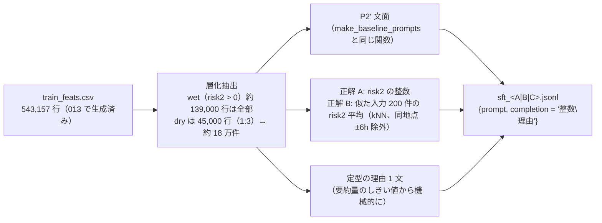

# FineTune の計画（提案）— risk2 を正解にした LoRA 学習で、尺度と量子化耐性を得られるか

- 作成日: 2026-10-15（前サイクル: `015_プロンプト調整_報告.md`。台帳 2026-10-15 / 015 行）
- 位置づけ: **提案書**（承認後に実施。モードA サイクル 3）。revD §3-6 の学習計画を、013〜015 で確定した評価系と正解（risk2）に合わせて具体化したもの。

## 0. 前提（既定値）

| 区分 | 項目 | 既定値 |
|---|---|---|
| 固定 | 入出力・正解・評価データ・指標 | 013 と同じ（dev 層化 2,500 行、AUC・ρ・MAE・信頼性表・整数率）。test は FineTune 後の最終確認で 1 回だけ |
| 固定 | 学習データの出所 | train 分割（2019〜2022、543,157 行）だけ。dev・test・extra は使わない |
| 固定 | 正解の出所 | 実測（risk2）から作る。LLM 生成のラベルは使わない（revD の方針、R-011） |
| 既定 | 学習文面 | **P2'**（要約＋手がかり。015 で採用）。対照として P0（現行 36 値列挙）も 1 本 |
| 既定 | ベースモデル・手法 | `unsloth/gemma-4-E2B-it`（BF16）、LoRA r=16（attention + MLP）、1 epoch、学習率 2e-4、系列長 512。T4 で 1 試行 1〜2 時間の見込み |
| 既定 | 回答の形 | `<risk2 の整数>\n<定型の理由 1 文>` + EOS。理由は入力の要約量から定型で作る（LLM に書かせない。revD §3-4） |
| 既定 | 評価 | マージした BF16 を ① の llama-server に載せ、013 と同じ 2,500 行・生文面・温度 0 で採点。次に Q4_K_M（imatrix）に量子化して同じ採点 |

## 1. 結論（先に要点）

**提案: train 分割から「P2' 文面 → risk2 の整数 + 定型理由」の学習データを作り、LoRA で 3 本学習する（A: risk2 そのまま、B: 似た入力での risk2 の期待値、C: P0 文面で A と同じ）。013 と同じ 2,500 行で採点し、合格は BF16 で AUC 0.80 以上・ρ 0.50 以上、4 ビット量子化後に AUC 0.75 以上。到達点の目安は統計モデルの 0.87〜0.90。所要は環境構築 0.5 日 + 学習 3 本 約 5 時間（無人）+ 評価・量子化 2 時間 + 報告 0.5 日。**

- A（risk2 そのまま）が指示どおりの主案。ただし温度 0 の生成は「最も確率の高い整数」を出すので、不確かな入力では 0 に寄る懸念がある（revD §3-4 の限界）。
- B はその懸念への保険: 正解を「似た入力 200 件の risk2 の平均」に置き換える（kNN、同地点 ±6 時間を除外）。実測だけから作る点は A と同じ。A と B を同じ評価で比べて、どちらを採るかを数字で決める。
- C は「文面の差（P0 と P2'）が FineTune 後も残るか」を見る対照。残らなければ実機の文面は所要秒だけで選べる。

## 2. 背景・現状の課題（015 の診断）

| 015 の事実 | 課題 |
|---|---|
| P2' BF16 で AUC 0.60・ρ 0.31 だが、出力は 30/40 の 2 値 | 尺度を使えない（規則の当てはめ）。統計モデルの ρ 0.66 との差 |
| UD-Q4_K_XL では P2' でも 99% が 30（AUC 0.51） | 文面で作った決定境界は量子化で潰れる |
| 湿度 < 90% の対流性の雨を見逃す | 手がかりが湿度・気圧だけ。温度・変化量の組合せを使えていない |
| 理由文がほぼ出ない / 1% は上限まで繰り返す | 形式が安定していない |

## 3. 検証したい仮説

- **H3**: 36 値（要約量）から risk2 への対応は LoRA で学習でき、学習後は (i) 出力が 0〜100 の多数の値を取り、(ii) AUC が統計モデルに近づき（0.80 以上）、(iii) 4 ビット量子化後も 0.75 以上を保つ。
- **反証条件**: BF16 で AUC ≥ 0.80・ρ ≥ 0.50・出力の値の種類 ≥ 20、Q4 で AUC ≥ 0.75、整数率 100%、理由文が定型どおり。
- **棄却条件**: A・B とも BF16 で AUC < 0.70 なら、E2B モデルでは数値から risk2 を学べない（モデルの大きさ・入力表現の問題）。A だけ悪く B が良ければ「期待値の正解が必要」。Q4 だけ落ちれば量子化経路の問題（Phase 8 で QAT 風を試す）。

## 4. 改善対象: 学習方法（データ・手法・評価の順に）

### 4-1. 学習データ（train 分割から）

fig1: 学習データの作り方。正解も理由も実測と要約量から機械的に作り、LLM は介在しない。

| 項目 | 内容 |
|---|---|
| 件数 | wet 全件（約 139,000）+ dry 45,000（無作為、seed 固定）= 約 18.4 万件。1 epoch で T4 1〜2 時間の見込み（系列長 ~300 トークン） |
| 正解 A | risk2_lin（0〜100 の整数）そのまま |
| 正解 B | 入力の要約量 8 個を標準化し、train 内で最も近い 200 件（同じ地点の ±6 時間は除く）の risk2 の平均を四捨五入。revD §3-4 の L を「event の割合」から「risk2 の平均」に置き換えたもの。目的関数は無く平均を取るだけ。K は 200 固定（校正表は 013 の信頼性表で確認する） |
| 定型の理由 | 要約量から 1 文。例: 「湿度が 96% と高く、気圧が 60 分で 1.2 hPa 下がっているため」「湿度・気圧とも安定しているため」。語彙は 6 パターン（湿度高/低 × 気圧低下/上昇/安定）に固定し、入力と矛盾しない |
| 損失 | 回答部分（整数 + 理由）のトークンだけの交差エントロピー。文面側は損失に入れない |

### 4-2. 学習（⑤ gemma4-train コンテナ、新規）

| 項目 | 内容 |
|---|---|
| イメージ | `nvidia/cuda:12.8` + PyTorch + Unsloth + llama.cpp の `convert_hf_to_gguf.py`（`env/docker/Dockerfile.train`）。Gemma 4 E2B に対応する Unsloth / transformers の版は構築時に確認（対応していなければ HF PEFT に切り替え） |
| ベース | `unsloth/gemma-4-E2B-it`（BF16、テキストのみ） |
| LoRA | r=16、α=16、attention（q/k/v/o）+ MLP（gate/up/down）、dropout 0。学習率 2e-4、cosine、warmup 3%、1 epoch、batch 16（勾配蓄積）、系列長 512、bf16 不可なら fp16 |
| 試行 | A（P2' / risk2）、B（P2' / 期待値）、C（P0 / risk2）の 3 本。seed 0。各 1〜2 時間 |
| 出力 | LoRA アダプタ → マージ → F16 GGUF（① で評価）→ imatrix Q4_K_M（③ で RSS、② で採点） |

### 4-3. 評価（013 の採点をそのまま）

| 段階 | 内容 |
|---|---|
| BF16（マージ後） | ① llama-server に F16 GGUF を載せ、`run_baseline.py --prompts dev_prompts_p2h.jsonl`（C は p0）→ `score_baseline.py`。対照: 015 の P2' BF16（0.60）、統計モデル（0.87〜0.90） |
| 量子化後 | 経路 (i) マージ → imatrix → Q4_K_M。同じ採点。対照: 015 の P2' Q4（0.51）。KL も記録（報告 005 の手順） |
| 追加の確認 | 出力の値の種類・信頼性表（校正）・整数率・理由文が定型どおりか（文字列一致率）・出力トークン数・温度 0.2 × 3 回の揺れ（500 行） |
| test | 最良 1 本だけ test 2,500 行（dev と同じ層化）で 1 回採点し、台帳に記録 |

## 5. 診断との紐付け

| 試行・項目 | 015 のどの診断に基づくか |
|---|---|
| A（risk2 直接） | §5-A・B: 尺度を使えない → 正解の尺度を直接学習させる |
| B（期待値） | §6: 温度 0 で最頻値に寄る懸念（revD §3-4）。A の結果が 0 寄りなら B が効く |
| C（P0 文面） | §6: 文面の差が FineTune 後に残るかで実機文面を決める |
| Q4 の採点 | §5-A: Q4 で効果が消えた → 学習した境界が量子化で残るか |
| 定型の理由 | §5-A: 理由文が出ない / 繰り返す → 形式を学習で固定 |

## 6. 作業計画

| # | ステップ | 中身 | 所要 |
|---|---|---|---|
| 1 | ⑤ の構築 | `Dockerfile.train`、compose に `train` サービス（gpus: all）。Unsloth で Gemma 4 E2B が読めるかの疎通 | 0.5 日 |
| 2 | 学習データ | `eval/scripts/make_sft_data.py`（層化・P2'/P0 文面・正解 A/B・定型理由 → `eval/data/sft/sft_{A,B,C}.jsonl`） | 2 時間 |
| 3 | 学習 | `eval/scripts/train_lora.py`（3 本、`nohup`）→ マージ → F16 GGUF | 5 時間（無人） |
| 4 | 評価 | ① に載せて 013 の採点（3 本 × 20 分）。最良を Q4_K_M に量子化して採点 + KL | 2 時間 |
| 5 | 報告 | `017_FineTune_報告.md`（.html）。台帳 1 行。test は最良 1 本のみ | 0.5 日 |

## 7. 変更予定のファイル

| ファイル | 変更 |
|---|---|
| `env/docker/Dockerfile.train`、`compose.yaml` | 新規 ⑤ gemma4-train |
| `eval/scripts/make_sft_data.py` | 新規（学習データ・正解 B の kNN・定型理由） |
| `eval/scripts/train_lora.py` | 新規（Unsloth / PEFT） |
| `models/ft/<run>/` | LoRA・マージ F16 GGUF・Q4_K_M GGUF |
| `eval/scripts/run_baseline.py` ほか | 変更なし（GGUF のパスを変えるだけ） |

## 8. リスク

| 事項 | 対応 |
|---|---|
| Unsloth / transformers が Gemma 4 E2B（PLE 付き）に未対応 | HF PEFT に切り替え（速度 2〜3 倍遅いが T4 で収まる）。それも不可なら Gemma 3 1B で手順だけ先に通す |
| T4 16 GB で BF16 ベース（約 10 GB）+ LoRA が載らない | 4bit QLoRA（Unsloth の既定）に切り替え。その場合マージは F16 に戻してから |
| A が 0 寄りに崩れる | B で補う。両方崩れたら正解を「risk2 の 10 刻み分類」にする案を次サイクルで |
| 学習データの地点偏り（SEA が多い） | 地点で重みを付けるか、地点ごとに上限を設ける（既定は付けない。層別で確認） |

## 9. 確認したい事項（既定値で進めてよければ回答不要）

- 1\. **正解の候補**: 既定 = A（risk2 そのまま）を主案、B（期待値）を保険として両方学習。A だけにすれば学習 1〜2 時間減。
- 2\. **学習文面**: 既定 = P2'（手がかり付き）。手がかり無しの P2 で学習する案もある（FineTune 後は手がかりが不要になる可能性。実機文面が短くなる）。
- 3\. **理由文**: 既定 = 定型 6 パターン。理由文を無くして整数だけ出す案（出力 2 トークン、実機で最速）もある。
- 4\. **合格の目安**: 既定 = BF16 AUC 0.80 / ρ 0.50、Q4 AUC 0.75。
- 5\. **test の使用**: 既定 = 最良 1 本だけ 1 回。

## 用語集

<dl>
<dt>LoRA</dt><dd>モデルの一部の重みだけを小さな追加行列で学習させる追加学習。少ないメモリで済み、学習結果（アダプタ）は元のモデルにマージできる。</dd>
<dt>QLoRA</dt><dd>ベースモデルを 4 ビットに圧縮した状態で LoRA を学習する方法。T4 のような小さい GPU で大きいモデルを学習できる。</dd>
<dt>SFT</dt><dd>「入力文 → 正解の回答」の対で追加学習すること（教師あり微調整）。</dd>
<dt>正解 A / B</dt><dd>A = risk2 の実測値そのもの。B = 似た入力 200 件の risk2 の平均（期待値）。どちらも実測だけから作る。</dd>
<dt>kNN</dt><dd>入力が最も近い K 件を探す方法。ここでは要約量 8 個の距離で K = 200 件。</dd>
<dt>定型の理由</dt><dd>要約量のしきい値から機械的に選ぶ 1 文。入力と矛盾しないことが保証される。</dd>
<dt>交差エントロピー</dt><dd>正解のトークンを当てる確率が高いほど小さくなる損失。学習はこれを最小化する。</dd>
<dt>imatrix / Q4_K_M / KL</dt><dd>量子化の精度を上げる重要度行列 / 4 ビット量子化の形式 / 量子化前後の出力分布のずれ（報告 005 参照）。</dd>
<dt>PLE</dt><dd>Gemma 4 E2B の層ごとの埋め込み表。対応ライブラリが限られる原因になりうる。</dd>
</dl>
