# FineTune の報告 revC — 期待値ラベルの LoRA で AUC 0.87、4 ビット量子化後も 0.87 を保ち、実機候補の合格条件を満たした

- 作成日: 2026-10-17（revC。revB 022 は同日、初版 017 は 2026-10-16。提案書 `016_FineTune_提案.md` を既定値で承認 → 実施。前サイクル `015_プロンプト調整_報告.md`。レビュー指示: revC は `023_instruction.md`、revB は `022_instruction.md`）
- **revC の変更点（023 のレビュー指摘への対応）**:
  - 1\. **「LoRA をどこに加えたのか」を図で明示した**。§2-A-3 を新設し、モデルの全体像と各部位の役割・入力から出力を生成する仕組み（fig R6・R7）を先に示したうえで、§2-A-5 に「1 層の中身のどの行列に LoRA を横付けしたか」（fig R8）、「35 層 × 7 箇所の地図」（fig R9）、部位別の学習数の表を載せた。数はすべて `config.json`・`model.safetensors`・`adapter_model.safetensors` のヘッダから数えた実物（`023_finetune/make_figs_023.py`、`023_finetune/out/*.csv`）。
  - 2\. **指摘 2（理由文を定型にせず LLM に自由生成させる。推論を「危険度の推定」と「理由の生成」の 2 段に分ける案）は本改訂では未対応**。指示どおり指摘 1 を先に対応した。対応の案と必要な作業を §9 の次サイクル候補 4 に書いた（学習データの作り直し・再学習・再評価が要るため別サイクルで行う）。
  - revB の本文・数値・図はそのまま残し、§2-A の節番号を繰り下げた（旧 2-A-3〜2-A-7 → 2-A-4・2-A-6〜2-A-9）。§2-A-9 の「よくある疑問」に 3 項目、§7 に 1 項目、用語集に 7 項目を足した。実験の追加は無い。
- **revB の変更点（022 のレビュー指摘への対応）**:
  - 1\. **「元のモデルに何を加えて、どう学習させたか」を §2-A として新設**。全体像の模式図（fig R0）、LoRA で付けた行列の模式図（fig R1）、学習データ 1 件の構造（fig R2）、学習曲線（fig R3）、量子化の模式図（fig R4）、正解 A と B の違い（fig R5）を追加した。
  - 2\. **LLM の FineTune・量子化に詳しくない読者向けに書き直した**。重み・トークン・損失・ランク・マージ・GGUF・Q4_K_M・imatrix を初出で注釈し、§2-A-9（revB 時点は 2-A-7）に「よくある疑問」、用語集に 12 項目を追加した。
  - 初版の本文・数値・図（§1〜§10、017_finetune/figs/）はそのまま残し、§2-A と用語集を足した。追加した図は `022_finetune/figs/`（`022_finetune/make_figs_022.py` で `train_log.json`・`adapter_model.safetensors`・`sft_B.jsonl` から生成）。実験の追加は無い。
- 対象: 013 と同じ dev 層化 2,500 行・同じ採点。学習は train 分割（2019〜2022）のみ。test（2024 年）は最良 1 本に 1 回だけ使用（§5-H、台帳に記録）。
- 成果物: `env/docker/Dockerfile.train`・`requirements-train.txt`・compose の `train`、`eval/scripts/{make_sft_data,train_lora}.py`、`run_ft_queue.sh`・`run_ft_eval.sh`・`run_ft_extra.sh`・`run_ft_test.sh`・`serve_gguf.sh`、`eval/data/sft/`、`models/ft/{A,B,C}/`（LoRA・マージ・F16 GGUF、B は Q4_K_M 2 種）、`eval/results/baseline/out_017*/`、図 `017_finetune/figs/`・`022_finetune/figs/`・`023_finetune/figs/`

## 1. 結論（先に要点）

<div class="kpi" markdown="1">
**総合判定: 仮説 H3 を支持。「似た入力での risk2 の期待値」を正解にした LoRA（B）は、BF16 で AUC 0.87（CI 0.85〜0.89）・順位相関 0.63・出力 23 種類となり、合格の目安（AUC 0.80・ρ 0.50）を超えた。Q4_K_M に量子化しても AUC 0.87・ρ 0.63 を保ち（合格 0.75）、統計モデルの到達点（0.90・0.66）に迫る。risk2 をそのまま正解にした A・C は出力が「0 か 3」の 2 値に崩れた（提案書で懸念した最頻値への収束）。採否: B（P2' 文面 + 期待値ラベル）の Q4_K_M（imatrix）を実機候補として採用。**

| 条件（生文面、温度 0） | AUC（event）[95% CI] | ρ（risk2） | MAE | 出力の値の種類 | 理由文の形式一致 |
|---|---|---|---|---|---|
| P2' 現行 BF16（015） | 0.601 [0.587, 0.616] | 0.313 | 29.9 | 4（30/40） | — |
| P2' 現行 UD-Q4_K_XL（015） | 0.507 | 0.075 | 29.5 | 3（30 が 99%） | — |
| FT-A（risk2 そのまま、P2'） | 0.790 [0.771, 0.807] | 0.539 | 1.76 | **2（0 / 3）** | 99.96% |
| **FT-B（期待値ラベル、P2'）BF16** | **0.871 [0.853, 0.887]** | **0.629** | 2.28 | 23（0〜30） | 99.4% |
| **FT-B Q4_K_M（imatrix、実機候補）** | **0.866 [0.848, 0.883]** | **0.629** | 2.48 | 21 | 99.4% |
| FT-B Q4_K_M（imatrix 無し） | 0.863 [0.845, 0.880] | 0.618 | 2.46 | 21 | — |
| FT-C（risk2 そのまま、P0 現行文面） | 0.731 [0.711, 0.748] | 0.509 | 2.23 | 2（0 / 3） | 98.5% |
| 参照: 勾配ブースティング | 0.899 [0.883, 0.913] | 0.658 | 1.58 | 連続値 | — |

- 理由文は定型どおりで、述べている湿度の値と気圧の向き・量は入力と 100% 一致（§5-F）。出力は約 24 トークン、上限到達 0%。
- 出力の上限は 30 程度で、尺度の低い側しか使わない。これは「期待値」の性質で、信頼性表では出力 20 台の行が実際に 88% 降る（§5-C）。LED に出す値としては校正表で読み替える（§6）。
- 実機所要の見積り: 入力 231 トークン + 出力 24 トークン → 約 59 秒（005 の式）。
- **ノイズ**: 温度 0.2 × 3 回（500 行）で AUC の run 間 SD 0.004、同じ行の出力の幅は平均 0.7（3 回とも同じ値が 48%、温度 0 と一致 69%）。013 の現行モデル（SD 0.013、幅 4.7）より安定。
- **test（2024 年、1 回だけ）でも再現**: FT-B Q4_K_M-im は AUC 0.863（CI 0.846〜0.879）・ρ 0.60。dev（0.866・0.63）とほぼ同じで、dev で選んだ値が甘かった兆候は無い。同じ test で統計モデルは 0.888・0.61。
</div>

## 2. 実施内容の概要

| 項目 | 内容 |
|---|---|
| 学習データ | train 分割 543,157 行 → wet（risk2 > 0）138,751 + dry 45,000 = 183,751 件（`make_sft_data.py`）。**学習には先頭 15,700 件（+ 検証 300 件）だけ使った**（§3-2 の逸脱） |
| 正解 | A/C: risk2 の整数。B: 要約量 8 個を標準化した kNN（K = 200、同地点 ±6 時間除外、train 全体から）の risk2 平均（学習母集団 1:3 での期待値。中央値 5・99% 点 31、A との順位相関 0.55） |
| 回答 | `<整数>\n<定型理由>` + EOS。理由は湿度（≥ 90% で「と高く」）× 気圧（60 分変化 ≤ −0.5 / ≥ +0.5 / 安定）の 6 パターン |
| モデル・手法 | `unsloth/gemma-4-E2B-it`（HF、10.2 GB）を 4bit で読み QLoRA（r=16、α=16、attention + MLP、lr 2e-4、cosine、warmup 3%、1 epoch、batch 8 × 累積 2、系列長 512、seed 0）。損失は回答トークンのみ（確認: 1 件目で 249 トークン中 17 トークン） |
| 環境 | ⑤ gemma4-train（CUDA 12.8、torch 2.14.1、transformers 5.17.0、unsloth 2026.10.5、trl 1.15.0、peft 0.21.2）。T4 は bf16 非対応、Unsloth が Gemma 4 の fp16 を拒否 → **float32 計算** |
| 評価 | マージ 16bit → `convert_hf_to_gguf.py` → F16 GGUF（9.3 GB）を ① llama-server（v0.6.0）に載せ、013 と同じ 2,500 行・生文面・温度 0。B は `llama-quantize` で Q4_K_M（imatrix 無し / 有り。imatrix は学習に使っていない train 側 2,000 件の文面 + 回答） |

**再現性**: データセット 010 / 層化 seed 20261015 / SFT seed 20261015 / 学習 seed 0 / llama.cpp v0.6.0 / ブートストラップ 1,000 回。test 参照: FT-B Q4_K_M-im で 1 回（§5-H）。

## 2-A. 元のモデルに何を加え、どう学習させたか（revB 追加・丁寧版）

この節は「LLM の FineTune や量子化に詳しくない読者」向けに、§2 の 1 行ずつを噛み砕いたものである。数字はすべて §2〜§5 と同じ現物（`train_log.json`・`adapter_model.safetensors`・`sft_summary.json`）から取った。結論だけ知りたい場合は fig R0 と表 2-A-1 で足りる。**LoRA をどこに入れたかだけ知りたい場合は fig R6（全体像）→ fig R8（1 層の中身）→ fig R9（35 層 × 7 箇所の地図）の順に見る**（§2-A-3・§2-A-5、revC 追加）。

### 2-A-1. 全体像（何を・どの順に）

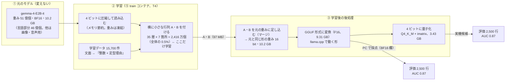

fig R0: 元のモデルは一切書き換えず、「横に付けた小さな行列 A・B」だけを学習し、最後に元の重みへ足し込む。足し込んだ後のモデルは元と同じ形・同じ大きさなので、以後の変換・量子化・実機への載せ方は FineTune 前と同じ経路をそのまま使える。

| 段階 | 何をしたか（平易に） | 本書での現物 |
|---|---|---|
| ① 元のモデル | Google 公開の Gemma 4 E2B（指示に従う版）。35 層の計算を積み重ね、各層に「数の表（重み）」を持つ。重みは全部で 51 億個、1 個 2 バイト（BF16）で 10.2 GB | `models/hf/gemma-4-E2B-it/` |
| ② 学習 | 重みは凍結。各層の 7 箇所に小さな行列 A・B を付け、「この文面にはこの答え」の 15,700 件を 1 周（982 ステップ）見せて A・B だけを更新 | `train_lora.py`、`models/ft/B/lora/`（97 MB） |
| ③ マージ・変換 | A×B を元の重みに足し込み（元と同じ形に戻る）、llama.cpp 用の GGUF に変換 | `models/ft/B/merged/`、`gemma-4-E2B-wr-B-F16.gguf` |
| ③ 量子化 | 重み 1 個を 16 ビット → 約 4.5 ビットに丸めて 3.43 GB に（実機の RAM に載せるため） | `gemma-4-E2B-wr-B-Q4_K_M-im.gguf` |
| 評価 | 学習に使っていない 2,500 行で採点（013 と同じ） | §5 |

### 2-A-2. 前置き: LLM の中身と「FineTune」の意味

- **LLM は「数の表」の積み重ね**。文面をトークン（単語の断片。Gemma 4 では語彙 26 万種）に区切り、各トークンを 1,536 個の数（ベクトル）にして、35 層の計算を通し、最後に「次のトークンはどれか」の確率を出す。各層の計算は「入力の数ベクトル × 重みの表」の掛け算が中心で、この**重みの表の中身がモデルの知識・振る舞い**である。
- **Gemma 4 E2B の重みの内訳**（`config.json` と safetensors から数えた値）: 35 層ぶんの計算部分 18.5 億個、トークンの埋め込み表 4.0 億個、層ごとの埋め込み表（PLE）23.9 億個、画像用 1.7 億個、音声用 3.1 億個、計 51.2 億個。「E2B」は実効 2B という意味で、PLE を外部メモリに置ける設計のため「2B 級の速さ」で動く。
- **FineTune（追加学習）** = 公開されたモデルの重みを、自分のデータで少し動かして振る舞いを変えること。ここでは「気象の要約文 → 0〜100 の整数と理由 1 文」という**新しい入出力の対応**を覚えさせた。モデルが元から持つ言葉の知識は残し、答え方だけを狙った形に寄せる。
- 追加学習には主に 3 つの方式がある。本書は 3 番目の QLoRA。

| 方式 | 何を動かすか | メモリ（この規模） | 本書 |
|---|---|---|---|
| 全パラメータ学習 | 51 億個すべて | 重み + 勾配 + 最適化の状態で 40 GB 超。T4（16 GB）に載らない | ✕ |
| LoRA | 元の重みは凍結し、横に付けた小さな行列だけ（2,416 万個） | 元の重み 10.2 GB + 少し。T4 でぎりぎり | — |
| **QLoRA** | LoRA と同じ。ただし凍結した元の重みを 4 ビットに圧縮してメモリに置く | 元の重み約 3 GB + 少し。T4 で余裕 | **採用** |

### 2-A-3. モデルの全体像と各部位の役割、入力から出力ができるまで（revC 追加）

「LoRA をどこに入れたか」を言うには、まず元のモデルがどんな部品でできていて、文面からどうやって答えを出しているかが要る。fig R6 が全体像で、橙が LoRA を付けた部位、灰が一切変えない部位である。


| 部位（fig R6 の番号） | 役割（平易に） | 重みの個数 | 学習 |
|---|---|---|---|
| ① トークナイザ | 文字列を 26 万種の「番号」の列に区切る。「14」は『1』『4』の 2 つ、「湿度が」は『湿』『度が』の 2 つになる | 重み無し（辞書） | — |
| ② トークン埋め込み表 | 番号 1 つを 1,536 個の数（ベクトル）に変える表。④ の出力層としても同じ表を使い回す（重み共有） | 4.0 億（262,144 × 1,536） | 凍結 |
| 層ごとの埋め込み表（PLE）＋射影 | 各層に「そのトークン専用の 256 個の数」を渡す補助の表。外部メモリに置ける設計で、E2B の「実効 2B」の由来 | 23.5 億 ＋ 0.4 億 | 凍結 |
| ③ 35 層: 注意機構（q/k/v/o） | 文面の中の「どのトークンを見るか」を決めて情報を集める（例: 『79』の近くの『湿度』を見る） | 3.0 億 | **LoRA あり（536 万）** |
| ③ 35 層: MLP（gate/up/down） | 集めた情報を変換する。モデルの「知識」の大部分がここにある | 15.6 億 | **LoRA あり（1,880 万）** |
| ③ 各層の正規化 | 数の大きさを揃える（1 層あたり 1,536 個のスケール値が数本） | 0.02 億 | 凍結 |
| ④ 最終正規化 → 出力層 | 1,536 個の数を「26 万種それぞれが次に来る確率」に変える（② の表を再利用） | （② に含む） | 凍結 |
| 画像・音声の入口 | 画像・音声を数ベクトルにする部品。本用途では使わない（GGUF 変換で落ちる） | 1.7 億・3.1 億 | 凍結 |
| 合計 | | 51.2 億 | LoRA 2,416 万（0.47%） |

**入力から出力を生成する仕組み（1 トークンずつ）**。モデルは一度に 1 トークンしか出さない。文面を読んで「次の 1 トークン」を選び、それを文面の末尾に足してもう一度読む、を繰り返す。fig R7 は §5-F の実物（DSM 2023-01-11 05:45、出力『14 / 湿度が 79% で、気圧が 60 分で 2.1 hPa 下がっているため』）がどう出てくるかである。

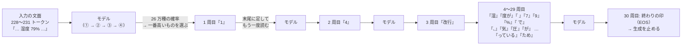

fig R7: 出力『14 / 湿度が 79% で、…ため』が出てくるまでの 30 周（29 トークン + 終わりの印。トークンの区切りは実物のトークナイザで確認）。整数は 1 桁ずつ別のトークンで、「14」は 2 周かけて出る。1 周ごとに ①〜④ を通すので、出力トークン数がそのまま所要時間に効く（§5-I: 平均 23.8 トークン）。

- **温度 0** は「⑤ で一番高い確率のトークンを選ぶ」こと。同じ文面には同じ出力が返る（§5-G の揺れは温度 0.2 で測ったもの）。
- **学習のときは ⑤ を使わない**。正解の回答（『1』『4』『改行』…）を文面の後ろに付けて一度に読ませ、各位置で「正解トークンに何 % の確率を付けたか」を読み取り、その低さを損失にする（§2-A-7）。損失を下げるように動かすのが橙の LoRA だけ、というのが本書の FineTune である。
- 2 周目以降は、文面の読み直しを省くために 1 周目の途中結果（k・v。fig R8）を取っておいて再利用する。実機の所要秒で「入力 ÷ 4.5 + 出力 ÷ 3.3」と入力と出力の係数が違うのはこのため（§5-I）。

### 2-A-4. 何を加えたか: LoRA（横に付けた小さな行列）

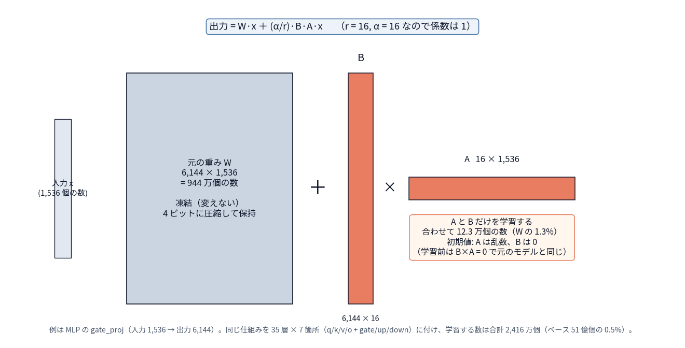

- **考え方**: 「追加学習で必要な重みの変化 ΔW は、大きな表の割に単純（階数が低い）」という経験則を使い、ΔW を細長い 2 つの行列の積 B·A で表す。**r = 16** がその「細さ」（ランク）。r を大きくすると表現力が増えるが学習する数も増える。
- **どこに付けたか**: fig R6 の ③、すなわち 35 層それぞれの注意機構の 4 箇所（q/k/v/o）と MLP の 3 箇所（gate/up/down）。1 層の中のどの位置かは次の §2-A-5（fig R8）、35 層ぶんの一覧は fig R9。`adapter_model.safetensors` を数えると 410 個の行列・合計 2,416 万個（図は gate_proj の例。k/v は Gemma 4 E2B が KV を 1 ヘッドに共有しているため 256 × 16 と小さく、後半 20 層は k/v を前の層と共有するので付かない）。ファイルは 97 MB。
- **α = 16 の意味**: B·A·x に掛ける係数 α/r。r = α なので係数 1、つまり「A・B の出力をそのまま足す」。
- **初期値**: A は小さな乱数、B は 0。学習前は B·A = 0 で**元のモデルそのもの**。学習が進むにつれて B·A が「この文面にはこの整数」の方向に育つ。
- **元の重みの扱い（QLoRA の Q）**: 学習中、元の重み W は bitsandbytes の 4 ビット形式に圧縮してメモリに置き、掛け算のたびに 16 ビットに戻して使う（§2 の「4bit で読み」）。W は一切更新しないので圧縮の誤差が学習で増幅することはない。学習後のマージでは圧縮前の BF16 の W を使う（§7 の「マージ後の BF16 は真の BF16 学習とは僅かに異なる」はこのため）。

### 2-A-5. LoRA をどこに入れたか: 1 層の中身と 35 層 × 7 箇所の地図（revC 追加）

fig R8 は fig R6 の ③ の 1 層（第 0 層）を開いたもので、橙のタグ「＋B·A」が付いた灰の箱が LoRA を横付けした行列である。


#### 7 箇所それぞれの役割と、LoRA で何が変わりうるか（平易に）

| 箇所 | 役割 | LoRA で変わりうること |
|---|---|---|
| q（query） | 「いま何を探しているか」を作る | 例: 整数を出す位置で『湿度』『気圧』の数値を探しに行く |
| k（key） | 各トークンの「見出し」を作る | 探される側の目印。数値トークンが見つかりやすくなる |
| v（value） | 各トークンの「中身」を作る | 見つけたトークンから何を持ってくるか |
| o（output） | 集めた情報を元の幅（1,536）に戻す | 集めた数値情報をどう残差に足すか |
| gate / up | 情報を 4 倍幅（6,144 または 12,288）に広げる | 「湿度 79% と気圧 −2.1 hPa なら 14」のような対応の記憶 |
| down | 元の幅（1,536）に戻す | 記憶した対応を次の層へ渡す形に変える |

#### 35 層 × 7 箇所の地図と部位別の学習数

fig R9 は 35 層すべてについて、7 箇所のどこに LoRA が付いたかの一覧である。


| 部位 | 元の重み（LoRA を付けた行列の合計） | LoRA の行列 | 学習する数（A ＋ B） | 割合 |
|---|---|---|---|---|
| 注意 q（35 層） | 1.32 億 | 70 | 224 万 | 9% |
| 注意 k（第 0〜14 層の 15 層） | 0.07 億 | 30 | 44 万 | 2% |
| 注意 v（同 15 層） | 0.07 億 | 30 | 44 万 | 2% |
| 注意 o（35 層） | 1.32 億 | 70 | 224 万 | 9% |
| MLP gate（35 層） | 5.19 億 | 70 | 627 万 | 26% |
| MLP up（35 層） | 5.19 億 | 70 | 627 万 | 26% |
| MLP down（35 層） | 5.19 億 | 70 | 627 万 | 26% |
| **合計** | **18.4 億** | **410** | **2,416 万** | 100%（全体 51.2 億の 0.47%） |

（`023_finetune/out/lora_by_module.csv`・`lora_by_layer.csv`。層による違い: 第 4・9・14・19・24・29・34 層は全体注意で q/k/v/o の幅が 2 倍、第 15〜34 層は MLP の幅が 2 倍。1 層あたりの学習数は 54.1 万〜84.4 万。）

**付けなかった場所と、その理由**:

- トークン埋め込み表（② と ④ の出力層）: 「語彙そのもの」を変えないため。本書で教えたいのは「読んだ内容をどう処理して整数にするか」であり、トークンの意味の表は元のままで足りる。
- 層ごとの埋め込み表（PLE）と射影: 同上。また 23.5 億個と最も大きく、LoRA を付けても外部メモリ前提の設計と相性が悪い。
- 正規化・注意の計算・残差: 学習する行列が無い、またはスケール値だけで小さい。
- 画像・音声の入口: 本用途で使わず、GGUF 変換で落ちる。
- 第 15〜34 層の k・v: 行列はファイルにあるが計算で使われない（KV 共有）ので、付けても意味が無い。Unsloth が自動で除外した。

この 7 種類は Unsloth・PEFT（LoRA ライブラリ）の標準の対象で、`train_lora.py` の `target_modules` に名前で指定している。「MLP だけ」「注意だけ」「ランク 8 / 32」などの別の付け方は試していない（§7）。

### 2-A-6. 何を教えたか: 学習データ 1 件の形と「正解」の作り方

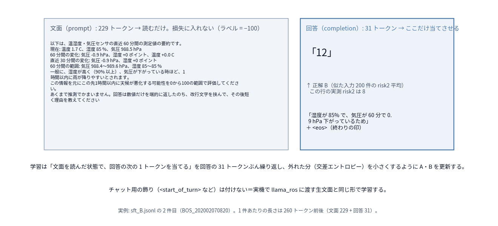

- **1 件 = 文面（prompt）+ 回答（completion）**。文面は 015 で採用した P2'（要約 + 手がかり）をそのまま使い、回答は「`<整数>` 改行 `<定型理由>`」+ EOS（終わりの印）。EOS を教えるので、学習後は理由 1 文で止まる（上限到達 0%、§1）。
- **損失は回答だけ**（`completion_only_loss=True`）。文面のトークンにはラベル −100 を付けて損失から外す。文面まで当てさせると「気象の要約文を書く練習」に学習の力が割かれるので、答え方だけに集中させる。学習ログの先頭 1 件は 260 トークン中 31 トークンが損失の対象（§2 の 249 / 17 は疎通学習の 1 件目の値）。
- **定型理由**: 要約量のしきい値から機械的に作る 6 パターン（湿度 ≥ 90% か / 気圧が 60 分で −0.5 以下・+0.5 以上・その間）。LLM に書かせないので、学習後の理由文が入力と矛盾しないことが保証される（§5-F で 100% 一致）。
- **正解の 2 通り（A と B）**: ここが本サイクルの要点。

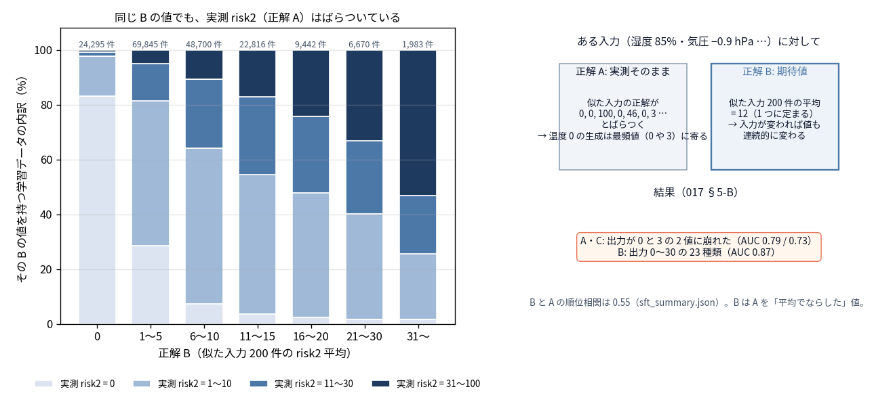

| | 正解 A（FT-A・FT-C） | 正解 B（FT-B） |
|---|---|---|
| 何か | その時刻に実際に降った量から作った risk2（0〜100 の整数） | 要約量 8 個が似ている 200 件（同じ地点の ±6 時間は除く）の risk2 の平均を四捨五入 |
| 性質 | 同じような入力でも 0 だったり 100 だったりする（雨は偶然に左右される） | 入力が決まれば値が 1 つに決まる。「この状況なら平均どれくらい降るか」 |
| 学習した結果 | モデルは「一番よく出る答え」を選ぶようになり、出力が 0 と 3 の 2 値に崩れた（AUC 0.79 / 0.73） | 入力に応じて出力が 0〜30 の 23 種類に動いた（AUC 0.87） |

なぜ A では崩れるか（平易に）: 学習は「回答のトークンの確率を上げる」ので、同じ入力に 0・0・100・0・46 … と答えがばらつくと、確率が一番高くなるのは最頻値（0 や 3）になる。温度 0 の生成はその最頻値をそのまま出す。B は答えを「平均」に置き換えてばらつきを消したので、モデルは入力と答えの滑らかな対応を学べた。

### 2-A-7. どう学習させたか: 手順と設定

学習の 1 ステップは次の繰り返しである（R-005 の方針で、目的関数・更新の仕方を言葉と式の両方で示す）。

- 1\. 学習データから 16 件（batch 8 × 勾配累積 2）を取り、各件の「文面 + 回答 + EOS」をトークン列にする。
- 2\. モデルに通して、回答部分の各位置で「次のトークンの確率」を出す。
- 3\. **目的関数**: 回答の各トークン t について、正解トークンに付けた確率 p_t の対数を取り符号を反転した値（交差エントロピー）を平均する。損失 L = −(1/N) Σ log p_t（N は 16 件ぶんの回答トークン数、1 件 約 31 なので N ≈ 500）。正解に確率 1 を付ければ L = 0、確率 0.37 なら L = 1。
- 4\. L が小さくなる方向に A・B だけを少し動かす（勾配降下。幅は学習率 2e-4 から cosine で 0 に減らす。最初の 3% は徐々に上げる）。最適化は AdamW の 8 ビット版（メモリ節約）。
- 5\. これを 982 ステップ（= 15,700 件 × 1 周）繰り返す。50 ステップごとに L を記録し、500・982 ステップで検証 300 件の L も測る。

小さな具体例（FT-B の実測ログ）: 50 ステップ時点の L = 1.20 は「正解トークンに平均で 30%（e^−1.2）の確率しか付けていない」状態で、整数も定型文も安定していない。100 ステップで L = 0.14（確率 87%）まで一気に下がる。これは定型理由（6 パターン）と改行・EOS の形式を覚えた段階で、以後の 0.14 → 0.086 の緩やかな低下が「整数の値を入力に合わせる」学習に相当する。

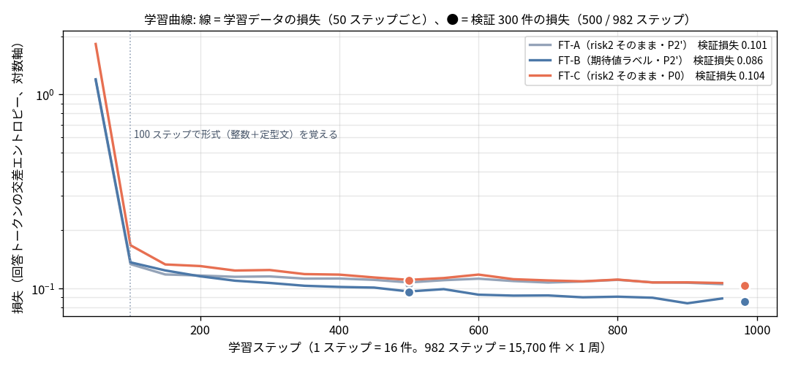

| 設定 | 値 | 平易な意味・選んだ理由 |
|---|---|---|
| 学習データ | 15,700 件（+ 検証 300） | 計画 18 万件の 1/11。float32 で 1 秒 3.3 件（`train_samples_per_second`）のため。損失は 500 ステップで平坦（fig R3） |
| 周回数（epoch） | 1 | 同じ件を 2 度見せない。件数を増やす方が先（§8） |
| 1 ステップの件数 | 16（8 × 2） | T4 のメモリに入る大きさで、更新 1 回の雑音を抑える |
| 学習率 | 2e-4、cosine、warmup 3% | LoRA の一般的な既定値。大きすぎると形式が壊れ、小さすぎると 1 周で足りない |
| 系列長 | 512 トークン | 1 件 260〜400 トークンなので切り捨て無し |
| 計算精度 | **float32** | T4 は bf16 非対応。Unsloth が Gemma 4 の fp16 を拒否したため 32 ビット（遅いが精度の問題は無い） |
| 乱数 seed | 0 | A・B の初期値とデータの順番を固定。再現用 |
| 所要 | A・B 80 分、C 131 分 | C は P0 文面が長い（401 トークン）ため |

### 2-A-8. 学習後に何をしたか: マージ → GGUF → 量子化

- **マージ**: 学習した A・B を元の重みに足し込む（W' = W + B·A）。足し込んだ後は**元と同じ形・同じ個数の重み**になり、LoRA の痕跡は無くなる。だから F16 GGUF のバイト数が元の BF16 GGUF と完全に一致する（§3-4）。疎通学習で確かめたとおり、各重みの相対変化は 0.06〜0.13% と小さい。「小さな変化で振る舞いが大きく変わる」のが追加学習の特徴。
- **GGUF 変換**: llama.cpp（PC 側の ①、実機の llama_ros）が読む形式に変換（`convert_hf_to_gguf.py`、F16 = 1 個 16 ビット）。画像・音声用の重みは落ちるので 10.2 GB → 9.31 GB。
- **量子化**: 実機（Arduino UNO Q、空き RAM 約 2.9 GB）には 9.31 GB は載らないので、重み 1 個を 16 ビットから約 4.5 ビットに丸める。

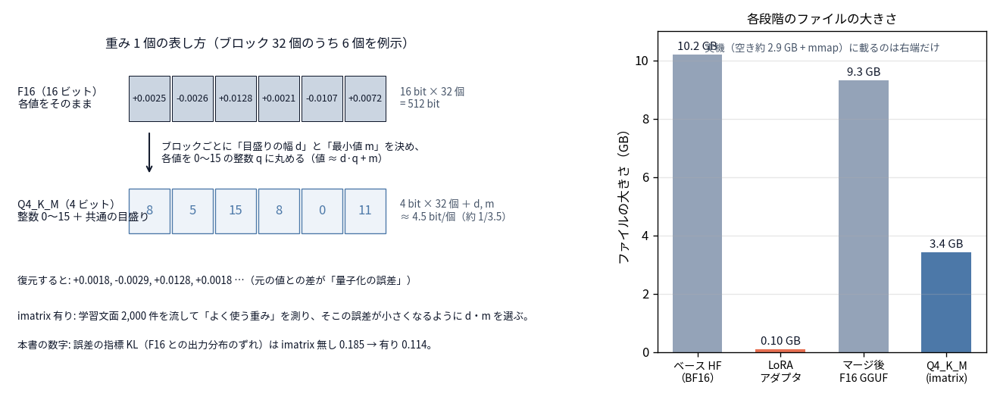

| 項目 | 平易な説明 | 本書の数字 |
|---|---|---|
| Q4_K_M | llama.cpp の 4 ビット形式。32 個単位の目盛りを 256 個単位でさらにまとめ、一部の行列（注意機構の v と MLP の down の半分）は 6 ビットで残す「M（medium）」の組合せ | 3.43 GB（F16 の 37%） |
| imatrix（重要度行列） | 代表的な文面を流して「どの重みがよく使われるか」を測り、よく使う重みの誤差が小さくなるように目盛りを決める。校正用の文面は**学習に使っていない** train 側 2,000 件 | 有り 0.114 / 無し 0.185（KL） |
| KL（劣化の指標） | F16 と量子化版で「次のトークンの確率分布」がどれだけずれたか。0 なら同じ | 現行の QAT 版（0.11〜0.12）と同程度 |
| 採点への影響 | 同じ 2,500 行で AUC 0.871（F16）→ 0.866（Q4_K_M-im）。差は CI の内側 | §5-A |

なぜ今回は量子化で落ちなかったか（§6 の再掲、平易に）: FineTune 前（015）は「湿度 90% 以上なら 40、それ以外は 30」のような**文面に書いた規則の読み取り**で判断しており、4 ビットの丸めでその読み取りが崩れた。FineTune 後は入力の数値と答えの対応が**重み全体に分散して**刻まれており、個々の重みの小さな丸め誤差では壊れない。

### 2-A-9. よくある疑問（読者向け）

| 疑問 | 答え |
|---|---|
| 元のモデルの言葉の知識は消えないか | 重みの変化は 0.1% 程度で、消えてはいない。ただし本書の用途（整数 + 定型理由）以外の振る舞いは評価していない。実機ではこの用途だけに使う |
| 学習前のモデルと「何が違う」のか | 重みの形・個数は同じ。中身が 0.06〜0.13% だけ動き、「気象の要約文を読んだら整数と定型理由を返す」ように変わった。チャット用の飾り無しの生文面で答えるようになった点も違い（FineTune 前は生文面だと書式を守らなかった、020 §3-4） |
| なぜ全重みを学習しなかったか | T4（16 GB）に載らない。LoRA は「必要な変化は単純」という前提で 0.5% だけ動かす方式で、この用途（入出力の形を決める）には十分だった（AUC 0.87） |
| BF16 / F16 / 4 ビットの違い | すべて「重み 1 個を何ビットで表すか」。BF16 と F16 は 16 ビットで精度がほぼ同じ（指数と仮数の配分が違う）。4 ビットは目盛りを粗くして大きさを 1/3.5 にする。本書の「BF16 欄」はマージ後の F16 GGUF の採点 |
| 学習データに評価データは混ざっていないか | 学習は train 分割（2019〜2022）だけ。評価 dev は 2023 年、test は 2024 年で年が違う。imatrix の校正文面も train 側 |
| 4 ビットで学習して 16 ビットに戻すのは矛盾では | 学習中の 4 ビットは「メモリに置くための圧縮」で、A・B の学習そのものは 32 ビットで行う。マージは圧縮前の BF16 の重みに足し込む。実機用の 4 ビットはその後に別途作る（fig R0 の ③） |
| 期待値ラベルは「本当の答え」ではないのでは | その通りで、B は「この状況で平均どれだけ降るか」。出力 20 は「9 割降る状況」の意味になる（§5-C の信頼性表）。LED の表示に使うときは読み替え表を通す（§6） |
| LoRA はモデルの「どこ」に入っているのか（revC） | 35 層それぞれの注意機構（q/k/v/o）と MLP（gate/up/down）の 7 種類の行列の横（fig R8・R9）。埋め込み表・PLE・正規化・出力層・画像/音声の入口には入っていない。第 15〜34 層は k・v が使われないので 5 種類 |
| なぜ MLP 側に学習する数が多いのか（revC） | 行列が大きい（1,536 × 6,144 または 12,288）ので、同じランク 16 でも A・B の個数が多い。全 LoRA の 78%。「どこが効いたか」は分けて測っていない |
| なぜ埋め込み表や出力層には付けないのか（revC） | 語彙（トークン → 数ベクトル）は変えず、「読んだ内容をどう処理するか」だけを変えたいため。Unsloth/PEFT の標準対象も 7 種類。付ける選択肢はあるが未検証（§7） |

## 3. 実行内容の確認

### 3-1. 処理フロー図

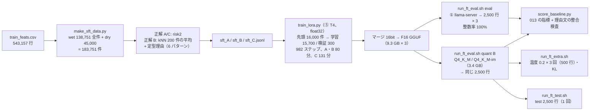

fig0: 学習から評価までの経路。評価側（右）は 013〜015 と同じスクリプトで、GGUF のパスを変えただけ。

### 3-2. 計画との対応表

| 016 の計画 | 実行 | 逸脱・追加（理由） |
|---|---|---|
| 1. ⑤ の構築 | `Dockerfile.train`（CUDA 12.8 devel + venv）、compose `train`。疎通 300 行で学習 → マージ → GGUF → llama-server 応答まで確認 | transformers 5.19 → **5.17.0**（unsloth の上限）。`python3-dev` を追加（Triton のビルドに必要）。Unsloth が Gemma 4 の fp16 を拒否し **float32** に |
| 2. 学習データ 約 18 万件 | 183,751 件を生成（A/B/C） | — |
| 3. 学習 3 本（1 epoch、各 1〜2 時間） | **各 15,700 件 × 1 epoch**（982 ステップ）。A・B 80 分、C 131 分 | **件数を 18 万 → 1.6 万に縮小**: float32 で 1 秒 2〜3 件（18 万件で 1 本 15〜24 時間）のため。損失は 500 ステップ以降ほぼ平坦（§5-A の学習曲線）で、1 epoch 分の追加データが効くかは未検証（§7） |
| 4. 評価（BF16 → 最良を Q4） | A/B/C の F16 を採点、最良 B を Q4_K_M 2 種で採点 | 追加: 温度 0.2 × 3 回（§5-G）、KL（§5-I）、理由文の整合検査（§5-F） |
| 5. test は最良 1 本だけ | FT-B Q4_K_M-im（実機候補）を test 層化 2,500 行で 1 回 | — |

### 3-3. 入力データの現物確認

<div class="exec" markdown="1">
- 評価データ: 013 と同一の 2,500 行（`dev_sample.csv`。fig1 は 013 と同じ）。文面は P2'（A・B）と P0（C）。
- 学習データ（`sft_summary.json`）: 183,751 件、ラベル A の平均 12.1（値の種類 41）、ラベル B の平均 6.9（値の種類 59、中央値 5、90% 点 15、99% 点 31）。定型理由の内訳: 「湿度 N% で・安定」75,001 / 「と高く・安定」35,579 / 「で・下がって」26,903 / 「で・上がって」19,774 / 「と高く・下がって」16,842 / 「と高く・上がって」9,652。
- 学習に使った 16,000 件は jsonl の先頭（seed 固定で無作為化済み）。wet:dry は全体と同じ約 3:1。
- test（§5-H）: test 分割（2024 年）125,010 行（バケット全欠測を除いて 124,687 行）から dev と同じ段・行数で層化した 2,500 行（`test_sample.csv`。b0 93,912 / b1 18,548 / b2 7,535 / b3 2,423 / b4 2,269 行から 800 / 600 / 500 / 350 / 250）。
</div>

### 3-4. 中間処理の確認

<div class="exec" markdown="1">
- 損失のマスク: 学習データ 1 件目は 249 トークンで、損失に入るのは回答の 17 トークンだけ（文面側は −100）。
- 学習曲線（50 ステップごとの損失。A / B / C）: 50 ステップ 1.19 / 1.20 / 1.82 → 100 ステップ 0.13 / 0.14 / 0.17 → 500 ステップ 0.107 / 0.096 / 0.111 → 982 ステップ 0.101 / 0.086 / 0.104（検証損失）。100 ステップで形式を覚え、以降は緩やかに下がる。
- マージの確認: 疎通学習（16 ステップ）後のマージ済み重みは元の重みと相対差 0.06〜0.13%（LoRA が乗っていることの確認）。
- GGUF 変換: 3 本とも `convert_hf_to_gguf.py` が exit 0、9,311,304,960 バイト（元の BF16 GGUF と同じテンソル構成）。
</div>

## 4. 検証したい仮説

- **H3**: 36 値（要約量）から risk2 への対応は LoRA で学習でき、(i) 出力が多数の値を取り、(ii) AUC が 0.80 以上、(iii) 4 ビット量子化後も 0.75 以上。
- **反証条件**: BF16 で AUC ≥ 0.80・ρ ≥ 0.50・値の種類 ≥ 20、Q4 で AUC ≥ 0.75、整数率 100%、理由文が定型どおり。
- **棄却条件**: A・B とも BF16 で AUC < 0.70。A だけ悪く B が良ければ「期待値の正解が必要」。

## 5. 分析結果（事実）

### A. 全体（§1 の表の補足。2,500 行、母集団重み）

<div class="fact" markdown="1">
| 条件 | AUC（heavy ≥ 30） | ρ 雨あり行 | MAE 雨あり行 | 上振れ | dev 最良閾値 / F1 | 出力トークン 平均 / p90 | T4 prompt_ms / predicted_ms |
|---|---|---|---|---|---|---|---|
| FT-A | 0.640 | 0.088 | 26.3 | +0.1 | 0 / 0.088 | 22.8 / 30 | 238 / 1,028 |
| **FT-B BF16** | **0.770** | **0.301** | 23.6 | +0.9 | 5 / 0.320 | 23.5 / 31 | 233 / 1,058 |
| FT-B Q4_K_M-im | 0.772 | 0.310 | 23.5 | +1.1 | 5 / 0.315 | 23.8 / 31 | 173 / 748 |
| FT-B Q4_K_M | 0.763 | 0.292 | 23.8 | +1.1 | 5 / 0.309 | 23.1 / 31 | 175 / 728 |
| FT-C | 0.615 | 0.115 | 26.1 | +0.6 | 0 / 0.088 | 22.1 / 30 | 289 / 1,119 |
| ref 勾配ブースティング | 0.780 | 0.311 | 23.3 | +0.2 | 5 / 0.365 | — | — |

- B の BF16 と Q4_K_M-im の差（AUC 0.005、ρ 0.000）は CI の幅（±0.017）と run 間 SD（§5-G）の内側。imatrix の有無の差（0.003）も同様。
- A と C の AUC 0.79 / 0.73 は、出力 2 値（0 か 3）が湿度で分かれているだけで得られた値（出力と湿度の順位相関 A 0.75、C 0.60）。
- 学習に使った文面の違い（B の P2' と C の P0）は正解が同じ A と C の比較で AUC 0.79 対 0.73。文面は FineTune 後も効く。
</div>

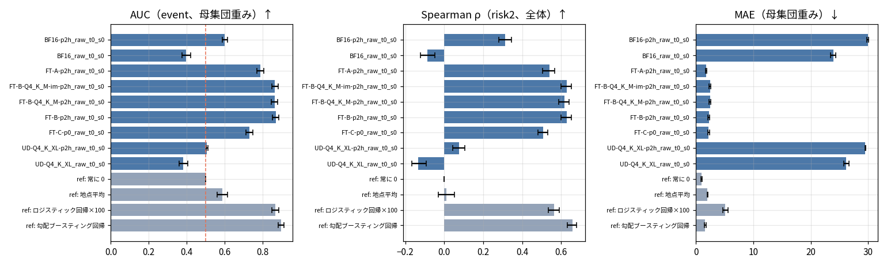

### B. 出力の分布と真値の段

<div class="fact" markdown="1">
| 条件 | 出力の値（上位） | 真値の段 0 / 1〜10 / 11〜30 / 31〜60 / 61〜100 の出力の平均（中央値） |
|---|---|---|
| FT-A | 3（72%）、0（28%） | 1.0 (0) / 2.6 (3) / 2.8 (3) / 2.9 (3) / 2.8 (3) |
| **FT-B BF16** | 1（16%）、0（12%）、4、3、10、2、6、5、7、8、14、11 … 23 種 | **1.6 (1) / 4.9 (4) / 6.2 (5) / 7.5 (7) / 9.0 (7)** |
| FT-B Q4_K_M-im | 21 種 | 1.8 (1) / 4.9 (4) / 6.3 (6) / 7.6 (7) / 9.0 (8) |
| FT-C | 3（82%）、0（18%） | 1.5 (0) / 2.9 (3) / 3.0 (3) / 3.0 (3) / 3.0 (3) |
| ref 勾配ブースティング | 連続 | 0.8 / 4.4 / 6.3 / 8.7 / 14.4 |

B は段が上がるほど出力の平均・中央値が単調に上がる。最高段（61〜100）でも平均 9.0 で、出力の最大は 30 程度（学習ラベル B の 99% 点が 31 のため）。
</div>

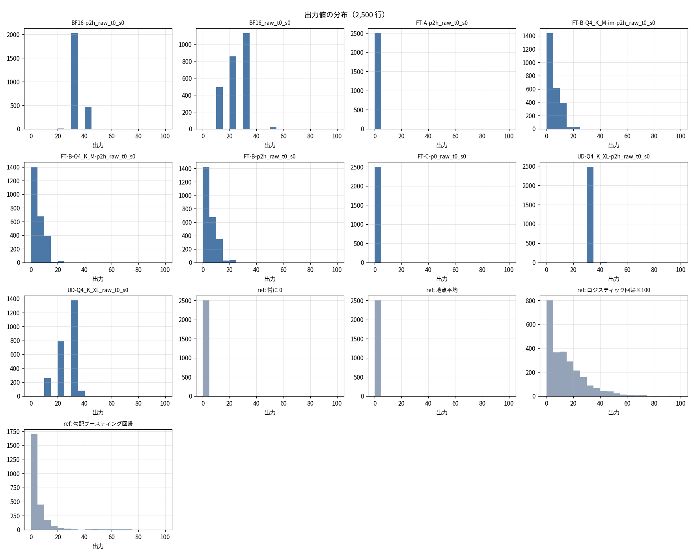

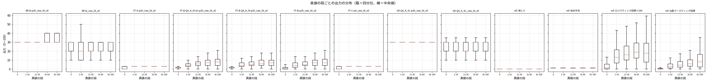

### C. 信頼性表（FT-B Q4_K_M-im。母集団重み）

<div class="fact" markdown="1">
| 出力 | 行数 | 実際に 0.5 mm 以上降った割合 | risk2 の平均 / 中央値 |
|---|---|---|---|
| 0〜9 | 2,051 | 3.8% | 0.7 / 3 |
| 10〜19 | 416 | 25.4% | 7.5 / 30 |
| 20〜29 | 33 | **87.8%** | 58.8 / 76 |

BF16 でもほぼ同じ（0〜9: 3.9%、10〜19: 25.5%、20〜29: 88.2%、30〜39: 3 行で 100%）。母集団の事象率は 2.4〜7.4% なので、出力 10 以上で 5 倍、20 以上で 20 倍の濃度。
</div>

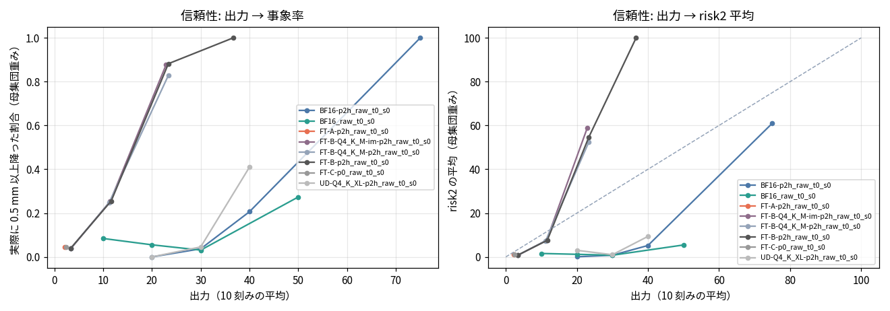

### D. 層別（FT-B Q4_K_M-im）

<div class="fact" markdown="1">
地点別 AUC: ATL 0.843 / BOS 0.852 / DSM 0.841 / IAH 0.805 / SEA 0.794。季節別: 冬 0.812 / 夏 0.836 / 春 0.860 / 秋 0.806。気圧低下の行 0.830 / 上昇・不変 0.822。湿度 < 90% の行 0.820 / **≥ 90% の行 0.666**（ρ 0.27）。最も悪いのは湿度 ≥ 90% の内側（事象率 81% の行群で、その中の順位付けが弱い）。BF16 も同じ傾向（≥ 90% で 0.664）。
</div>

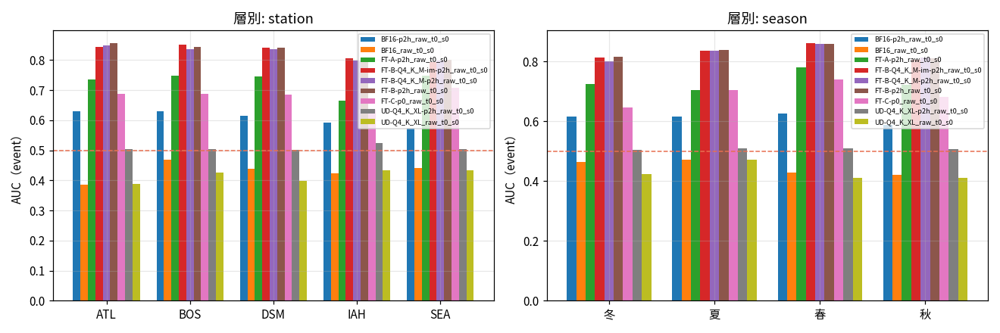

### E. 出力が反応している要約量（FT-B BF16）

<div class="fact" markdown="1">
出力と要約量の Spearman 順位相関: 現在の湿度 +0.74、60 分の湿度変化 +0.27、30 分の湿度変化 +0.23、60 分の気圧変化 −0.21、30 分の気圧変化 −0.18、現在の気圧 −0.19、60 分の温度変化 −0.14、現在の温度 −0.03。真値 risk2 との符号がすべて一致（013 §5-E: 湿度 +0.55、気圧変化 −0.09）。A は湿度 +0.75 だけで他はほぼ 0。
</div>

### F. 理由文と誤りの現物（FT-B Q4_K_M-im）

<div class="fact" markdown="1">
- 理由文が定型 6 パターンに一致: B 99.4%（BF16）、A 99.96%、C 98.5%。不一致の例: 「湿度が 94% と高く、温度が 60 分で 4.0°C 下がっているため」（学習に無い温度の文。B で 2 件）。
- 理由文の中身と入力の整合: 湿度の値（±1%）2,500 件中 100% 一致、気圧の向きと量（±0.15 hPa）1,216 件中 100% 一致。

| 種類 | 行 | 真値 | 出力 | 湿度 / 60 分気圧変化 | 応答 |
|---|---|---|---|---|---|
| 見逃し | DSM 2023-04-20 03:15 | 100 | 0 | 64% / +0.05 | `0\n湿度が 64% で、気圧が安定しているため` |
| 見逃し | ATL 2023-08-06 18:30 | 100 | 1 | 50% / −0.28 | `1\n湿度が 50% で、気圧が安定しているため` |
| 空振り | DSM 2023-01-11 05:45 | 0 | 14 | 79% / −2.13 | `14\n湿度が 79% で、気圧が 60 分で 2.1 hPa 下がっているため` |
| 空振り | BOS 2023-12-19 00:45 | 0 | 11 | 71% / +3.15 | `11\n湿度が 71% で、気圧が 60 分で 3.1 hPa 上がっているため` |

見逃しは湿度 50〜70% で気圧も動かない対流性の雨（夏の ATL など）で、要約量に前兆が無い。空振りは気圧が大きく動いた行（前線通過後など）。
</div>

### G. ノイズとの比較（温度 0.2 × 3 回、500 行、FT-B Q4_K_M-im）

<div class="fact" markdown="1">
| 項目 | FT-B Q4_K_M-im（温度 0.2 × 3 回、行ごとに seed を変える） | 参考: 現行 P0 BF16（013） |
|---|---|---|
| 3 回とも同じ値の行 | 47.6% | 59.4% |
| 同じ行の 3 回の幅（最大 − 最小）の平均 | **0.7** | 4.7 |
| 温度 0 の出力と一致した割合（3 回平均） | 68.9% | 78.7% |
| 指標の run 間 SD（AUC / ρ / MAE） | **0.004 / 0.004 / 0.008** | 0.013 / 0.028 / 0.04 |
| 同じ 500 行の温度 0 の AUC / ρ | 0.835 / 0.599 | 0.403 / −0.053 |
| 温度 0.2 の 3 回の AUC | 0.826 / 0.832 / 0.836 | 0.404 / 0.425 / 0.395 |

揺れは隣の整数（±1）に収まり、指標はほとんど動かない。この 500 行の AUC（0.835）が全体（0.866）より低いのは部分集合の違い（013 でも同じ傾向: 0.403 対 0.398）。

</div>

### H. test（2024 年）での最終確認（FT-B Q4_K_M-im、1 回）

<div class="fact" markdown="1">
test 分割（2024 年）から dev と同じ層化で抜いた 2,500 行（§3-3）。参照モデルは train で学習したものをそのまま test に当てた。

| 条件 | AUC（event）[95% CI] | AUC（heavy） | ρ 全体 | ρ 雨あり行 | MAE | 出力の値の種類 | 整数率 / 理由文の定型一致 |
|---|---|---|---|---|---|---|---|
| **FT-B Q4_K_M-im（test）** | **0.863 [0.846, 0.879]** | 0.746 | **0.596** [0.568, 0.626] | 0.265 | 2.63 | 20 | 100% / 気圧の向き 1,332 件中 100% |
| 同（dev、§1） | 0.866 [0.848, 0.883] | 0.772 | 0.629 | 0.310 | 2.48 | 21 | 100% / 100% |
| ref 勾配ブースティング（test） | 0.888 [0.873, 0.902] | 0.752 | 0.613 | 0.270 | 1.72 | 連続 | — |
| ref ロジスティック回帰（test） | 0.866 | 0.691 | 0.538 | 0.142 | 5.53 | 連続 | — |
| ref 常に 0（test） | 0.500 | 0.500 | 0 | 0 | 1.22 | 1 | — |

- 真値の段ごとの出力の平均（test）: 1.8 / 5.3 / 6.5 / 7.8 / 8.9（dev: 1.8 / 4.9 / 6.3 / 7.6 / 9.0）。信頼性表（test）: 出力 0〜9 → 事象率 3.8%、10〜19 → 40.4%、20〜29 → 100%（35 行）。
- 地点別 AUC（test）: ATL 0.879 / BOS 0.872 / DSM 0.759 / IAH 0.769 / SEA 0.799。季節別: 冬 0.774 / 夏 0.859 / 春 0.848 / 秋 0.846。dev より DSM・IAH・冬が低い（年による違いの範囲）。
- test の母集団重みで戻した事象率は DSM 3.4%（dev と同じ方法の検算値 4.1%）など ±0.7 pt の範囲。

</div>

### I. 量子化の劣化（KL）と形式・コスト

<div class="fact" markdown="1">
| 量子化（FT-B、F16 を基準） | 平均 KL | 99.9% 点 | 最大 | ファイル |
|---|---|---|---|---|
| **Q4_K_M + imatrix（実機候補）** | **0.114 ± 0.004** | 8.5 | 12.9 | 3.43 GB |
| Q4_K_M（imatrix 無し） | 0.185 ± 0.005 | 8.7 | 14.9 | 3.43 GB |
| 参考: 現行 UD-Q4_K_XL（QAT、報告 005、一般文） | 0.11〜0.12 | — | — | 3.18 GB |

KL は学習に使っていない train 側の文面 + 回答 200 段落（`kl_text.txt`、c=512）で計測。imatrix 有りは QAT 版と同程度の劣化に収まり、採点（AUC 0.866 対 0.863）でも imatrix 有りがわずかに良い。


| 条件 | 入力トークン | 出力トークン 平均 / p90 / 上限到達 | 実機の所要秒の見積り（入力 ÷ 4.5 + 出力 ÷ 3.3） |
|---|---|---|---|
| FT-B Q4_K_M-im（P2'） | 231 | 23.8 / 31 / 0% | **約 59 秒** |
| FT-C（P0） | 382 | 22.1 / 30 / 0% | 約 92 秒 |
| 参考: 現行 P0（013） | 382 | 4.5 / 3 / 1% | 約 86 秒 |

GGUF: F16 9.31 GB、Q4_K_M 3.43 GB（imatrix 有無で同じ大きさ）。実機候補の UD-Q4_K_XL（3.18 GB）より 0.25 GB 大きい（Q4_K_M は埋め込み表の量子化が異なる。報告 005 の表では Q4_K_M 3.41 GB）。
</div>

## 6. 解釈（事実と分離）

<div class="interp" markdown="1">
- **H3 は支持された**（反証条件をすべて満たす: BF16 AUC 0.87・ρ 0.63・値 23 種、Q4 0.87、整数率 100%、理由文 99.4% 定型）。
- **正解の作り方が決定的**だった。risk2 をそのまま学習した A・C は出力が「0 か 3」に崩れ、提案書 016 §1 と revD §3-4 の懸念どおりになった。温度 0 の生成は「最も確率の高い整数」を出すので、雨の有無が不確かな入力では最頻値（dry なら 0、wet の最頻値 3）に寄る。期待値ラベル B は入力ごとに正解が 1 つに定まるため、学習後の出力が入力に応じて連続的に動くと考えられる。
- **量子化で落ちない**のは、学習で得た判断が「30 か 40 か」の僅差ではなく、重みの広い範囲に分散した対応関係になったためと考えられる（015 の文面だけの決定境界との違い）。imatrix の効果はこの用途では見えない（KL は §5-I）。
- 統計モデル（0.90）との残差 0.03 は、(a) 学習に 1.6 万件しか使っていない、(b) LLM は要約量を文字列として読むため細かい差を区別しにくい、のどちらかと考えられる。(a) は件数を増やして確かめられる（§9）。
- 出力が 0〜30 に収まるのは期待値ラベルの性質で、「20 と出たら 9 割降る」という意味になる。LED に 0〜100 を使い切らせたい場合は、信頼性表（§5-C）を使って出力を事象率に読み替える（例: 出力 10 → 25、20 → 88）か、revD §3-4 (B) の相対的な危険度（順位）に写す。これは用途側の判断で、モデルの精度とは独立に後処理で決められる。
- 湿度 ≥ 90% の内側で順位が付きにくい（AUC 0.67）のは、そこでの区別に要約量以外の情報（温度の推移・時刻・季節）が要るためと考えられる。文面に入れていない情報なので、現状の入力の限界に近い。
</div>

## 7. 反証条件・限界

<div class="limit" markdown="1">
- 学習は計画の 18 万件ではなく **1.6 万件**（float32 の速度制約）。損失は 500 ステップで平坦になったが、件数を増やしたときの伸びは未検証。
- dev で 3 本から B を選んだ（dev の選択回数: 文面 1 回 + モデル 1 回 = 2 回）。test の数字（§5-H）が確からしさの根拠。
- 温度 0.2 の揺れは Q4_K_M-im の 500 行で測った（§5-G）。
- 期待値ラベル B は「学習母集団（dry を 1:3 に間引いた集合）での期待値」で、母集団重みで戻した値ではない。出力の絶対値は母集団の事象率より高めに出る（信頼性表で読み替える前提）。
- 定型理由は 6 パターンしか無く、「理由」としての情報量は湿度の高低と気圧の向きだけ。入力と矛盾しないことは保証されるが、見逃しの理由（対流性の雨）は説明できない。
- 実機の所要秒は 005 の簡易式による見積り。実機では llama_ros（b10327）のタグ差・mmap のページ追い出しで変わりうる（Phase 9・10）。
- LoRA の挿入箇所は Unsloth の標準（35 層の注意機構 q/k/v/o と MLP gate/up/down、ランク 16）で、埋め込み表・PLE・出力層には付けていない（§2-A-5）。「MLP だけ」「注意だけ」「ランク 8 / 32」との比較は未実施で、7 箇所のうちどこが効いたかは分からない。
- QLoRA（4bit ベースで学習 → 16bit にマージ）なので、マージ後の BF16 は真の BF16 学習とは僅かに異なる。評価は GGUF で行っているので実機で使う物そのものの数字ではある。
</div>

## 8. 診断 → 改善の接続

| 診断（§5） | 原因の見立て（§6） | 改善候補【対象】 |
|---|---|---|
| A: B と統計モデルの差 0.03 | 学習件数 1.6 万（計画の 1/11） | **B を 5〜8 万件で再学習**（float32 で 5〜8 時間。または bf16 対応 GPU）【学習方法】 |
| D: 湿度 ≥ 90% の内側で AUC 0.67 | 要約量に無い情報が要る | 文面に温度の推移（60 分の最大/最小）を足す P2'' で再学習【前処理】 |
| C・§6: 出力が 0〜30 に収まる | 期待値ラベルの性質 | 後処理で信頼性表による読み替え（LED 用）。モデルは変えない【後処理】 |
| F: 理由文が 6 パターン | 定型の設計 | 温度・湿度変化を含む 12 パターンに拡張（学習データ側だけの変更）【データ】。または定型をやめて LLM に自由生成させる（レビュー指摘 2、§9 の 4）【データ・推論】 |
| I: Q4_K_M 3.43 GB（実機の空き 2.9 GB、mmap 前提） | — | 実機で RSS・所要秒を実測（Phase 10）。必要なら IQ4_XS（3.29 GB）も同じ採点で確認【量子化】 |

## 9. 結論および改善案

- **総合判定: 支持**（FineTune で現行の AUC 0.40 → 0.87、Q4 でも 0.87）。
- **採否: 採用**。実機候補 = `models/ft/B/gemma-4-E2B-wr-B-Q4_K_M-im.gguf`（3.43 GB）+ P2' 文面（`build_prompt_p2h()`）。
- **次サイクル候補**:
  - 1\. 【実機】Phase 9〜10: `③' b10327` での出力一致確認と、実機での所要秒・RSS・整数率の実測（revD §5 の手順）。LED 用の読み替え表（信頼性表）を添える。
  - 2\. 【学習方法】B を 5〜8 万件で再学習し、0.90 に近づくかを確認（無人 5〜8 時間）。
  - 3\. 【前処理・データ】P2''（温度の推移を追加）と理由文 12 パターン。湿度 ≥ 90% の内側の改善を狙う。
  - 4\. 【データ・推論】**レビュー指摘 2（023、未対応）: 理由文を定型にせず LLM に自由生成させる**。定型 6 パターンは入力と矛盾しない代わりに表現が固定で、LLM の表現力を使えていない（§7）。案は 2 つ。(a) **1 段**: 学習データの理由文を、要約量から多様な言い回しで書いた文（Claude 等で生成し、入力との整合を機械検査して通ったもの）に置き換えて FT-B を再学習する。実機の所要は変わらないが、整数の精度への影響を再評価する必要がある。(b) **2 段**: 推論を「危険度の整数（現在の FT-B）」→「その整数と要約量を渡して理由文を生成（元の Gemma 4 または理由専用の LoRA）」に分ける。FT-B の精度（AUC 0.87）を保ったまま理由側だけ差し替えられるが、実機の所要が 2 回分（約 59 秒 + 理由文の生成）になる。どちらも、理由文の評価には §5-F の整合検査に加えて「理由として妥当か」の採点（人手または LLM 採点）が要る。次の改訂で設計を提案する。

## 10. 次のタスク / 引き継ぎ事項

```bash
# 学習データ → 学習 → GGUF（⑤ train コンテナ。ホストから）
docker run --rm --user $(id -u):$(id -g) -e HOME=/tmp -v $PWD:/w -w /w gemma4-eval python3 -I eval/scripts/make_sft_data.py
bash env/docker/run.sh up && docker compose -f env/docker/compose.yaml up -d train
bash eval/scripts/run_ft_queue.sh "A B C" 16000 300           # 各 80〜130 分
# 評価・量子化・追加確認・test
bash eval/scripts/run_ft_eval.sh eval "A B C"
bash eval/scripts/run_ft_eval.sh quant B
bash eval/scripts/run_ft_extra.sh B                            # 温度 0.2 × 3 回・KL
bash eval/scripts/run_ft_test.sh B Q4_K_M-im                   # test（1 回だけ。台帳に記録）
docker run --rm --user $(id -u):$(id -g) -e HOME=/tmp -v $PWD:/w -w /w gemma4-eval python3 -I eval/scripts/score_baseline.py \
    --cond-filter '(^FT-[ABC])|(-p2h_raw_t0_s0$)|(^BF16_raw_t0_s0$)|(^UD-Q4_K_XL_raw_t0_s0$)' --figdir report/261008_auduino検証/017_finetune/figs --summary-dir eval/results/baseline/out_017
```

- 実機候補: `models/ft/B/gemma-4-E2B-wr-B-Q4_K_M-im.gguf`。学習成果物: `models/ft/B/{lora,merged}/`、`train_log.json`。
- 学習コンテナの注意: `python3-dev` が無いと Triton が動かない（Dockerfile に反映済み。稼働中のコンテナは手動で入れた）。
- 最有力の次サイクル: 実機展開（Phase 9〜10）。学習の拡張（2.・3.）は並行可。

## 用語集

<dl>
<dt>重み（パラメータ）</dt><dd>モデルの中の「数の表」。入力の数ベクトルに掛け算して次の層へ渡す。Gemma 4 E2B は 51 億個。FineTune はこの一部を動かすこと。</dd>
<dt>トークン</dt><dd>LLM が扱う文字列の単位（単語の断片）。Gemma 4 は 26 万種。学習データ 1 件は 260〜400 トークン、回答は約 31 トークン。</dd>
<dt>FineTune（追加学習・SFT）</dt><dd>公開モデルの重みを自分のデータで少し動かし、振る舞いを変えること。SFT は「文面 → 正解の回答」の対で行う教師あり微調整。</dd>
<dt>ランク r / α</dt><dd>LoRA の行列 A・B の細さ（r = 16）と、B·A の出力に掛ける係数 α/r（= 1）。</dd>
<dt>マージ</dt><dd>学習した A·B を元の重みに足し込み、元と同じ形の 1 つのモデルに戻すこと。以後は普通のモデルとして扱える。</dd>
<dt>交差エントロピー（損失）</dt><dd>正解トークンに付けた確率の対数の符号を反転した値。確率 1 で 0、確率 0.37 で 1。学習はこれを小さくする。</dd>
<dt>学習率 / cosine / warmup</dt><dd>1 回の更新で重みを動かす幅 / その幅を周の終わりに向けて滑らかに 0 へ減らす方式 / 最初の数 % だけ幅を徐々に上げる期間。</dd>
<dt>epoch / ステップ / batch</dt><dd>学習データを 1 周すること / 1 回の更新 / 1 回の更新に使う件数（16）。982 ステップ × 16 件 = 15,700 件 × 1 周。</dd>
<dt>bitsandbytes 4 ビット</dt><dd>QLoRA で凍結した元の重みをメモリに置くための圧縮形式。学習の計算時に 16 ビットに戻す。実機用の Q4_K_M とは別物。</dd>
<dt>GGUF</dt><dd>llama.cpp（PC 側 ①・実機の llama_ros）が読むモデルファイルの形式。F16（16 ビット）と Q4_K_M（4 ビット）がある。</dd>
<dt>BF16 / F16 / float32</dt><dd>数 1 個を 16 ビット（2 種類の配分）/ 32 ビットで表す形式。本書の「BF16 欄」はマージ後の F16 GGUF の採点、学習の計算は float32。</dd>
<dt>PLE（層ごとの埋め込み表）</dt><dd>Gemma 4 E2B が各層に持つ大きな表（23.9 億個）。外部メモリに置けるため「E（実効）2B」と呼ばれる。LoRA は付けていない。</dd>
<dt>トークナイザ（revC）</dt><dd>文字列を 26 万種の「番号」の列に区切る辞書。重みは無い。整数は 1 桁ずつ別のトークンになる。</dd>
<dt>注意機構（attention）（revC）</dt><dd>各層の前半。q（何を探すか）・k（見出し）・v（中身）の 3 つの行列で「文面のどのトークンを見るか」を決めて情報を集め、o で元の幅に戻す。LoRA は q/k/v/o に付けた。</dd>
<dt>MLP（revC）</dt><dd>各層の後半。gate・up で 4 倍幅に広げ、down で戻す 3 つの行列。知識の大部分がここにあり、LoRA の学習数の 78% を占める。</dd>
<dt>残差（revC）</dt><dd>各部品の出力を入力にそのまま足す配線。層を重ねても情報が消えない。LoRA は付けない（行列が無い）。</dd>
<dt>局所注意 / 全体注意（revC）</dt><dd>注意機構が見る範囲。局所は直前 512 トークン、全体は文面全部。Gemma 4 E2B は 5 層に 1 層が全体注意（第 4・9・…・34 層）。</dd>
<dt>KV 共有（revC）</dt><dd>第 15〜34 層が k・v を第 0〜14 層の結果から借りる設計。この 20 層では k・v の行列が使われず、LoRA も付かない。</dd>
<dt>出力層（重み共有）（revC）</dt><dd>1,536 個の数を 26 万種の確率に変える最後の行列。トークン埋め込み表と同じ表を使い回す。LoRA は付けない。</dd>
<dt>LoRA / QLoRA</dt><dd>モデルの一部の重みだけを小さな追加行列で学習させる追加学習。QLoRA はベースを 4 ビットに圧縮した状態で学習する。</dd>
<dt>期待値ラベル（正解 B）</dt><dd>似た入力 200 件（kNN）の risk2 の平均。入力ごとに 1 つに定まる「この状況なら平均どれだけ降るか」の値。</dd>
<dt>最頻値への収束</dt><dd>温度 0 の生成が「最も確率の高い整数」を出すため、ばらつく正解を学習すると最頻値ばかり答えるようになる現象。A・C で起きた。</dd>
<dt>定型理由</dt><dd>要約量のしきい値から機械的に選ぶ 1 文（6 パターン）。入力と矛盾しない。</dd>
<dt>AUC / ρ / MAE / 信頼性表 / 母集団重み / CI / run 間 SD</dt><dd>013 と同じ。</dd>
<dt>Q4_K_M / imatrix / KL</dt><dd>4 ビット量子化の形式 / 量子化の精度を上げる重要度行列 / 量子化前後の出力分布のずれ。</dd>
<dt>float32 学習</dt><dd>T4 が bf16 に非対応で、Unsloth が Gemma 4 の fp16 を拒否するため、32 ビットで計算した。速度が 2〜3 倍遅い。</dd>
<dt>prefill</dt><dd>入力を読む段階。実機の所要秒はここでほぼ決まる。</dd>
<dt>Phase 9 / 10</dt><dd>revD の実機パッケージ作成 / 実機での計測。</dd>
</dl>
