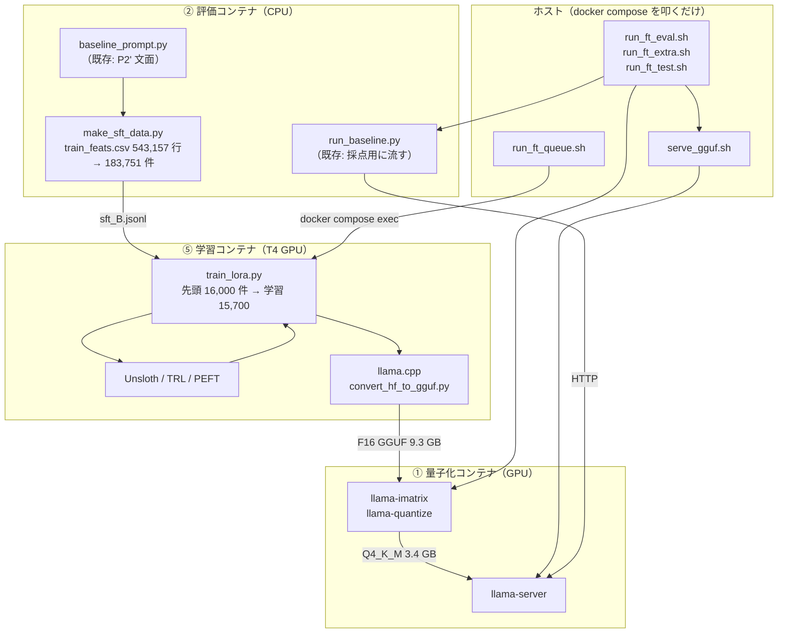
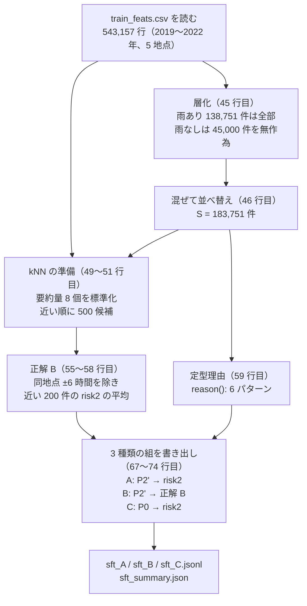
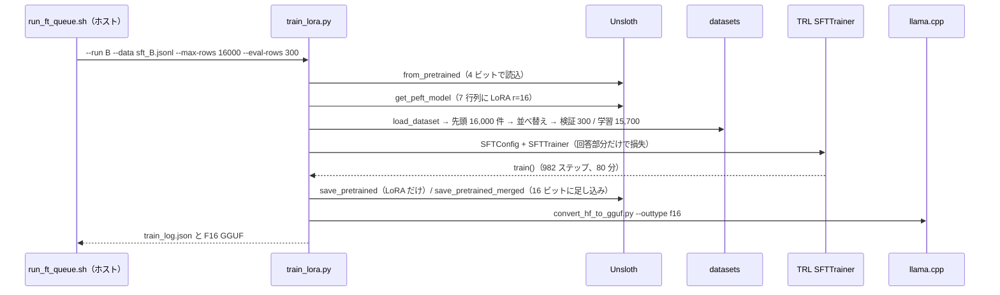
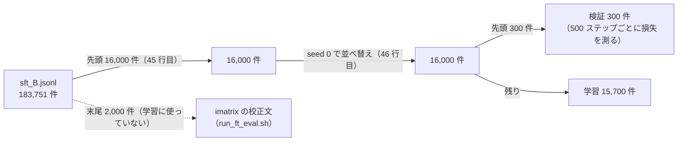
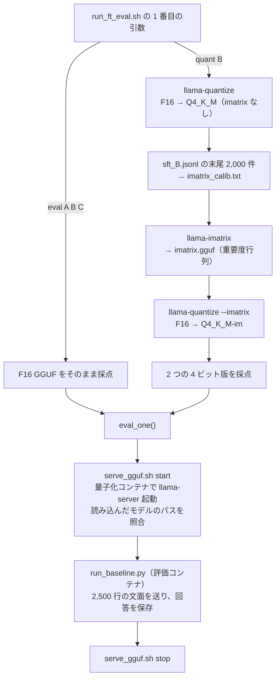

# FineTune の追加コード解説 — 学習用コンテナ・学習データ作成・LoRA 学習・量子化と評価の全文と構造

## 0. この文書について

<div class="kpi" markdown="1">

この文書は、降雨危険度の LoRA FineTune（FT-B）のために**新しく書いたコードの全文**を載せ、構造と各部分の役割を説明するものです。

- 新しく書いたのは **9 ファイルと compose.yaml への追記 20 行、計 339 行**です（学習用コンテナ 2、学習データ作成 1、学習 1、実行・評価用シェル 5）。GitHub から持ってきたコード（実機アプリ・Unsloth・TRL・PEFT・llama.cpp）は**どれも書き換えていません**。
- 学習の中身は `train_lora.py` の **約 50 行**（読込 → LoRA を付ける → 学習 → マージ → GGUF 変換）で、ほとんどが Unsloth と TRL の標準機能の呼び出しと設定です。

</div>

**表 0-1: この文書の前提**

| 項目 | 内容 |
|---|---|
| 読者 | 開発チームのメンバー。Python は読めるが、LLM の FineTune には詳しくない人を想定 |
| 対象 | 2026-10-15 に作った FineTune 用のコード（下の表）。2026-10-26 時点のファイルをそのまま載せている |
| 関連資料 | 実装の説明スライド: `028_検討状況共有_revC_ロゴなし_配色変更.pptx` の 8〜10 枚目。結果の報告: `023_FineTune_報告_revC.md` |
| 範囲外 | 採点のスクリプト（`run_baseline.py`・`score_baseline.py`。FineTune 前から使っているもの）、2 段推論のスクリプト（`run_stage2.py` ほか） |

**表 0-2: この文書で解説するファイル（新規 9 本と、呼び出している既存 1 本）**

| 区分 | ファイル | 行数 | 実行する場所 | 役割 |
|---|---|---:|---|---|
| 学習用コンテナ | `env/docker/Dockerfile.train` | 22 | ホストで build | 学習用の Docker イメージの作り方 |
| 学習用コンテナ | `env/docker/requirements-train.txt` | 16 | （build 時） | Python ライブラリと版の固定 |
| 学習用コンテナ | `env/docker/compose.yaml` の `train` | 20 | ホストで up | GPU を割り当てて常駐させる設定 |
| 学習データ | `eval/scripts/make_sft_data.py` | 79 | 評価コンテナ | 「文面 → 整数＋理由」の組を作る |
| 学習 | `eval/scripts/train_lora.py` | 84 | 学習コンテナ | LoRA 学習 → マージ → GGUF 変換 |
| 実行 | `eval/scripts/run_ft_queue.sh` | 16 | ホスト | 学習を順番に流す |
| 評価 | `eval/scripts/run_ft_eval.sh` | 44 | ホスト | 採点、4 ビット量子化 → 採点 |
| 評価 | `eval/scripts/serve_gguf.sh` | 24 | ホスト | 量子化コンテナで推論サーバーを起動・停止 |
| 評価 | `eval/scripts/run_ft_extra.sh` | 20 | ホスト | 追加確認（温度 0.2 × 3 回、KL） |
| 評価 | `eval/scripts/run_ft_test.sh` | 14 | ホスト | test（2024 年）で 1 回だけ採点 |
| 既存（参照） | `eval/scripts/baseline_prompt.py` の一部 | 抜粋 | — | P2' の文面を作る関数（プロンプト調整のときに作ったもの） |

行数は compose の抜粋を除き、ファイル全体を数えたものです。

## 1. 全体像



図 1: 新しく書いたコードとコンテナの関係。ホストのシェルは `docker compose exec` で各コンテナの中のコマンドを呼ぶだけで、Python やライブラリはホストに入れていない。

処理は 4 段です。

- ① **学習データを作る**（評価コンテナ）: `make_sft_data.py` が P2' の文面と「整数＋定型理由」の組を JSONL（1 行 1 件の JSON）に書き出す。
- ② **学習する**（学習コンテナ）: `run_ft_queue.sh` が学習コンテナの中で `train_lora.py` を起動する。中では Unsloth（省メモリの FineTune ライブラリ）と TRL（学習ループのライブラリ）を呼ぶ。
- ③ **マージ・変換する**（同じスクリプトの続き）: 学習した LoRA を元の重みに足し込み、llama.cpp（実機でも使う LLM 実行ソフト）が読める GGUF 形式に変換する。
- ④ **量子化・評価する**（量子化コンテナ）: `run_ft_eval.sh` が 4 ビットに量子化し、推論サーバーに載せて 2,500 行を採点する。

置き場所は次のとおりです。コンテナの中では、リポジトリの `models/`・`eval/`・`logs/` が `/work/` の下に見えます（compose の `x-common-volumes`）。

```text
work_261007_Gemma4/
├── env/docker/
│   ├── Dockerfile.train          … 学習用イメージ（新規）
│   ├── requirements-train.txt    … ライブラリの版（新規）
│   └── compose.yaml              … train サービスを追記
├── eval/
│   ├── scripts/
│   │   ├── make_sft_data.py      … 学習データ作成（新規）
│   │   ├── train_lora.py         … 学習（新規）
│   │   ├── run_ft_queue.sh / run_ft_eval.sh / serve_gguf.sh / run_ft_extra.sh / run_ft_test.sh（新規）
│   │   └── baseline_prompt.py    … 文面を作る関数（既存）
│   ├── data/baseline/train_feats.csv … 学習データの元（既存）
│   └── data/sft/                 … sft_A/B/C.jsonl（出力）
├── models/
│   ├── hf/gemma-4-E2B-it/        … ベースモデル（Hugging Face の unsloth/gemma-4-E2B-it を手で取得）
│   └── ft/B/                     … 学習の出力（下の表 4-3）
└── logs/train_B_20261015.log     … 学習ログ
```

## 2. 学習用コンテナ

### 2-1. Dockerfile.train（全文）

`env/docker/Dockerfile.train`（全 22 行）

```dockerfile
 1  # ⑤ gemma4-train: LoRA FineTune 用（amd64 + CUDA 12.8, T4 向け）。提案書 016 §4-2
 2  #   役割: unsloth/gemma-4-E2B-it の LoRA 学習 → マージ → F16 GGUF 変換（llama.cpp の convert_hf_to_gguf.py）
 3  #   モデル本体は持たない（models/hf/ をマウント）。学習データは eval/data/sft/ をマウント。
 4  ARG CUDA_VERSION=12.8.1
 5  ARG UBUNTU_VERSION=24.04
 6  FROM docker.io/nvidia/cuda:${CUDA_VERSION}-devel-ubuntu${UBUNTU_VERSION}
 7  ARG LLAMA_CPP_TAG=v0.6.0
 8  ENV DEBIAN_FRONTEND=noninteractive PIP_NO_CACHE_DIR=1 PYTHONUNBUFFERED=1
 9  RUN apt-get update && apt-get install -y --no-install-recommends \
10        python3 python3-venv python3-pip python3-dev git ca-certificates curl \
11      && rm -rf /var/lib/apt/lists/*
12  RUN python3 -m venv /opt/venv
13  ENV PATH=/opt/venv/bin:$PATH
14  COPY requirements-train.txt /tmp/requirements-train.txt
15  RUN pip install -r /tmp/requirements-train.txt
16  # GGUF 変換スクリプト（llama.cpp のタグを ①③ と揃える）
17  RUN git clone --depth 1 --branch ${LLAMA_CPP_TAG} https://github.com/ggml-org/llama.cpp /opt/llama.cpp \
18      && pip install /opt/llama.cpp/gguf-py \
19      && git -C /opt/llama.cpp rev-parse HEAD > /opt/llama.cpp/COMMIT
20  ENV LLAMA_CPP_DIR=/opt/llama.cpp HF_HUB_OFFLINE=1 HF_HOME=/tmp/hf
21  WORKDIR /work
22  CMD ["sleep", "infinity"]
```

構造は上から 4 ブロックです。

**表 2-1: Dockerfile.train のブロック**

| 行 | ブロック | 何をしているか |
|---|---|---|
| 4〜6 | 土台 | NVIDIA の CUDA 12.8 開発用イメージ（Ubuntu 24.04）。GPU で PyTorch を動かすため |
| 9〜11 | OS の部品 | Python 3 と `python3-dev`（Unsloth が使う Triton のビルドに必要）、git、curl |
| 12〜15 | Python 環境 | `/opt/venv` に仮想環境を作り、`requirements-train.txt` の版で一括導入 |
| 17〜19 | 変換スクリプト | llama.cpp を **v0.6.0** で取得し、`convert_hf_to_gguf.py` と `gguf-py` を使えるようにする。版は量子化コンテナ①・実機用③と揃えている。取得したコミットを `COMMIT` に記録 |
| 20 | 環境変数 | `HF_HUB_OFFLINE=1`: 学習中に Hugging Face へ取りに行かない（モデルは `models/hf/` に置いたものだけ使う） |
| 22 | 起動 | `sleep infinity` で待機。学習は外から `docker compose exec` で投げる |

モデル本体と学習データはイメージに入れず、実行時にマウントします（イメージを小さく保ち、同じイメージで何度も学習できるようにするため）。

### 2-2. requirements-train.txt（全文）

`env/docker/requirements-train.txt`（全 16 行）

```text
 1  # ⑤ 学習コンテナの依存（2026-10-15 時点の最新。Gemma 4 は transformers >= 5.5 が必要。unsloth 2026.10.5 の上限が <=5.17.0）
 2  torch==2.14.1
 3  transformers==5.17.0
 4  peft==0.21.2
 5  trl==1.15.0
 6  accelerate
 7  bitsandbytes==0.50.2
 8  unsloth==2026.10.5
 9  unsloth_zoo
10  datasets
11  sentencepiece
12  protobuf
13  safetensors
14  numpy
15  pandas
16  scikit-learn
```

版を固定している理由は次のとおりです（2026-10-15 時点）。

- `transformers==5.17.0`: Gemma 4 には 5.5 以上が必要。一方 `unsloth==2026.10.5` が 5.17.0 までしか対応していないため、その上限に合わせた。
- `bitsandbytes`: 元の重みを 4 ビットで読むため（QLoRA）。`adamw_8bit`（省メモリの最適化手法）もこのライブラリのもの。
- `pandas`・`scikit-learn` は学習本体（`train_lora.py`）では使っていない。

### 2-3. compose.yaml の train サービス（抜粋）

`env/docker/compose.yaml`（130〜149 行目を抜粋）

```yaml
130    # ⑤ LoRA FineTune（amd64 + CUDA / T4）。提案書 016。既定はアイドル
131    train:
132      build:
133        context: .
134        dockerfile: Dockerfile.train
135        args:
136          <<: *proxy-args
137          LLAMA_CPP_TAG: v0.6.0
138      image: gemma4-train:latest
139      container_name: gemma4-train
140      hostname: train
141      user: *user
142      gpus: all
143      volumes: *common-volumes
144      working_dir: /work
145      shm_size: "8g"
146      environment:
147        <<: [*proxy-args, *ca-env]
148      command: ["sleep", "infinity"]
149      networks: [gemma4]
```

- `gpus: all`: ホストの GPU（T4、16 GB）をコンテナに渡す。
- `volumes: *common-volumes`: 他のコンテナと同じマウント（`models/`・`eval/`・`logs/` など）を使う。
- `user: *user`: ホストの利用者の UID で動かし、出力ファイルが root 所有にならないようにする。
- `shm_size: "8g"`: コンテナの共有メモリを 8 GB に増やす（PyTorch のデータ読込などが使う。Docker の既定は 64 MB）。

## 3. 学習データ作成: make_sft_data.py

### 3-1. 全文

`eval/scripts/make_sft_data.py`（全 79 行）

```python
 1  #!/usr/bin/env python3
 2  """LoRA FineTune 用の学習データを train 分割から作る（提案書 016 §4-1）。
 3    docker run --rm --user $(id -u):$(id -g) -e HOME=/tmp -v $PWD:/w -w /w gemma4-eval python3 -I eval/scripts/make_sft_data.py
 4  入力: eval/data/baseline/train_feats.csv（013 で生成。train 分割 543,157 行の 5 分平均 × 12 × 3・要約量・真値）
 5  出力: eval/data/sft/
 6    sft_A.jsonl   P2' 文面 → risk2 そのもの          {"prompt", "completion", "sample_id", "label", "risk2"}
 7    sft_B.jsonl   P2' 文面 → 似た入力 200 件の risk2 平均（kNN、同地点 ±6 時間を除外）
 8    sft_C.jsonl   P0 文面  → risk2 そのもの
 9    sft_summary.json
10  ■ 層化: wet（risk2 > 0）は全部、dry は N_DRY 件を無作為（seed 固定）。
11  ■ completion = "<整数>\\n<定型の理由>"。理由は要約量のしきい値から機械的に選ぶ（LLM は使わない）。EOS は学習側で付ける。
12  ■ 正解 B の kNN: 要約量 8 個を標準化し、train 全体（dry 間引き後の 1:3 の母集団）の中で近い順に探す。平均は重み無し
13    （= 学習母集団での期待値。母集団重みで戻すと値が 0〜5 に潰れるため）。
14  """
15  import argparse, json, os, sys
16  import numpy as np, pandas as pd
17  from sklearn.neighbors import NearestNeighbors
18  from sklearn.preprocessing import StandardScaler
19  
20  sys.path.insert(0, os.path.dirname(os.path.abspath(__file__)))
21  from baseline_prompt import BUILDERS
22  
23  FEATS8 = ["P_now", "dP60", "dP30", "RH_now", "dRH60", "dRH30", "T_now", "dT60"]
24  N_DRY = 45000; SEED = 20261015; K = 200; EXCL_MIN = 6 * 60
25  
26  
27  def reason(r) -> str:
28      """定型の理由（6 パターン）。入力の要約量と矛盾しない。"""
29      hum = f"湿度が {r.RH_now:.0f}% と高く" if r.RH_now >= 90 else f"湿度が {r.RH_now:.0f}% で"
30      if r.dP60 <= -0.5:
31          pres = f"気圧が 60 分で {abs(r.dP60):.1f} hPa 下がっているため"
32      elif r.dP60 >= 0.5:
33          pres = f"気圧が 60 分で {r.dP60:.1f} hPa 上がっているため"
34      else:
35          pres = "気圧が安定しているため"
36      return f"{hum}、{pres}"
37  
38  
39  def main():
40      ap = argparse.ArgumentParser()
41      ap.add_argument("--train", default="eval/data/baseline/train_feats.csv"); ap.add_argument("--out", default="eval/data/sft")
42      ap.add_argument("--n-dry", type=int, default=N_DRY); ap.add_argument("--seed", type=int, default=SEED); ap.add_argument("--k", type=int, default=K)
43      a = ap.parse_args(); os.makedirs(a.out, exist_ok=True); rng = np.random.default_rng(a.seed)
44      T = pd.read_csv(a.train); T["t"] = pd.to_datetime(T.t0_utc).astype("int64") // 60_000_000_000   # 分
45      wet = T[T.risk2_lin > 0]; dry = T[T.risk2_lin == 0].sample(n=a.n_dry, random_state=a.seed)
46      S = pd.concat([wet, dry]).sample(frac=1.0, random_state=a.seed).reset_index(drop=True)
47      print(f"train {len(T)} → wet {len(wet)} + dry {len(dry)} = {len(S)}", flush=True)
48      # 正解 B: kNN（train 全体から。同地点 ±6h を除外）
49      sc = StandardScaler().fit(T[FEATS8]); X_all = sc.transform(T[FEATS8]); X_q = sc.transform(S[FEATS8])
50      nn = NearestNeighbors(n_neighbors=a.k + 300, algorithm="kd_tree").fit(X_all)
51      dist, ind = nn.kneighbors(X_q)
52      t_all, st_all, y_all = T.t.to_numpy(), T.station.to_numpy(), T.risk2_lin.to_numpy(float)
53      t_q, st_q = S.t.to_numpy(), S.station.to_numpy()
54      B = np.zeros(len(S)); nused = np.zeros(len(S), int)
55      for i in range(len(S)):
56          c = ind[i]; ok = ~((st_all[c] == st_q[i]) & (np.abs(t_all[c] - t_q[i]) < EXCL_MIN)); sel = c[ok][: a.k]
57          B[i] = y_all[sel].mean(); nused[i] = len(sel)
58      S["label_B"] = np.floor(B + 0.5).astype(int); S["label_A"] = S.risk2_lin.astype(int)
59      S["reason"] = S.apply(reason, axis=1)
60      cols = {"A": ("p2h", "label_A"), "B": ("p2h", "label_B"), "C": ("p0", "label_A")}
61      stats = {"n": int(len(S)), "n_wet": int(len(wet)), "n_dry": int(len(dry)), "k": a.k, "nused_min": int(nused.min()), "seed": a.seed,
62               "label_A_mean": float(S.label_A.mean()), "label_B_mean": float(S.label_B.mean()),
63               "label_A_nunique": int(S.label_A.nunique()), "label_B_nunique": int(S.label_B.nunique()),
64               "label_B_quantiles": {q: float(S.label_B.quantile(q)) for q in (0.1, 0.5, 0.9, 0.99)},
65               "corr_A_B_spearman": float(S.label_A.corr(S.label_B, method="spearman")),
66               "reason_counts": {k: int(v) for k, v in S.reason.str.replace(r"[0-9.]+", "N", regex=True).value_counts().items()}}
67      for name, (style, lab) in cols.items():
68          build = BUILDERS[style]; out = f"{a.out}/sft_{name}.jsonl"; chars = []
69          with open(out, "w", encoding="utf-8") as f:
70              for _, r in S.iterrows():
71                  t = [r[f"T_b{k:02d}"] for k in range(12)]; h = [r[f"RH_b{k:02d}"] for k in range(12)]; p = [r[f"P_b{k:02d}"] for k in range(12)]
72                  prompt = build(t, h, p); comp = f"{int(r[lab])}\n{r.reason}"; chars.append(len(prompt))
73                  f.write(json.dumps({"prompt": prompt, "completion": comp, "sample_id": r.sample_id, "label": int(r[lab]), "risk2": int(r.risk2_lin)}, ensure_ascii=False) + "\n")
74          stats[f"sft_{name}_prompt_chars_mean"] = float(np.mean(chars)); print(f"wrote {out}", flush=True)
75      json.dump(stats, open(f"{a.out}/sft_summary.json", "w"), indent=1, ensure_ascii=False); print(json.dumps(stats, indent=1, ensure_ascii=False))
76  
77  
78  if __name__ == "__main__":
79      main()
```

### 3-2. 構造



図 2: `make_sft_data.py` の処理の流れ。FT-B で使ったのは `sft_B.jsonl`（P2' の文面 → 似た状況 200 件の平均）。

### 3-3. 各部分の説明

**(1) 定数（23〜24 行目）**

- `FEATS8`: 「似た状況」を探すときに使う要約量 8 個。現在の気圧・湿度・温度、60 分と 30 分の変化。どれも 5 分平均 12 個から計算した値（`make_baseline_prompts.py` 49〜50 行目。例: `dP60 = P_b11 − P_b00`）。
- `N_DRY = 45000`: 雨なしの行を何件残すか。`K = 200`: 平均を取る近傍の数。`EXCL_MIN = 360`: 同じ地点の ±6 時間を除く幅（分）。

**(2) 定型の理由 `reason()`（27〜36 行目）**

LLM は使わず、要約量のしきい値で文を選びます。湿度 2 通り × 気圧 3 通り = **6 パターン**です。

**表 3-1: 定型理由の選び方**

| 条件 | 文の前半 / 後半 |
|---|---|
| 湿度 ≥ 90% | 「湿度が NN% と高く」 |
| 湿度 < 90% | 「湿度が NN% で」 |
| 60 分の気圧変化 ≤ −0.5 hPa | 「気圧が 60 分で N.N hPa 下がっているため」 |
| ≥ +0.5 hPa | 「気圧が 60 分で N.N hPa 上がっているため」 |
| その間 | 「気圧が安定しているため」 |

**(3) 層化（45〜47 行目）**

元のデータは雨なしの行が多いので、雨ありの行（`risk2_lin > 0`、138,751 件）は全部残し、雨なしは 45,000 件だけ無作為に選びます。その後、全体を並べ替えます（`sample(frac=1.0)`）。この並べ替えがあるので、後で `train_lora.py` が「先頭 16,000 件」を取っても雨あり・なしが偏りません。

**(4) 正解 B を kNN で作る（49〜58 行目）**

kNN（k 近傍法）は「要約量が近い過去の行を k 件集める」方法です。

- 49 行目: 要約量 8 個を標準化（平均 0・標準偏差 1 にそろえる）。気圧（約 1,000）と変化量（約 1）の桁の違いで距離が偏らないようにするため。
- 50〜51 行目: train_feats.csv の全行から、各行に近い順に **500 件**（`K + 300`）の候補を探す。kd 木（近い点を速く探すためのデータ構造）を使う。
- 55〜57 行目: 候補のうち**同じ地点で ±6 時間以内の行を除き**、残りの先頭 200 件の `risk2_lin` を平均する。除くのは、ほぼ同じ時刻の自分自身（答えそのもの）を混ぜないため。`sft_summary.json` の `nused_min = 200` から、全行で 200 件そろったことが分かる。
- 58 行目: 四捨五入して整数にする（`floor(B + 0.5)`）。

小さな例: ある行の要約量に近い 200 件のうち、170 件が雨なし（0）、30 件が平均 33 の雨だったとすると、正解 B = (170 × 0 + 30 × 33) ÷ 200 ≈ 5 になります。「この状況なら平均でどれだけ降るか」という**期待値**です。そのため正解 B は 0〜30 程度に収まります（中央値 5、99% 点 31）。

**(5) 書き出し（60〜75 行目）**

同じ 183,751 件から、文面と正解の組合せを変えて 3 本作ります。

**表 3-2: 書き出す 3 種類の学習データ**

| ファイル | 文面 | 正解の整数 | 学習結果 |
|---|---|---|---|
| `sft_A.jsonl` | P2'（要約＋手がかり） | `risk2_lin` そのもの | FT-A |
| **`sft_B.jsonl`** | **P2'** | **正解 B（近い 200 件の平均）** | **FT-B（採用）** |
| `sft_C.jsonl` | P0（現行、数値の列挙） | `risk2_lin` そのもの | FT-C |

文面は既存の `baseline_prompt.py` の `BUILDERS` から関数を選んで作ります（68 行目）。12 個の 5 分平均（`T_b00`〜`T_b11` など）を渡すと文面の文字列が返ります。回答（completion）は `"<整数>\n<定型理由>"` です。文末の EOS（文の終わりを表す記号）は学習側で付けます。

### 3-4. 呼び出している既存の関数（baseline_prompt.py の抜粋）

P2' の文面は次の 3 つの部品をつないで作ります。

`eval/scripts/baseline_prompt.py`（60〜62 行目を抜粋）

```python
60  _TAIL = ('この情報を元にこの先1時間以内に天候が悪化する可能性を0から100の範囲で評価してください。\n'
61           'あくまで推測でかまいません。回答は数値だけを端的に返したのち、改行文字を挟んで、その後短く理由を教えてください\n')
62  HINT = '一般に、湿度が高く（90% 以上）、気圧が下がっている時ほど、1 時間以内に雨が降りやすいとされます。\n'
```

`eval/scripts/baseline_prompt.py`（75〜92 行目を抜粋）

```python
75  def summary_lines(temperatures, humidities, pressures) -> str:
76      """P2 系の要約部分: 現在値・60/30 分の変化・60 分の範囲（12 個の 5 分平均から計算）。"""
77      T, H, P = list(temperatures), list(humidities), list(pressures); n = len(T); h = n // 2
78      return (f'以下は、温湿度・気圧センサの直近 60 分間の測定値の要約です。\n'
79              f'現在: 温度 {T[-1]:.1f} C、湿度 {H[-1]:.0f} %、気圧 {P[-1]:.1f} hPa\n'
80              f'60 分間の変化: 気圧 {P[-1]-P[0]:+.1f} hPa、湿度 {H[-1]-H[0]:+.0f} ポイント、温度 {T[-1]-T[0]:+.1f} C\n'
81              f'直近 30 分間の変化: 気圧 {P[-1]-P[h-1]:+.1f} hPa、湿度 {H[-1]-H[h-1]:+.0f} ポイント\n'
82              f'60 分間の範囲: 気圧 {min(P):.1f}〜{max(P):.1f} hPa、湿度 {min(H):.0f}〜{max(H):.0f} %\n')
83  
84  
85  def build_prompt_p2(temperatures, humidities, pressures, bucket_seconds: float = BUCKET_SECONDS, **meta) -> str:
86      """P2 要約: 36 値の列挙を要約量に置き換える。"""
87      return summary_lines(temperatures, humidities, pressures) + _TAIL
88  
89  
90  def build_prompt_p2h(temperatures, humidities, pressures, bucket_seconds: float = BUCKET_SECONDS, **meta) -> str:
91      """P2' 要約 + 判断の手がかり 1 文。"""
92      return summary_lines(temperatures, humidities, pressures) + HINT + _TAIL
```

### 3-5. 出力 1 件の例（sft_B.jsonl の先頭行）

```json
{
 "prompt": "以下は、温湿度・気圧センサの直近 60 分間の測定値の要約です。\n現在: 温度 9.9 C、湿度 36 %、気圧 988.7 hPa\n60 分間の変化: 気圧 -0.7 hPa、湿度 -1 ポイント、温度 +1.3 C\n直近 30 分間の変化: 気圧 -0.4 hPa、湿度 -0 ポイント\n60 分間の範囲: 気圧 988.7〜989.5 hPa、湿度 35〜39 %\n一般に、湿度が高く（90% 以上）、気圧が下がっている時ほど、1 時間以内に雨が降りやすいとされます。\nこの情報を元にこの先1時間以内に天候が悪化する可能性を0から100の範囲で評価してください。\nあくまで推測でかまいません。回答は数値だけを端的に返したのち、改行文字を挟んで、その後短く理由を教えてください\n",
 "completion": "0\n湿度が 36% で、気圧が 60 分で 0.7 hPa 下がっているため",
 "sample_id": "ATL_202201261820",
 "label": 0,
 "risk2": 0
}
```

`prompt` が入力の文面、`completion` がモデルに覚えさせる回答です。`label` は正解の整数（ここでは正解 B）、`risk2` は実際の降水量から作った真値です。

## 4. 学習: train_lora.py

### 4-1. 全文

`eval/scripts/train_lora.py`（全 84 行）

```python
 1  #!/usr/bin/env python3
 2  """LoRA FineTune（提案書 016 §4-2）: unsloth/gemma-4-E2B-it に「生文面 → 整数\\n定型理由」を学習させ、マージして F16 GGUF にする。
 3    （⑤ gemma4-train コンテナ内）
 4    python eval/scripts/train_lora.py --run A --data eval/data/sft/sft_A.jsonl [--max-rows N] [--epochs 1]
 5  出力: models/ft/<run>/lora/（アダプタ）、models/ft/<run>/merged/（HF 16bit）、models/ft/<run>/gemma-4-E2B-wr-<run>-F16.gguf、train_log.json
 6  方針:
 7    - 生文面（チャットテンプレート無し）: text = prompt + completion + EOS。損失は completion 部分だけ（prompt のトークンは -100）。
 8    - T4（sm_75）は bf16 の行列積が遅いので fp16。ベースは 4bit（QLoRA）で読み、マージ時に 16bit に戻す（Unsloth の merged_16bit）。
 9    - 乱数 seed 0。ハイパーパラメータは提案書 016 の既定値。
10  """
11  from __future__ import annotations
12  import argparse, json, os, pathlib, subprocess, sys, time
13  
14  ROOT = pathlib.Path(__file__).resolve().parents[2]
15  
16  
17  def main():
18      ap = argparse.ArgumentParser()
19      ap.add_argument("--run", required=True); ap.add_argument("--data", required=True)
20      ap.add_argument("--base", default=str(ROOT / "models" / "hf" / "gemma-4-E2B-it"))
21      ap.add_argument("--out", default=str(ROOT / "models" / "ft"))
22      ap.add_argument("--max-rows", type=int, default=0); ap.add_argument("--epochs", type=float, default=1.0)
23      ap.add_argument("--lr", type=float, default=2e-4); ap.add_argument("--r", type=int, default=16); ap.add_argument("--alpha", type=int, default=16)
24      ap.add_argument("--max-len", type=int, default=512); ap.add_argument("--bs", type=int, default=8); ap.add_argument("--grad-acc", type=int, default=2)
25      ap.add_argument("--load-4bit", type=int, default=1); ap.add_argument("--seed", type=int, default=0)
26      ap.add_argument("--no-gguf", action="store_true"); ap.add_argument("--eval-rows", type=int, default=1000)
27      a = ap.parse_args()
28      out = pathlib.Path(a.out) / a.run; out.mkdir(parents=True, exist_ok=True)
29      t0 = time.time()
30      from unsloth import FastLanguageModel
31      import torch
32      from datasets import load_dataset
33      from trl import SFTTrainer, SFTConfig
34  
35      model, tokenizer = FastLanguageModel.from_pretrained(
36          model_name=a.base, max_seq_length=a.max_len, dtype=None, load_in_4bit=bool(a.load_4bit), local_files_only=True)
37      model = FastLanguageModel.get_peft_model(
38          model, r=a.r, lora_alpha=a.alpha, lora_dropout=0.0, bias="none",
39          target_modules=["q_proj", "k_proj", "v_proj", "o_proj", "gate_proj", "up_proj", "down_proj"],
40          use_gradient_checkpointing="unsloth", random_state=a.seed)
41      eos = tokenizer.eos_token or "<eos>"
42  
43      ds = load_dataset("json", data_files=a.data, split="train")
44      if a.max_rows:
45          ds = ds.select(range(min(a.max_rows, len(ds))))
46      ds = ds.shuffle(seed=a.seed)
47      ev = ds.select(range(min(a.eval_rows, len(ds)))); tr = ds.select(range(min(a.eval_rows, len(ds)), len(ds)))
48  
49      def to_text(ex):   # 生文面 + 回答 + EOS（損失は completion のみ: completion_only_loss）
50          return {"prompt": ex["prompt"], "completion": ex["completion"] + eos}
51      tr = tr.map(to_text, remove_columns=[c for c in tr.column_names if c not in ("prompt", "completion")])
52      ev = ev.map(to_text, remove_columns=[c for c in ev.column_names if c not in ("prompt", "completion")])
53  
54      cfg = SFTConfig(
55          output_dir=str(out / "ckpt"), per_device_train_batch_size=a.bs, gradient_accumulation_steps=a.grad_acc,
56          num_train_epochs=a.epochs, learning_rate=a.lr, lr_scheduler_type="cosine", warmup_ratio=0.03,
57          logging_steps=50, eval_strategy="steps", eval_steps=500, save_strategy="no", seed=a.seed,
58          fp16=not torch.cuda.is_bf16_supported(), bf16=torch.cuda.is_bf16_supported(),
59          optim="adamw_8bit", weight_decay=0.0, max_length=a.max_len, completion_only_loss=True, packing=False,
60          dataset_num_proc=4, report_to="none")
61      trainer = SFTTrainer(model=model, processing_class=tokenizer, train_dataset=tr, eval_dataset=ev, args=cfg)
62      # 損失が completion だけに掛かっているかの確認（先頭 1 件のラベルで -100 の個数）
63      b = trainer.train_dataset[0]
64      n_lab = sum(1 for x in b["labels"] if x != -100) if "labels" in b else None
65      print(f"[check] input_ids={len(b['input_ids'])} completion tokens in loss={n_lab}", flush=True)
66      stats = trainer.train()
67      log = {"run": a.run, "data": a.data, "n_train": len(tr), "n_eval": len(ev), "args": vars(a), "train_stats": stats.metrics,
68             "log_history": trainer.state.log_history, "completion_tokens_in_loss_example": n_lab, "bf16": torch.cuda.is_bf16_supported()}
69      model.save_pretrained(str(out / "lora")); tokenizer.save_pretrained(str(out / "lora"))
70      model.save_pretrained_merged(str(out / "merged"), tokenizer, save_method="merged_16bit")
71      log["merge_s"] = time.time() - t0
72      if not a.no_gguf:
73          gguf = out / f"gemma-4-E2B-wr-{a.run}-F16.gguf"
74          conv = os.environ.get("LLAMA_CPP_DIR", "/opt/llama.cpp") + "/convert_hf_to_gguf.py"
75          r = subprocess.run([sys.executable, conv, str(out / "merged"), "--outfile", str(gguf), "--outtype", "f16"], capture_output=True, text=True)
76          log["gguf"] = {"path": str(gguf), "returncode": r.returncode, "stderr_tail": r.stderr[-2000:]}
77          print(r.stdout[-1500:], r.stderr[-1500:], flush=True)
78      log["total_s"] = time.time() - t0
79      json.dump(log, open(out / "train_log.json", "w"), indent=1, ensure_ascii=False, default=str)
80      print(json.dumps({k: log[k] for k in ("run", "n_train", "train_stats", "total_s")}, ensure_ascii=False, default=str))
81  
82  
83  if __name__ == "__main__":
84      main()
```

### 4-2. 構造



図 3: `train_lora.py` の呼び出し順。自作部分は引数の受け取り・データの分け方・設定の受け渡し・後片付けで、学習そのものはライブラリが行う。

### 4-3. 各部分の説明

**(1) 引数（18〜27 行目）**

**表 4-1: train_lora.py の引数（太字は FT-B で既定から変えたもの）**

| 引数 | 既定値 | 意味 |
|---|---|---|
| `--run` | （必須） | 実行名。出力先 `models/ft/<run>/` とファイル名に使う |
| `--data` | （必須） | 学習データの JSONL |
| `--base` | `models/hf/gemma-4-E2B-it` | ベースモデルのフォルダ |
| **`--max-rows`** | 0（全部） | 先頭から何件使うか。**FT-B は 16,000** |
| `--epochs` | 1.0 | データを何周するか |
| `--lr` | 2e-4 | 学習率（1 回の更新で重みをどれだけ動かすか） |
| `--r` / `--alpha` | 16 / 16 | LoRA のランク（A・B の幅）と倍率。B·A の出力に α/r = 1 を掛ける |
| `--max-len` | 512 | 1 件の最大トークン数。文面＋回答は約 260 トークンなので切れない |
| `--bs` / `--grad-acc` | 8 / 2 | 1 度に 8 件を計算し、2 回分ためてから更新 → 実質 16 件ごとに更新 |
| `--load-4bit` | 1 | 元の重みを 4 ビットで読む（QLoRA） |
| **`--eval-rows`** | 1000 | 検証用に取り分ける件数。**FT-B は 300** |
| `--no-gguf` | なし | 付けると GGUF 変換を飛ばす |

**(2) モデルを読み込み、LoRA を付ける（35〜40 行目）**

- `FastLanguageModel.from_pretrained(..., load_in_4bit=True)`: Unsloth の読込関数。元の重みを 4 ビットに圧縮してメモリに置く（QLoRA）。T4 の 16 GB に収めるため。`local_files_only=True` でネットには取りに行かない。
- `FastLanguageModel.get_peft_model(...)`: 指定した行列に LoRA（横付けする小さな行列 A・B）を付け、**元の重みは凍結**する。
  - `target_modules`: 各層の注意機構の `q/k/v/o_proj` と MLP の `gate/up/down_proj` の 7 種類。
  - `r=16`: A・B の幅。例えば MLP の `up_proj`（1,536 → 6,144）では、元の 944 万個に対して A・B は 12.3 万個（1.3%）。全体では 2,416 万個（元の重みの 0.47%）を学習する。
  - `use_gradient_checkpointing="unsloth"`: 途中結果を保存せずに計算し直して、メモリを節約する。
  - `lora_dropout=0.0`・`bias="none"`: Unsloth の推奨値（速度が出る設定）。

**(3) データを分ける（43〜47 行目）**



図 4: データの分け方。学習に使うのは先頭 16,000 件だけなので、末尾 2,000 件は量子化の校正（imatrix）に使っても学習データと重ならない。

**(4) 回答部分だけで損失を計算する（49〜52 行目・59 行目）**

`to_text()` は `prompt`（文面）と `completion`（回答＋EOS）の 2 列だけを残します。`SFTConfig(completion_only_loss=True)` を指定すると、TRL が文面部分のトークンの正解ラベルを −100（「採点しない」の印）にし、**回答部分だけで損失**（正解とのずれ）を計算します。文面を丸暗記させず、「この文面にはこの回答」だけを学ばせるためです。

チャットテンプレート（`<start_of_turn>user …` のような会話用の枠）は使わず、**生の文面**のまま学習します。実機の llama_ros が生プロンプト方式で文面を渡すので、それに合わせています。

63〜65 行目はその確認です。学習データの 1 件目について「全トークン数」と「損失の対象になるトークン数」を表示します。FT-B のログは `input_ids=260 completion tokens in loss=31` で、260 トークンのうち回答の 31 トークンだけが採点されていることが分かります。

**(5) 学習の設定（54〜61 行目）**

**表 4-2: SFTConfig の主な設定**

| 設定 | 値 | 意味 |
|---|---|---|
| `learning_rate` / `lr_scheduler_type` / `warmup_ratio` | 2e-4 / cosine / 0.03 | 最初の 3% で学習率を徐々に上げ、その後は余弦カーブで 0 まで下げる |
| `num_train_epochs` | 1 | 15,700 件を 1 周。15,700 ÷ 16 = 982 ステップ |
| `eval_strategy` / `eval_steps` | steps / 500 | 500 ステップごとに検証 300 件の損失を測る |
| `save_strategy` | no | 途中のチェックポイントは保存しない（最後にまとめて保存） |
| `fp16` / `bf16` | GPU が bf16 非対応なら fp16 | T4 は bf16 非対応なので fp16 を指定。ただし Unsloth が「Gemma 4 は fp16 では動かない」として **float32 に切り替えた**（ログに表示） |
| `optim` | adamw_8bit | 最適化手法 AdamW の内部状態を 8 ビットで持ち、メモリを節約 |
| `packing` | False | 複数件を 1 本につなげない（1 件ずつ扱う） |
| `max_length` | 512 | これを超えるトークンは切り捨て（実際は約 260 なので切れない） |

**(6) 保存・マージ・GGUF 変換（66〜80 行目）**

- 66 行目 `trainer.train()`: 学習の本体。FT-B は 4,790 秒（80 分）、学習損失の平均 0.156。
- 69 行目 `save_pretrained`: LoRA の A・B だけを `lora/` に保存（2 段推論のアダプタの元になる）。
- 70 行目 `save_pretrained_merged(..., "merged_16bit")`: 4 ビットで読んでいた元の重みを 16 ビットに戻し、B·A を足し込んだ完全なモデルを `merged/` に保存。
- 73〜77 行目: llama.cpp の `convert_hf_to_gguf.py` を別プロセスで呼び、`merged/` を F16（16 ビット）の GGUF に変換。終了コードとエラー出力の末尾をログに残す。
- 79 行目: 引数・学習損失の推移・所要時間などを `train_log.json` に保存。FT-B は全体で 5,159 秒（86 分）。

**表 4-3: models/ft/B/ にできるもの（2026-10-26 時点）**

| ファイル・フォルダ | 作ったもの | 大きさ | 内容 |
|---|---|---:|---|
| `lora/` | train_lora.py | 129 MB | LoRA の A・B とトークナイザ |
| `merged/` | train_lora.py | 10.3 GB | 足し込み済みのモデル（Hugging Face 形式） |
| `gemma-4-E2B-wr-B-F16.gguf` | train_lora.py | 9.3 GB | 上を GGUF に変換したもの |
| `train_log.json` | train_lora.py | 7 KB | 学習の記録 |
| `imatrix_calib.txt`・`imatrix.gguf` | run_ft_eval.sh | 1.7 MB・5.6 MB | 量子化の校正文と重要度行列 |
| `gemma-4-E2B-wr-B-Q4_K_M-im.gguf` | run_ft_eval.sh | 3.4 GB | 4 ビット版（imatrix あり）= 実機候補 |
| `gemma-4-E2B-wr-B-Q4_K_M.gguf` | run_ft_eval.sh | 3.4 GB | 4 ビット版（imatrix なし） |
| `kl_text.txt`・`kld_f16.bin` | run_ft_extra.sh | 172 KB・13.1 GB | 量子化前後のずれ（KL）を測るための文と基準 |
| `adapter-B-F16.gguf` | （2 段推論の準備で別途変換） | 48 MB | `lora/` を GGUF にしたアダプタ。本書の範囲外 |

大きさは 10 進（1 GB = 10⁹ バイト）で書いています。`du -h` は 2 進で表示するので、例えば F16 GGUF は 8.7G、4 ビット版は 3.2G と出ます。

## 5. 学習の実行: run_ft_queue.sh

### 5-1. 全文

`eval/scripts/run_ft_queue.sh`（全 16 行）

```bash
 1  #!/usr/bin/env bash
 2  # FineTune 本番キュー（提案書 016）: A / B / C を順に学習 → マージ → F16 GGUF（⑤ gemma4-train、ホストから nohup で起動）
 3  #   bash eval/scripts/run_ft_queue.sh ["A B C"] [MAX_ROWS] [EVAL_ROWS]
 4  #   T4 + float32（Unsloth が Gemma 4 の fp16 を拒否）で 1 秒 2.1 件 → 15,000 件で約 2 時間/本
 5  set -uo pipefail
 6  HERE="$(cd "$(dirname "${BASH_SOURCE[0]}")/../.." && pwd)"
 7  C=(docker compose -f "$HERE/env/docker/compose.yaml")
 8  RUNS=${1:-"A B C"}; MAX_ROWS=${2:-16000}; EVAL_ROWS=${3:-300}
 9  for run in $RUNS; do
10    echo "=== [$(date +%H:%M:%S)] train $run (max_rows=$MAX_ROWS)"
11    "${C[@]}" exec -T -w /tmp train python /work/eval/scripts/train_lora.py --run "$run" --data "/work/eval/data/sft/sft_$run.jsonl" \
12        --max-rows "$MAX_ROWS" --eval-rows "$EVAL_ROWS" --base /work/models/hf/gemma-4-E2B-it --out /work/models/ft \
13        > "$HERE/logs/train_${run}_$(date +%Y%m%d).log" 2>&1
14    echo "--- [$(date +%H:%M:%S)] $run exit=$? gguf: $(ls -la $HERE/models/ft/$run/*.gguf 2>/dev/null | awk '{print $5, $9}')"
15  done
16  echo "=== [$(date +%H:%M:%S)] ft queue done: [$RUNS]"
```

### 5-2. 説明

- 引数: 1 番目が実行名の並び（既定 `"A B C"`）、2 番目が `--max-rows`（既定 16,000）、3 番目が `--eval-rows`（既定 300）。FT-B だけ学習し直すなら `bash eval/scripts/run_ft_queue.sh B 16000 300`。
- 各実行名について、学習コンテナの中で `train_lora.py` を呼びます。パスはコンテナ内の `/work/...` で渡します。
- 出力は `logs/train_<run>_<日付>.log` にまとめて書きます。時間がかかるので、ホストから `nohup` でバックグラウンド起動する想定です。
- 終わったら、できた GGUF の大きさを表示します。

## 6. 量子化と評価: run_ft_eval.sh・serve_gguf.sh

### 6-1. run_ft_eval.sh（全文）

`eval/scripts/run_ft_eval.sh`（全 44 行）

```bash
 1  #!/usr/bin/env bash
 2  # FineTune 済みモデルの評価キュー（提案書 016 §4-3。ホストから実行。中身は全部コンテナ内）
 3  #   bash eval/scripts/run_ft_eval.sh eval  "A B C"          # F16 GGUF を ① に載せ、013 と同じ 2,500 行を流す（C は P0 文面、他は P2'）
 4  #   bash eval/scripts/run_ft_eval.sh quant A                # 最良 run を Q4_K_M（imatrix 無し / 有り）に量子化して同じ採点
 5  # 結果: eval/results/baseline/FT-<run>[-Q4_K_M|-Q4_K_M-im]-<style>_raw_t0_s0.jsonl
 6  set -euo pipefail
 7  HERE="$(cd "$(dirname "${BASH_SOURCE[0]}")/../.." && pwd)"
 8  C=(docker compose -f "$HERE/env/docker/compose.yaml")
 9  NP=${NP:-4}
10  style_of() { [ "$1" = "C" ] && echo p0 || echo p2h; }
11  prompts_of() { [ "$1" = "p0" ] && echo /work/eval/data/baseline/dev_prompts.jsonl || echo /work/eval/data/baseline/dev_prompts_$1.jsonl; }
12  eval_one() {  # tag gguf style [limit]
13    local tag=$1 gguf=$2 style=$3 limit=${4:-0}
14    bash "$HERE/eval/scripts/serve_gguf.sh" start "$gguf" "$NP"
15    "${C[@]}" exec -T -w /work/eval/scripts eval python run_baseline.py --url http://quant:8080 --tag "$tag" --mode raw --temp 0 --seed 0 \
16        --limit "$limit" --label "$style" --prompts "$(prompts_of $style)" --concurrency "$NP"
17    bash "$HERE/eval/scripts/serve_gguf.sh" stop
18  }
19  cmd=${1:?eval|quant}; shift
20  case "$cmd" in
21    eval)
22      for run in ${1:-"A B C"}; do
23        gguf=/work/models/ft/$run/gemma-4-E2B-wr-$run-F16.gguf; st=$(style_of $run)
24        echo "=== [$(date +%H:%M:%S)] eval FT-$run ($st) $gguf"; eval_one "FT-$run" "$gguf" "$st"
25      done ;;
26    quant)
27      run=${1:?run}; st=$(style_of $run); d=/work/models/ft/$run; f16=$d/gemma-4-E2B-wr-$run-F16.gguf
28      echo "=== [$(date +%H:%M:%S)] quantize $run: Q4_K_M (no imatrix)"
29      "${C[@]}" exec -T quant llama-quantize "$f16" "$d/gemma-4-E2B-wr-$run-Q4_K_M.gguf" Q4_K_M > "$HERE/logs/quantize_${run}_q4km.log" 2>&1
30      echo "=== [$(date +%H:%M:%S)] imatrix from 2,000 training rows (train 分割の文面 + 回答。dev は使わない)"
31      "${C[@]}" exec -T eval python - <<EOF
32  import json
33  rows=[json.loads(l) for l in open("/work/eval/data/sft/sft_$run.jsonl", encoding="utf-8")][-2000:]   # 学習に使っていない末尾側
34  open("/work/models/ft/$run/imatrix_calib.txt","w",encoding="utf-8").write("\n\n".join(r["prompt"]+r["completion"] for r in rows))
35  print("calib rows", len(rows))
36  EOF
37      "${C[@]}" exec -T quant llama-imatrix -m "$f16" -f "$d/imatrix_calib.txt" -o "$d/imatrix.gguf" -ngl 99 -c 512 > "$HERE/logs/imatrix_${run}.log" 2>&1
38      "${C[@]}" exec -T quant llama-quantize --imatrix "$d/imatrix.gguf" "$f16" "$d/gemma-4-E2B-wr-$run-Q4_K_M-im.gguf" Q4_K_M > "$HERE/logs/quantize_${run}_q4km_im.log" 2>&1
39      ls -la "$HERE/models/ft/$run/"*.gguf
40      for v in Q4_K_M Q4_K_M-im; do
41        echo "=== [$(date +%H:%M:%S)] eval FT-$run-$v ($st)"; eval_one "FT-$run-$v" "$d/gemma-4-E2B-wr-$run-$v.gguf" "$st"
42      done ;;
43  esac
44  echo "=== [$(date +%H:%M:%S)] $cmd done"
```

### 6-2. serve_gguf.sh（全文）

`eval/scripts/serve_gguf.sh`（全 24 行）

```bash
 1  #!/usr/bin/env bash
 2  # ① quant コンテナで任意の GGUF の llama-server を起動／停止する（FineTune 済みモデルの評価用。提案書 016 §4-3）
 3  #   bash eval/scripts/serve_gguf.sh start <container 内の gguf パス> [NP] [CTX]
 4  #   bash eval/scripts/serve_gguf.sh stop
 5  set -euo pipefail
 6  HERE="$(cd "$(dirname "${BASH_SOURCE[0]}")/../.." && pwd)"
 7  C=(docker compose -f "$HERE/env/docker/compose.yaml")
 8  cmd=${1:?start|stop}
 9  stop_server() {
10    "${C[@]}" exec -T quant pkill -9 -x llama-server || true
11    for i in $(seq 1 30); do "${C[@]}" exec -T quant pgrep -x llama-server >/dev/null 2>&1 || break; sleep 1; done
12  }
13  case "$cmd" in
14    stop) stop_server ;;
15    start)
16      gguf=${2:?gguf}; NP=${3:-4}; CTX=${4:-1024}
17      stop_server
18      "${C[@]}" exec -d quant llama-server -m "$gguf" -ngl 99 -c $((CTX*NP)) -np "$NP" --host 0.0.0.0 --port 8080
19      for i in $(seq 1 120); do "${C[@]}" exec -T quant curl -sf http://127.0.0.1:8080/health >/dev/null 2>&1 && break; sleep 2; done
20      "${C[@]}" exec -T quant curl -sf http://127.0.0.1:8080/health >/dev/null || { echo "server failed"; exit 1; }
21      served=$("${C[@]}" exec -T quant curl -sf http://127.0.0.1:8080/props | python3 -c "import sys,json; print(json.load(sys.stdin).get('model_path',''))")
22      [ "$served" = "$gguf" ] || { echo "model mismatch: $served"; exit 1; }
23      echo "serving: $served" ;;
24  esac
```

### 6-3. 構造



図 5: `run_ft_eval.sh` の 2 つのモードと、共通の採点手順 `eval_one()`。採点は FineTune 前と同じ `run_baseline.py` を使い、GGUF のパスだけ変えている。

### 6-4. 説明

- **`style_of()`**: FT-C は P0 の文面、それ以外は P2' の文面で採点する（学習したときと同じ文面で聞くため）。
- **`eval_one()`**: サーバー起動 → 採点 → 停止の 3 段。採点は温度 0（毎回同じ回答になる設定）、4 本並列（`NP=4`）。
- **`quant` モード**:
  - `llama-quantize`: F16 の GGUF を 4 ビット（Q4_K_M）に丸める。
  - imatrix（重要度行列）: 「どの重みが出力に効くか」を校正文で測り、効く重みを丁寧に丸めるための表。校正文は `sft_B.jsonl` の**末尾 2,000 件**（学習に使った先頭 16,000 件とは重ならない）。評価用の dev データは使わない。
- **`serve_gguf.sh`**:
  - `start`: 動いている llama-server を止めてから、指定の GGUF で起動する（`-ngl 99` で全層を GPU に載せる。`-c` は 1 本あたり 1,024 トークン × 並列数）。`/health` が応答するまで最大 240 秒待つ。最後に `/props` から読み込んだモデルのパスを取り出し、**指定したファイルと違えば止める**（別のモデルで採点してしまう事故を防ぐ）。
  - `stop`: `pkill` で止め、プロセスが消えるまで最大 30 秒待つ。

## 7. 追加の確認: run_ft_extra.sh・run_ft_test.sh

### 7-1. run_ft_extra.sh（全文）

`eval/scripts/run_ft_extra.sh`（全 20 行）

```bash
 1  #!/usr/bin/env bash
 2  # FineTune 済み実機候補（FT-B Q4_K_M-im）の追加確認: 温度 0.2 × 3 回（500 行、行ごと seed）と、F16 に対する KL（train 側の校正文で）
 3  set -uo pipefail
 4  HERE="$(cd "$(dirname "${BASH_SOURCE[0]}")/../.." && pwd)"; C=(docker compose -f "$HERE/env/docker/compose.yaml")
 5  run=${1:-B}; d=/work/models/ft/$run; q=$d/gemma-4-E2B-wr-$run-Q4_K_M-im.gguf; f16=$d/gemma-4-E2B-wr-$run-F16.gguf
 6  echo "=== [$(date +%H:%M:%S)] noise: $q"
 7  bash "$HERE/eval/scripts/serve_gguf.sh" start "$q" 4
 8  for seed in 0 1 2; do
 9    "${C[@]}" exec -T -w /work/eval/scripts eval python run_baseline.py --url http://quant:8080 --tag "FT-$run-Q4_K_M-im" --mode raw --temp 0.2 --seed $seed --limit 500 --label p2h --prompts /work/eval/data/baseline/dev_prompts_p2h.jsonl --concurrency 4 | tail -1
10  done
11  bash "$HERE/eval/scripts/serve_gguf.sh" stop
12  echo "=== [$(date +%H:%M:%S)] KL: F16 logits → Q4_K_M-im / Q4_K_M（校正文 = imatrix_calib.txt の先頭 200 段落）"
13  "${C[@]}" exec -T eval python -c "
14  t=open('$d/imatrix_calib.txt',encoding='utf-8').read().split('\n\n')[:200]; open('$d/kl_text.txt','w',encoding='utf-8').write('\n\n'.join(t)); print(len(t))"
15  "${C[@]}" exec -T quant llama-perplexity -m "$f16" -f "$d/kl_text.txt" --kl-divergence-base "$d/kld_f16.bin" -ngl 99 -c 512 -b 512 > "$HERE/logs/kl_${run}_base.log" 2>&1
16  for v in Q4_K_M-im Q4_K_M; do
17    "${C[@]}" exec -T quant llama-perplexity -m "$d/gemma-4-E2B-wr-$run-$v.gguf" --kl-divergence-base "$d/kld_f16.bin" --kl-divergence -ngl 99 -c 512 -b 512 > "$HERE/logs/kl_${run}_$v.log" 2>&1
18    echo "--- $v: $(grep -E 'Mean KLD|KLD' "$HERE/logs/kl_${run}_$v.log" | head -3 | tr '\n' ' ')"
19  done
20  echo "=== [$(date +%H:%M:%S)] extra done"
```

- 前半: 実機候補（Q4_K_M-im）を**温度 0.2**（実機の設定）で 500 行 × 3 回流し、回答がどれだけぶれるかを見る。seed を 0・1・2 と変える。
- 後半: 量子化でモデルの出力がどれだけ変わったかを **KL**（2 つの確率分布のずれ）で測る。`llama-perplexity` で F16 の出力を基準として保存し（`kld_f16.bin`）、4 ビット版 2 本と比べる。

### 7-2. run_ft_test.sh（全文）

`eval/scripts/run_ft_test.sh`（全 14 行）

```bash
 1  #!/usr/bin/env bash
 2  # test（2024 年）での最終確認: 最良 1 本（既定 FT-B Q4_K_M-im = 実機候補）を test 層化 2,500 行で 1 回だけ採点する（016 §4-3。台帳に記録）
 3  set -uo pipefail
 4  HERE="$(cd "$(dirname "${BASH_SOURCE[0]}")/../.." && pwd)"; C=(docker compose -f "$HERE/env/docker/compose.yaml")
 5  run=${1:-B}; v=${2:-Q4_K_M-im}; gguf=/work/models/ft/$run/gemma-4-E2B-wr-$run-$v.gguf
 6  while pgrep -f '^bash .*run_ft_extra[.]sh' >/dev/null; do sleep 30; done   # 自分を起動したシェルの文字列に一致しないよう先頭一致にする
 7  echo "=== [$(date +%H:%M:%S)] test eval FT-$run-$v"
 8  bash "$HERE/eval/scripts/serve_gguf.sh" start "$gguf" 4
 9  "${C[@]}" exec -T -w /work/eval/scripts eval python run_baseline.py --url http://quant:8080 --tag "FT-$run-$v-TEST" --mode raw --temp 0 --seed 0 \
10      --label p2h --prompts /work/eval/data/baseline/test_prompts_p2h.jsonl --concurrency 4 | tail -1
11  bash "$HERE/eval/scripts/serve_gguf.sh" stop
12  docker run --rm --user $(id -u):$(id -g) -e HOME=/tmp -v "$HERE":/w -w /w gemma4-eval python3 -I eval/scripts/score_baseline.py \
13      --sample test --cond-filter 'TEST' --figdir report/261008_auduino検証/017_finetune/figs_test --summary-dir eval/results/baseline/out_017_test > "$HERE/logs/score_ft_test_20261016.log" 2>&1
14  echo "=== [$(date +%H:%M:%S)] test done exit=$?"
```

- test（2024 年）のデータで、最良の 1 本（既定 FT-B Q4_K_M-im）を **1 回だけ**採点する。test を何度も見ると、test に合わせて選んだことになってしまうため。
- `run_ft_extra.sh` が動いている間は待つ（同じ GPU と推論サーバーを使うため）。
- 採点後、評価コンテナで `score_baseline.py` を呼んで指標と図を作る。

## 8. 再現の手順

すべてリポジトリの直下（`work_261007_Gemma4/`）から実行します。

```bash
# 0. 学習コンテナを作って起動（初回だけ）
docker compose -f env/docker/compose.yaml build train
docker compose -f env/docker/compose.yaml up -d train quant eval
#    ベースモデル unsloth/gemma-4-E2B-it（Hugging Face、safetensors 10.2 GB）を models/hf/gemma-4-E2B-it/ に置く（取得スクリプトは無く、手で取得した）

# 1. 学習データを作る（評価コンテナ、sft_A/B/C.jsonl）
docker run --rm --user $(id -u):$(id -g) -e HOME=/tmp -v $PWD:/w -w /w gemma4-eval python3 -I eval/scripts/make_sft_data.py

# 2. 学習 → マージ → F16 GGUF（FT-B だけ。約 86 分）
nohup bash eval/scripts/run_ft_queue.sh B 16000 300 > logs/ft_queue.log 2>&1 &

# 3. 4 ビット量子化して採点
bash eval/scripts/run_ft_eval.sh quant B

# 4. 追加の確認と test での 1 回だけの採点
bash eval/scripts/run_ft_extra.sh B
bash eval/scripts/run_ft_test.sh B Q4_K_M-im
```

乱数は、層化と kNN が seed 20261015、学習が seed 0 です。

## 9. 制約・注意点

<div class="limit" markdown="1">

コードを読んで見つけた、注意が要る点です（いずれも結果の数字には影響しない、または影響が小さいことを確認済み）。

- **`train_lora.py` の冒頭の説明と実際の計算精度が違う**: 説明文（8 行目）には「fp16」とあるが、実際は Unsloth が Gemma 4 の fp16 を拒否して **float32** で計算した（ログ: `Unsloth: Switching to float32 training since model cannot work with float16`）。速度が 2〜3 倍遅くなった原因で、件数を 18.4 万 → 1.6 万に減らした理由でもある。
- **`run_ft_queue.sh` の終了コードの表示が常に 0 になる**: 14 行目の `echo "--- [$(date +%H:%M:%S)] $run exit=$? ..."` は、`$?` より先に `$(date ...)` が実行されるため、学習が失敗しても `exit=0` と出る。成否はログの末尾と GGUF の有無で判断する必要がある（FT-A/B/C は GGUF ができていることを確認済み）。
- **理由文の気圧の数値が文面と 0.1 hPa ずれる行がある**: 文面の「60 分間の変化」は 5 分平均から文面を作るときに計算し、理由文は CSV に保存済みの `dP60` 列から作るため、四捨五入の境目で値がずれる。学習に使った先頭 16,000 件のうち **71 件（0.44%）** が ±0.1 hPa ずれていた（湿度のずれは 0 件）。
- **Unsloth の警告**: `warmup_ratio` は新しい transformers では `warmup_steps` に名前が変わったという警告が出る（Unsloth が値を引き継ぐので動作は同じ）。版を上げるときは書き換える。
- **版の組合せが壊れやすい**: `transformers` は Gemma 4 の下限（5.5）と Unsloth の上限（5.17.0）に挟まれている。どれか 1 つを上げるときは、全部の組合せを確認し直す。
- **ベースモデルの取得手順がスクリプトに無い**: `models/hf/gemma-4-E2B-it/` は手で取得した。学習コンテナはオフライン設定（`HF_HUB_OFFLINE=1`・`local_files_only=True`）なので、置いていないと読込で止まる。

</div>

## 用語集

<dl>
<dt>FineTune（追加学習）</dt><dd>学習済みのモデルに、目的に合わせたデータを追加で学習させること。</dd>
<dt>LoRA</dt><dd>元の重みを凍結し、行列の横に小さな行列 A・B を付けて、A・B だけを学習する方式。</dd>
<dt>QLoRA</dt><dd>元の重みを 4 ビットに圧縮して読み込んだまま LoRA を学習する方式。メモリを節約できる。</dd>
<dt>ランク r / α</dt><dd>LoRA の行列 A・B の幅（r = 16）と、B·A の出力に掛ける倍率 α/r（= 1）。</dd>
<dt>Unsloth</dt><dd>LLM の FineTune を省メモリ・高速にする公開ライブラリ。読込・LoRA の付与・マージを担当。</dd>
<dt>TRL / SFTTrainer</dt><dd>Hugging Face の学習ライブラリ。SFTTrainer は「文面 → 回答」の組で学習する繰り返し処理を受け持つ。</dd>
<dt>PEFT</dt><dd>Hugging Face の LoRA 実装。Unsloth の中で使われる。</dd>
<dt>JSONL</dt><dd>1 行に 1 件の JSON を書いたファイル形式。</dd>
<dt>層化</dt><dd>データを区分（ここでは雨あり・なし）に分けて、区分ごとに件数を決めて抜き出すこと。</dd>
<dt>kNN（k 近傍法）</dt><dd>要約量が近い行を k 件（ここでは 200 件）集める方法。</dd>
<dt>標準化</dt><dd>値から平均を引き、標準偏差で割って、桁の違う量をそろえること。</dd>
<dt>正解 B（期待値ラベル）</dt><dd>似た状況 200 件の risk2 の平均。「この状況なら平均でどれだけ降るか」。</dd>
<dt>risk2（真値）</dt><dd>次の 1 時間の降水量 mm × 10 を整数にした値（上限 100）。</dd>
<dt>P0 / P2'</dt><dd>モデルに渡す文面の種類。P0 は現行（36 個の数値を列挙）、P2' は要約＋判断の手がかり 1 文。</dd>
<dt>トークン</dt><dd>モデルが文字列を区切って扱う単位。日本語では 1〜数文字。</dd>
<dt>EOS</dt><dd>文の終わりを表す特別なトークン。これを出すとモデルは生成を止める。</dd>
<dt>損失</dt><dd>モデルの出力と正解のずれを表す数。学習はこれを小さくする。</dd>
<dt>チャットテンプレート</dt><dd>会話形式のモデルに渡すときの決まった枠（発話者の印など）。今回は使わず生の文面で学習した。</dd>
<dt>エポック / ステップ</dt><dd>エポックはデータ全体を 1 周すること。ステップは重みを 1 回更新すること（ここでは 16 件ごと）。</dd>
<dt>学習率</dt><dd>1 回の更新で重みをどれだけ動かすか。</dd>
<dt>AdamW（adamw_8bit）</dt><dd>よく使われる最適化手法。8 ビット版は内部の記録を 8 ビットで持ってメモリを節約する。</dd>
<dt>勾配チェックポイント</dt><dd>途中の計算結果を保存せず、必要なときに計算し直してメモリを節約する方法。</dd>
<dt>fp16 / bf16 / float32</dt><dd>数 1 個を 16 ビット（2 種類の配分）または 32 ビットで表す形式。T4 は bf16 非対応。</dd>
<dt>マージ</dt><dd>学習した B·A を元の重みに足し込み、1 つの普通のモデルにすること。</dd>
<dt>GGUF</dt><dd>llama.cpp（実機でも使う LLM 実行ソフト）が読むモデルファイルの形式。</dd>
<dt>量子化 / Q4_K_M</dt><dd>重みを少ないビット数に丸めてファイルを小さくすること。Q4_K_M は llama.cpp の 4 ビット形式の 1 つ。</dd>
<dt>imatrix（重要度行列）</dt><dd>校正文を流して「どの重みが出力に効くか」を測った表。量子化の精度を上げるのに使う。</dd>
<dt>KL</dt><dd>2 つの確率分布のずれ。量子化前後で次のトークンの確率がどれだけ変わったかを測る。</dd>
<dt>llama-server</dt><dd>llama.cpp の推論サーバー。HTTP で文面を送ると回答を返す。</dd>
<dt>温度</dt><dd>回答のばらつきを決める設定。0 なら毎回同じ回答、実機は 0.2。</dd>
<dt>docker compose exec</dt><dd>起動中のコンテナの中でコマンドを実行する Docker の命令。</dd>
<dt>dev / test</dt><dd>dev は条件を比べるための評価データ（2023 年）、test は最後に 1 回だけ使う確認用データ（2024 年）。</dd>
</dl>
